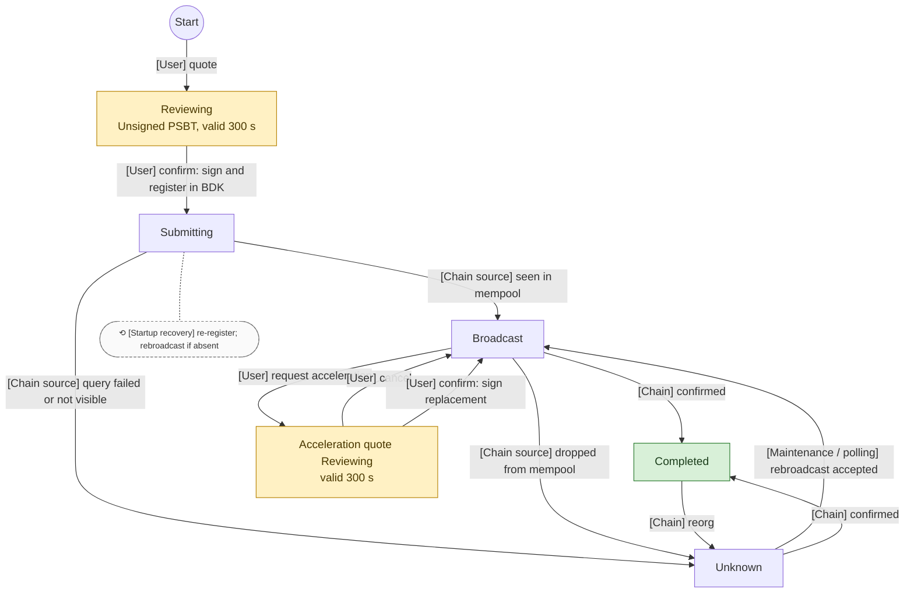
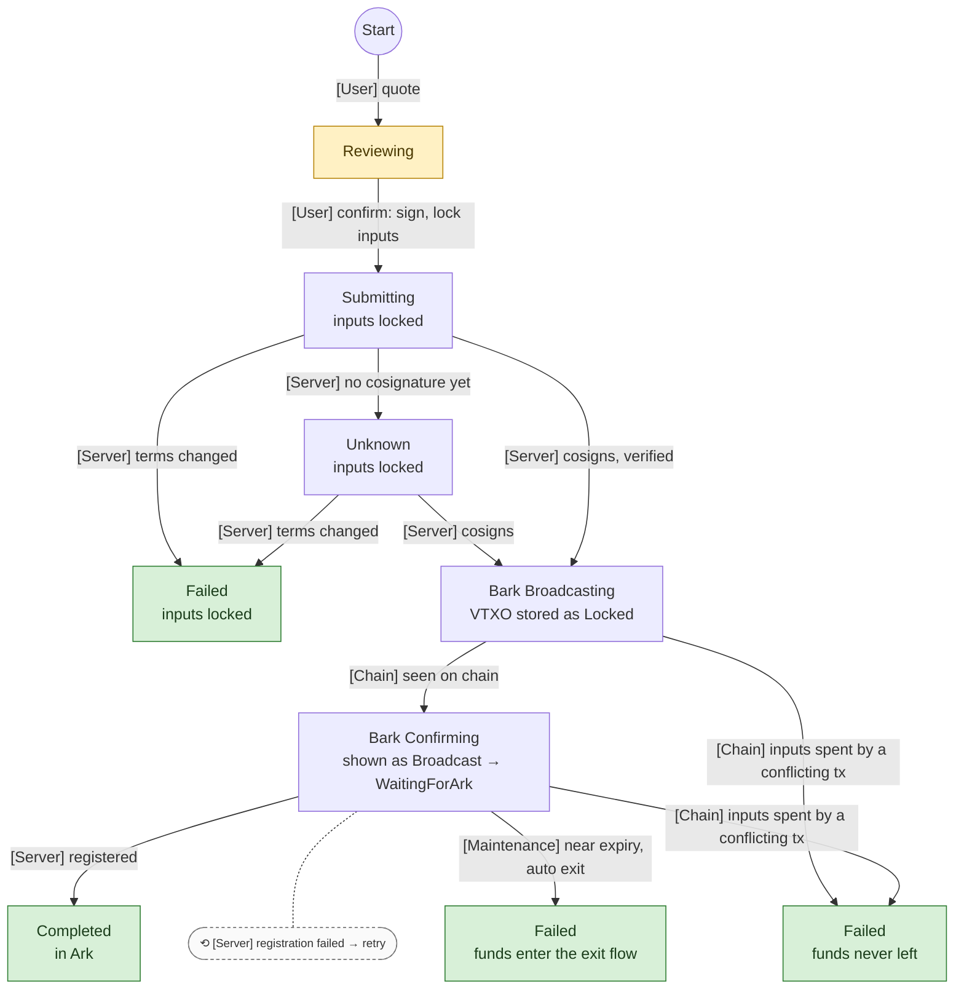

# A1 Onboard to Ark, direct BTC send, RBF acceleration

[Back to contents](../README.md) · A · On-chain & Ark funds

## State diagram

GitHub renders the Mermaid block below directly; if it does not display correctly, open the SVG.

### A1a Direct BTC send (with RBF)

[SVG](diagrams/A1a.svg) · [Mermaid source](diagrams/A1a.mmd)

### A1b Onboard to Ark

[SVG](diagrams/A1b.svg) · [Mermaid source](diagrams/A1b.mmd)

## State table

### Shared record (`keychat_bitcoin_transfers`)

| ID | State (code name) | Entry condition | Where funds / data are | UI display | What the user can do | Terminal? | Code location |
|---|---|---|---|---|---|---|---|
| A1-01 | `Reviewing` | Persisted as soon as the quote is generated; valid 300 s | Unsigned PSBT; funds still in the on-chain wallet, not locked | `wallet.bitcoin.review` | Confirm; or drop the quote (acceleration quotes can be deleted) | No (no expiry cleanup; confirming after expiry is rejected) | `W/ark/bitcoin/transfer.rs:308-336`, `:355-358` |
| A1-02 | `Submitting` | Signed; `signed_tx_hex` written | Signed tx stored locally; direct send already `register_tx`-ed into BDK and counted as spent; onboard inputs locked | `wallet.bitcoin.submitting` + `wallet.bitcoin.unknown-help` | Wait only | No | direct send `W/ark/bitcoin/transfer.rs:382-393`; onboard `W/ark/bark_runtime/onboard.rs:220-236` |
| A1-03 | `Broadcast` | Chain source reports mempool | Tx in mempool | `wallet.bitcoin.onboard.awaiting-confirmation` + `wallet.bitcoin.waiting-chain` | Wait; direct send can RBF | No | direct `W/ark/bitcoin/replacement.rs:803-807`; onboard `W/ark/bark_runtime/onboard.rs:339` |
| A1-04 | `WaitingForArk` | Onboard only: funding tx confirmed, Ark has not registered it | Funds in board output; board VTXO locked by the movement | Same as above + `wallet.bitcoin.waiting-ark` | Wait | No | `W/ark/bark_runtime/onboard.rs:336-338` |
| A1-05 | `Unknown` | Chain-source query failed, tx not visible, onboard has no cosignature, or movement missing | Direct send: signed tx still in BDK; onboard: inputs locked | `wallet.bitcoin.checking` + `wallet.bitcoin.unknown-help` | Wait | No | direct `W/ark/bitcoin/replacement.rs:806`, `:808-809`; onboard `W/ark/bark_runtime/onboard.rs:311-313`, `:340-345`; projected as Unknown without chain source `W/ark/provider/shared_bitcoin.rs:818-840` |
| A1-06 | `Completed` | Direct send: one attempt confirmed; onboard: movement successful with exit proof | Direct send: delivered; onboard: in Ark | `wallet.bitcoin.completed` | — | Yes (direct send can return to Unknown on a chain reorg) | `W/ark/bitcoin/replacement.rs:796-802`; `W/ark/bark_runtime/onboard.rs:325-327` |
| A1-07 | `Failed` | Onboard only: server terms changed (`submit_signed_board` returns None), or Bark movement Failed/Canceled | On terms change: inputs remain locked; on movement failure: funds may be inside an exit | `wallet.bitcoin.failed` ("Transfer failed. Review a new quote to try again.") | New quote | Yes | `W/ark/bark_runtime/onboard.rs:306-310`, `:328-329` |

### Bark states layered on onboard (`Board.progress`)

| ID | State (code name) | Entry condition | Where funds / data are | UI display | What the user can do | Terminal? | Code location |
|---|---|---|---|---|---|---|---|
| A1-08 | `Broadcasting` | Cosignature obtained, VTXO built | Funding tx to be pushed; VTXO stored as Locked | — | Seen on chain → `Confirming`; inputs conflicted by a confirmed tx → fail; otherwise park | No | `BK/actions/board.rs:147-160`, `:230-283` |
| A1-09 | `Confirming` | Funding tx in mempool or block | Board VTXO Locked, counted in `pending_board` | — | Register once confirmations suffice; retry on registration failure; start an exit near expiry | No | `BK/actions/board.rs:290-393` |
| A1-10 | movement `Failed` (after exit) | VTXO exited, or inputs spent by a conflicting tx | Former: in an exit; latter: funds never left | — | Terminal | Yes | `BK/actions/board.rs:299-314` |

### RBF acceleration (direct-send "lineage")

| ID | State (code name) | Entry condition | Where funds / data are | UI display | What the user can do | Terminal? | Code location |
|---|---|---|---|---|---|---|---|
| A1-11 | Acceleration quote `Reviewing` + `replacement` | User requests acceleration; preconditions met | Unsigned replacement PSBT, valid 300 s | — | Confirm; or cancel (deletes only the unsigned record) | No (follows lineage) | `W/ark/bitcoin/replacement.rs:378-401`, `:403-450` |
| A1-12 | Parent `replaced_by` set, child signed | User confirms | Parent and child committed in one transaction | — | Wait | No (follows lineage) | `W/ark/bitcoin/replacement.rs:825-860` |
| A1-13 | Lineage state | The attempt that confirms becomes Completed, others unchanged; head judged by mempool / not-seen | — | — | — | No (follows lineage) | `W/ark/bitcoin/replacement.rs:786-823` |

"Same as above" refers to the previous row of the table. In the UI column, `xxx.yyy` values are localization keys.
