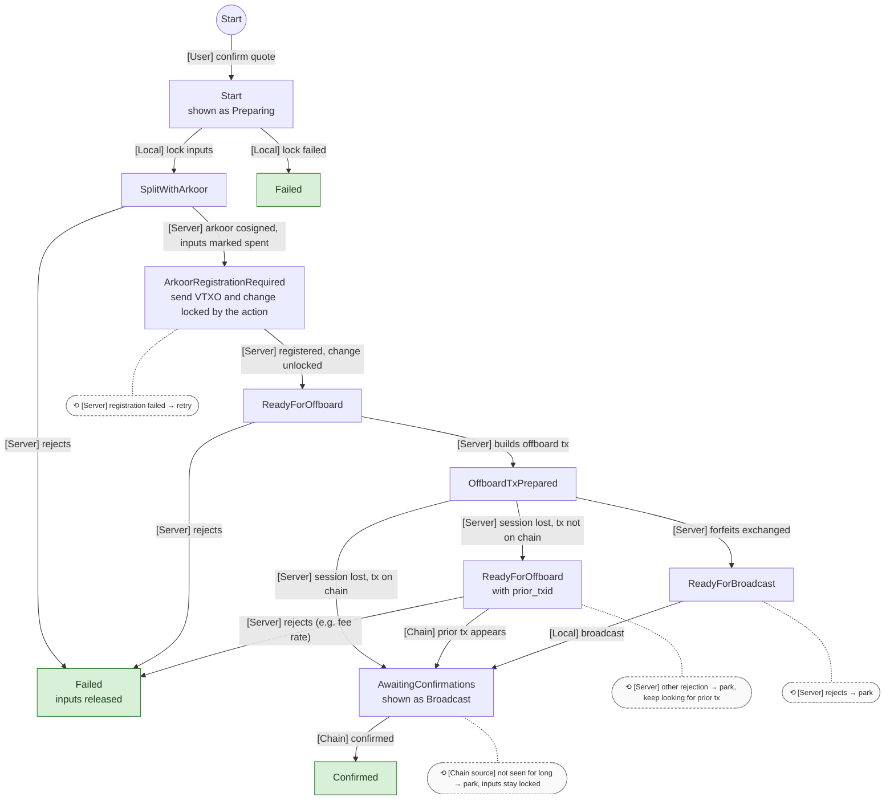

# A2 Sending BTC from Ark to an on-chain address

[Back to contents](../README.md) · A · On-chain & Ark funds

## State diagram

GitHub renders the Mermaid block below directly; if it does not display correctly, open the SVG.

[SVG](diagrams/A2.svg) · [Mermaid source](diagrams/A2.mmd)

## State table

| ID | State (code name) | Entry condition | Where funds / data are | UI display | What the user can do | Terminal? | Code location |
|---|---|---|---|---|---|---|---|
| A2-01 | `Preparing` (Bark `Start` / `SplitWithArkoor`) | User confirms; action checkpoint written | Input VTXOs locked by the action | `wallet.bitcoin-send.preparing` ("Payment in progress") | "Check status" | No | projection `W/ark/bark_runtime/bitcoin_send.rs:105-111`, `:127-139`; locking `BK/actions/offboard.rs:553-572` |
| A2-02 | `Preparing` (Bark `ArkoorRegistrationRequired`) | Arkoor split done; original inputs marked spent | Split-off send VTXO **and change** both locked by the action, awaiting server registration | Same as above | Same as above | No | `BK/actions/offboard.rs:605-636`, `:641-661` |
| A2-03 | `Preparing` (Bark `ReadyForOffboard` / `OffboardTxPrepared` / `ReadyForBroadcast`) | Registered; offboard tx and forfeits exchanged with server | Send VTXO locked; change unlocked | Same as above | Same as above | No | `BK/actions/offboard.rs:263-286`, `:670-760` |
| A2-04 | `Broadcast` (Bark `AwaitingConfirmations`) | Offboard tx pushed | Funds in an on-chain tx; VTXOs forfeited | `wallet.bitcoin-send.broadcast` | "Check status" | No | `bitcoin_send.rs:109`; `BK/actions/offboard.rs:287-326` |
| A2-05 | `Confirmed` | Movement Successful | Delivered to recipient address | `wallet.bitcoin-send.confirmed` | — | Yes | `bitcoin_send.rs:106` |
| A2-06 | `Failed` | Movement Failed / Canceled (Bark releases inputs on failure in `Start`, `SplitWithArkoor`, or a pre-forfeit `ReadyForOffboard`) | Inputs spendable again | `wallet.bitcoin-send.failed` | New quote | Yes | `bitcoin_send.rs:107`; `BK/actions/offboard.rs:352-414` |
| A2-07 | Outcome unknown (confirm call timed out or errored) | `start_send_onchain_confirmed` wrote the checkpoint but timed out | Whatever the underlying Bark state holds | `wallet.bitcoin-send.uncertain` | Check the original operation; cannot start another | No | `bitcoin_send.rs:73-79`; `iOS/Wallet/Views/Forms/ArkBitcoinSendReview.swift:240-242` |

"Same as above" refers to the previous row of the table. In the UI column, `xxx.yyy` values are localization keys.
