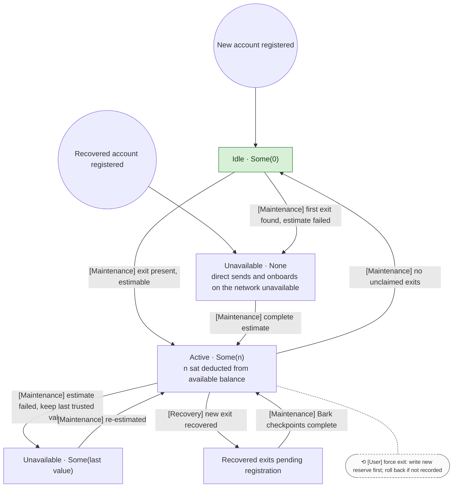

# A3 Exit fee reservation

[Back to contents](../README.md) · A · On-chain & Ark funds

## State diagram

GitHub renders the Mermaid block below directly; if it does not display correctly, open the SVG.

[SVG](diagrams/A3.svg) · [Mermaid source](diagrams/A3.mmd)

## State table

| ID | State (code name) | Entry condition | Where funds / data are | UI display | What the user can do | Terminal? | Code location |
|---|---|---|---|---|---|---|---|
| A3-01 | `Idle`, `remaining_sats = Some(0)` | New account registered; no unclaimed exits | No reservation | None | — | No (can become Active again) | registration `W/ark/bitcoin.rs:259-271`; zeroing `W/ark/bark_runtime/exit_fee.rs:195-200` |
| A3-02 | `Active`, `Some(n)` | Exit in progress and fees can be estimated | n sat of shared BTC treated as reserved, deducted from available balance | Balance struct has `reserved_sats` / `available_sats` (`W/ark/types.rs:429-439`) | Sends that eat into the reserve need explicit confirmation (`BitcoinExitReserveImpact`) | No | `exit_fee.rs:215-221`, `:116-122` |
| A3-03 | `Unavailable`, `Some(last value)` | Estimation failed; last trusted value kept | Same as above | Same as above | Same as above | No | `exit_fee.rs:207-212`; retention rule `W/ark/bitcoin.rs:322-330` |
| A3-04 | `Unavailable`, `None` | Recovery started, recovered a new exit, first exit discovered from Idle, or new exit authorized without re-estimation | Reservation unknown; direct sends and onboards on the same network are unavailable | Send errors | None | No | `W/ark/bitcoin.rs:62-77`, `:245-251`, `:259-267`; `exit_fee.rs:123-131`; error site `W/ark/bitcoin/transfer.rs:232-235` |
| A3-05 | Pending recovered exits (`pending_recovered_exit_ids` non-empty) | Recovered exits recorded, Bark checkpoints incomplete | Same as above | Same as above | None | No | `W/ark/bitcoin.rs:69`; rejected on read `transfer.rs:231-234`; cleared `exit_fee.rs:92-105` |

"Same as above" refers to the previous row of the table. In the UI column, `xxx.yyy` values are localization keys.
