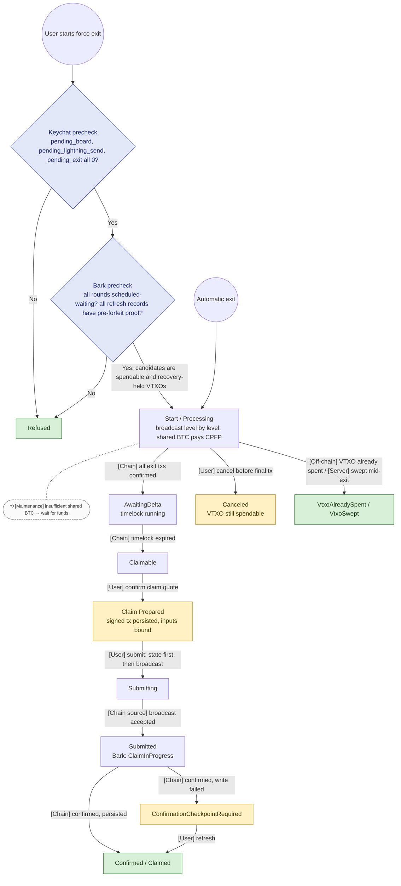

# A4 Force exit and claim

[Back to contents](../README.md) · A · On-chain & Ark funds

## State diagram

GitHub renders the Mermaid block below directly; if it does not display correctly, open the SVG.

[SVG](diagrams/A4.svg) · [Mermaid source](diagrams/A4.mmd)

## State table

### Exit (one per VTXO)

| ID | State (code name) | Entry condition | Where funds / data are | UI display | What the user can do | Terminal? | Code location |
|---|---|---|---|---|---|---|---|
| A4-01 | `Start` / `Processing` | User confirms force exit, or system auto-exits for a board / HTLC | Exit-chain txs broadcast level by level; shared BTC pays CPFP | `wallet.ark.exit-in-progress`, `wallet.ark.pending-funding`, `wallet.ark.refresh-to-progress-exit` | Refresh to progress; add on-chain funds | No | `BK/exit/progress/mod.rs:45-56`; funding check `W/ark/bark_runtime/exit_fee.rs:225-250` |
| A4-02 | `AwaitingDelta` | All exit txs confirmed | Exit output, timelock not yet expired | `wallet.ark.claim-timelock-running` | Wait | No | `BK/exit/progress/mod.rs:57` |
| A4-03 | `Claimable` | Timelock expired | Exit output, spendable only by the user | `wallet.ark.claim-to-bitcoin-address` | Claim | No | `BK/exit/progress/states.rs:356-361` |
| A4-04 | `ClaimInProgress` | A mempool tx spending the output appears | Claim tx in mempool | `wallet.ark.claim-in-progress` | Wait | No; falls back to `Claimable` if it drops from the mempool | `BK/exit/progress/states.rs:367-389` |
| A4-05 | `Claimed` | Spending tx confirmed | At the user address | — | — | Yes | `BK/exit/progress/states.rs:344-349`, `:375-378` |
| A4-06 | `VtxoAlreadySpent` / `VtxoSwept` | VTXO already spent off-chain; or server swept mid-exit | None | — | — | Yes | `BK/exit/models/mod.rs:40-47` |
| A4-07 | `Canceled` | Canceled before the final tx is broadcast | VTXO still spendable | — | Start again | Resumable | `BK/exit/models/mod.rs:48-51` |

### Keychat claim record (`ark_claims`; inputs bound 1:1 to a signed tx)

| ID | State (code name) | Entry condition | Where funds / data are | UI display | What the user can do | Terminal? | Code location |
|---|---|---|---|---|---|---|---|
| A4-08 | `Prepared` | User confirms quote; signed tx persisted; inputs registered in `ark_claim_inputs` | — | `wallet.ark.claim-prepared` | "Submit original tx" | No | `W/ark/bark_runtime/exit_claim.rs:46-61`; `W/ark/claim_store.rs:189-218` |
| A4-09 | `Submitting` | Broadcast started (state written before broadcasting) | — | Claiming | Wait | No | `exit_claim.rs:97-104`; `claim_store.rs:262-271` |
| A4-10 | `Submitted` | Broadcast returned success, or chain source reports mempool | — | `wallet.ark.claim-in-progress-message` | "Refresh" | No | `claim_store.rs:272-279`; `exit_claim.rs:140-142` |
| A4-11 | `ConfirmationCheckpointRequired` (projection) | Confirmed on chain but DB write failed | — | `wallet.ark.claim-confirmation-checkpoint-required` | Refresh | No | `exit_claim.rs:130-139`, `:153-159` |
| A4-12 | `Confirmed` | Confirmed on chain and persisted | — | Claimed | — | Yes | `claim_store.rs:287-293` |

"Same as above" refers to the previous row of the table. In the UI column, `xxx.yyy` values are localization keys.
