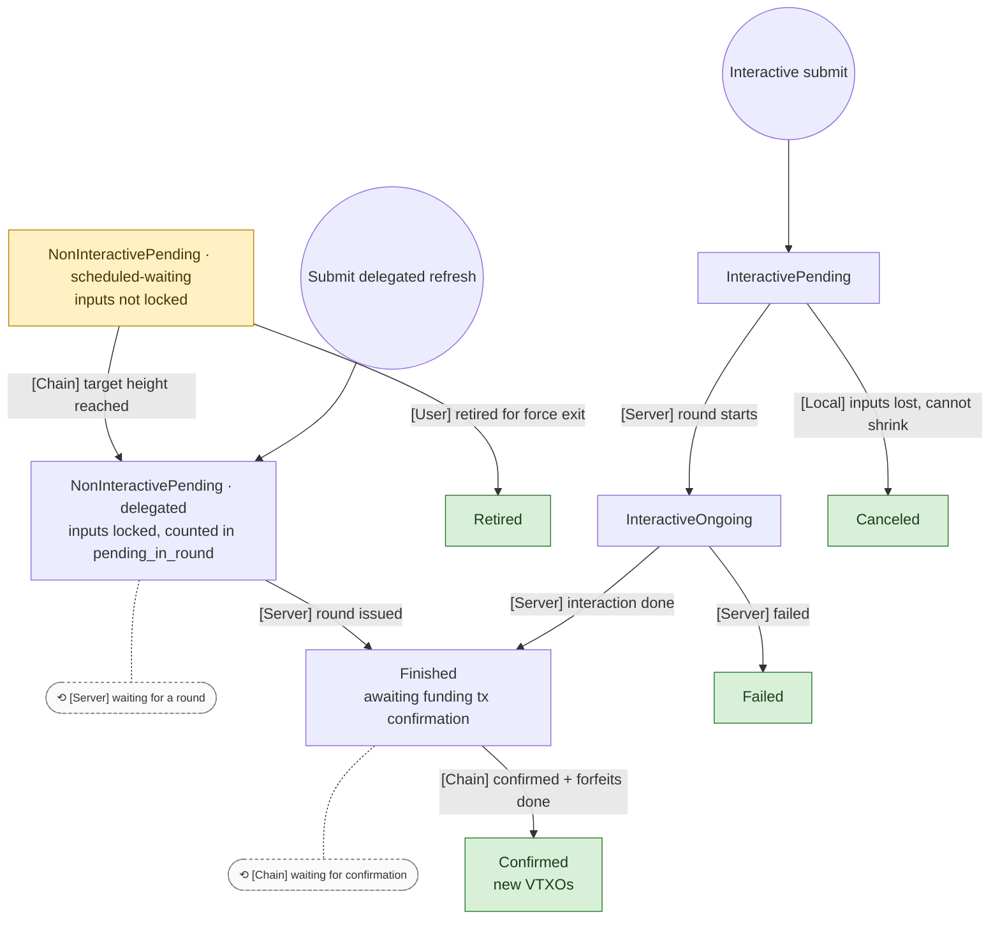
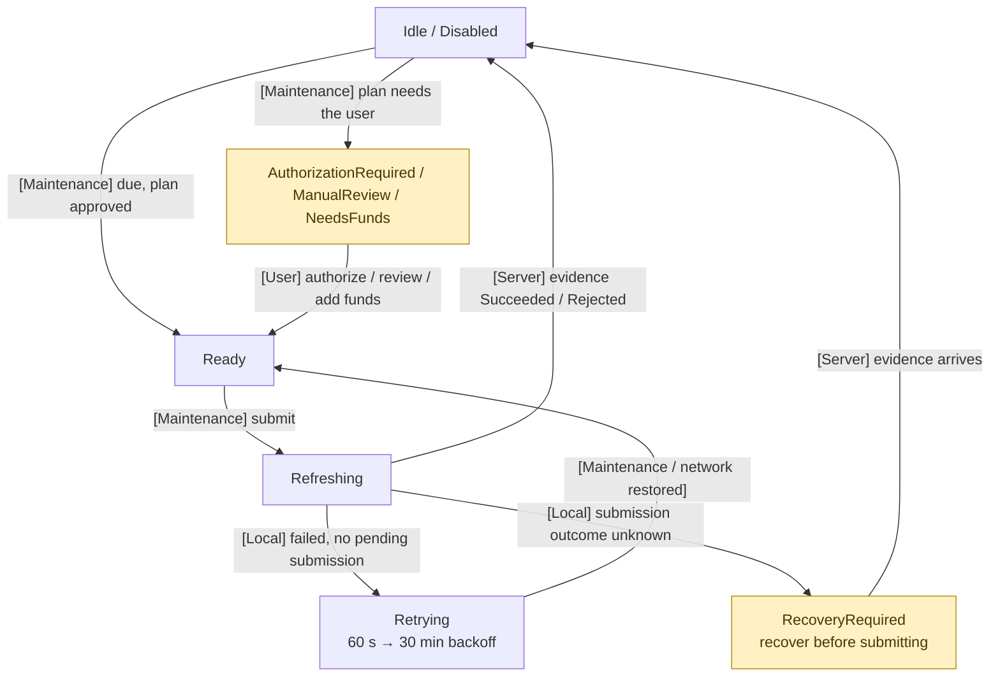

# A5 Refresh and automatic maintenance

[Back to contents](../README.md) · A · On-chain & Ark funds

## State diagram

GitHub renders the Mermaid block below directly; if it does not display correctly, open the SVG.

### A5a One refresh (Bark round)

[SVG](diagrams/A5a.svg) · [Mermaid source](diagrams/A5a.mmd)

### A5b Keychat maintenance phase (per account)

[SVG](diagrams/A5b.svg) · [Mermaid source](diagrams/A5b.mmd)

## State table

### One refresh (Bark round)

| ID | State (code name) | Entry condition | Where funds / data are | UI display | What the user can do | Terminal? | Code location |
|---|---|---|---|---|---|---|---|
| A5-01 | `NonInteractivePending{scheduled_height: Some}` | Scheduled refresh accepted by server, waiting for target height; scheduled-waiting: yes (`is_scheduled_waiting`) | Inputs not locked; still force-exitable | — | — | No | `BK/round/mod.rs:262-267` |
| A5-02 | `NonInteractivePending{scheduled_height: None}` / `Redelegating` | Delegated refresh submitted, waiting for the server to run a round; scheduled-waiting: no | Inputs locked by the movement, counted in `pending_in_round` | — | — | No | `BK/round/mod.rs:1043-1059`, `:816-830`; balance `BK/balance.rs:190-197` |
| A5-03 | `InteractivePending` / `InteractiveOngoing` | Interactive round queued / in progress; scheduled-waiting: no | Same as above | — | — | No | `BK/round/mod.rs:777`, `:783-803` |
| A5-04 | `Finished` (not done) | Interaction done, waiting for round funding tx to confirm; scheduled-waiting: no | Same as above; forfeits not yet complete | — | — | No | `BK/round/mod.rs:923-959` |
| A5-05 | `Finished` (done) → `Confirmed` | Funding tx confirmed and forfeits complete; scheduled-waiting: — | New VTXOs | — | — | Yes | `BK/round/mod.rs:771-775`, `:937-948` |
| A5-06 | `Failed` / `Canceled` | Round failed, user canceled, or inputs lost and cannot shrink; scheduled-waiting: — | Inputs released | — | — | Yes | `BK/round/mod.rs:793-813` |

### Keychat maintenance phase (per account)

| ID | State (code name) | Entry condition | Where funds / data are | UI display | What the user can do | Terminal? | Code location |
|---|---|---|---|---|---|---|---|
| A5-07 | `Idle` / `Disabled` | No refresh needed / auto refresh off | — | `disabled-title` | Enable, or refresh manually | No (resting) | `W/ark/maintenance.rs:72-75` |
| A5-08 | `Ready` / `Refreshing` | Plan approved / submitted | — | — | Wait | No | `W/ark/provider/maintenance.rs:530-538` |
| A5-09 | `Retrying` | Failure backoff 60 s → 30 min | — | — | Wait | No | `W/ark/maintenance.rs:132-146` |
| A5-10 | `RecoveryRequired` | Submission outcome unknown; recovery first | — | — | Wait (re-checked every `URGENT_CHECK_SECONDS`) | No | `W/ark/provider/maintenance.rs:241-258` |
| A5-11 | `AuthorizationRequired` / `ManualReview` / `NeedsFunds` | Needs user fee authorization, manual review, or more funds | — | `authorization-*`, `funds-title`, etc. | Authorize, review, or add funds | No (awaiting user) | `W/ark/maintenance.rs:35-62` |

"Same as above" refers to the previous row of the table. In the UI column, `xxx.yyy` values are localization keys.
