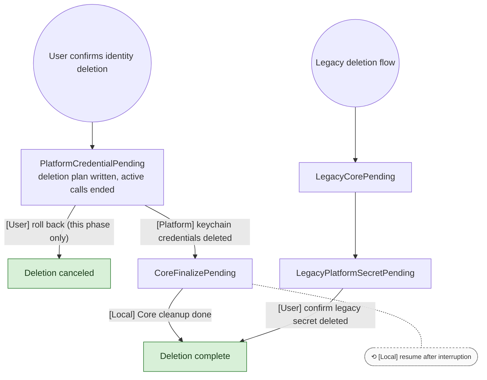

# D1 Identity deletion

[Back to contents](../README.md) · D · Identity, device & recovery

## State diagram

GitHub renders the Mermaid block below directly; if it does not display correctly, open the SVG.

[SVG](diagrams/D1.svg) · [Mermaid source](diagrams/D1.mmd)

## State table

| ID | State (code name) | Entry condition | Where funds / data are | UI display | What the user can do | Terminal? | Code location |
|---|---|---|---|---|---|---|---|
| D1-01 | `PlatformCredentialPending` | User confirms deletion; Core writes deletion plan; active calls of the identity ended | Identity still present; new work blocked | — | Roll back (only in this phase) | No | `A/data_store/identity_deletion.rs:6-50`; rollback `A/app_storage/identities.rs:1386-1409` |
| D1-02 | `CoreFinalizePending` | Platform confirms keychain credentials deleted | Credentials deleted; Core data pending cleanup | — | Continue (repeatable) | No | `identity_deletion.rs:54-82`, `:101-138` |
| D1-03 | `LegacyCorePending` / `LegacyPlatformSecretPending` | Intermediate points of the legacy deletion flow | Same as above | — | Continue; confirm legacy secret deleted | No | `identity_deletion.rs:121-126`, `:237`, `:271` |
| D1-04 | Deletion complete | Core cleanup done; deletion row removed | Identity gone | — | — | Yes | — |

"Same as above" refers to the previous row of the table. In the UI column, `xxx.yyy` values are localization keys.
