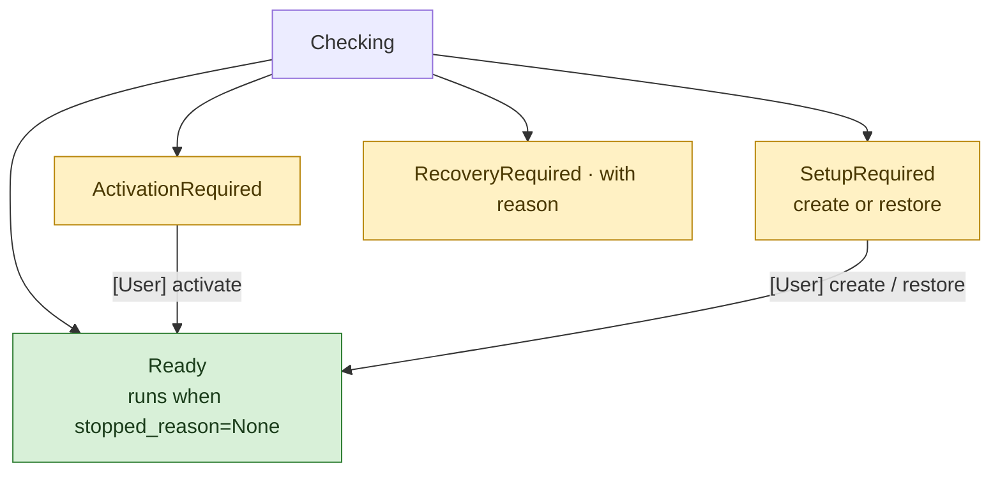
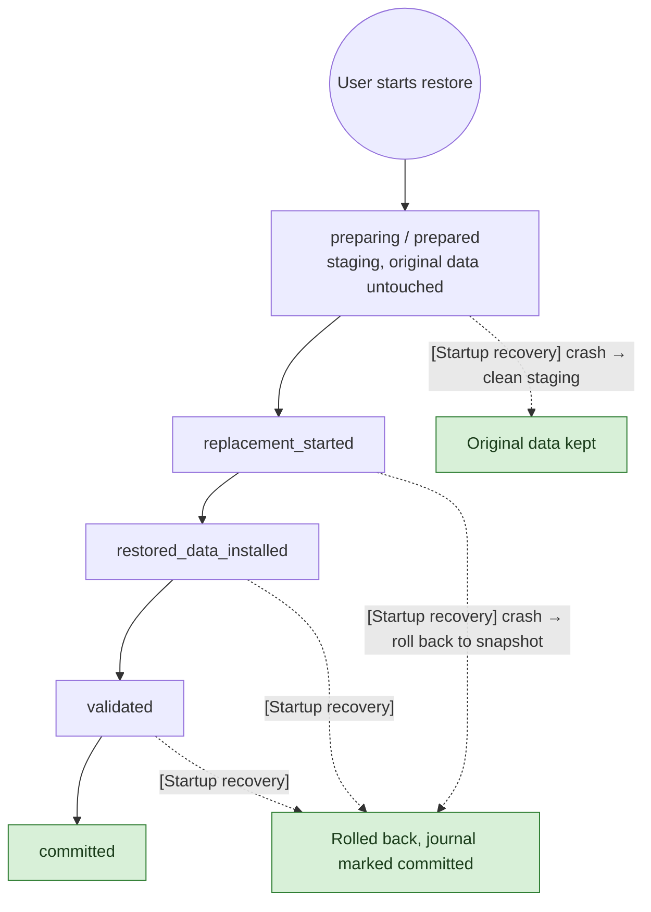

# D2 Device activation, startup and backup restore

[Back to contents](../README.md) · D · Identity, device & recovery

## State diagram

GitHub renders the Mermaid block below directly; if it does not display correctly, open the SVG.

### D2a Startup

[SVG](diagrams/D2a.svg) · [Mermaid source](diagrams/D2a.mmd)

### D2b Backup restore (iOS transaction journal)

[SVG](diagrams/D2b.svg) · [Mermaid source](diagrams/D2b.mmd)

## State table

### Startup

| ID | State (code name) | Entry condition | Where funds / data are | UI display | What the user can do | Terminal? | Code location |
|---|---|---|---|---|---|---|---|
| D2-01 | `Checking` | Launch | — | — | Wait | No | `A/device_activation.rs:61-62` |
| D2-02 | `SetupRequired` | No data | — | — | Create or restore | No (awaiting user) | `:63` |
| D2-03 | `ActivationRequired{pending}` | Data present, activation not verified | — | — | Activate | No (awaiting user) | `:64-66` |
| D2-04 | `RecoveryRequired{reason}` | Restore blocked, DB key missing, storage unavailable / incompatible, keychain unavailable, conflicting credentials, unsupported policy | — | — | Act per reason | No (awaiting user) | `:49-58`, `:67-69` |
| D2-05 | `Ready{stopped_reason}` | All ready; or paused manually / as migration source / as migration target | — | — | — | Yes (resting) | `:70-80` |

### Backup restore (Core progress) and iOS transaction journal

| ID | State (code name) | Entry condition | Where funds / data are | UI display | What the user can do | Terminal? | Code location |
|---|---|---|---|---|---|---|---|
| D2-06 | `RestoreInspecting` / `RestoreValidating` / `RestoreStaging` (iOS: `preparing` / `prepared`) | — | Staging area; original data untouched | — | Staging cleaned up at startup | No | `A/backup_restore.rs:606-621`; `iOS/Services/BackupRestoreTransaction.swift:197-199` |
| D2-07 | `RestoreReplacingLocalData` / `RestoreWritingKeychain` (iOS: `replacement_started` / `restored_data_installed`) | — | Original-data snapshot + new data | — | Rolled back to snapshot at startup; journal then marked committed to avoid repeat rollback | No | `BackupRestoreTransaction.swift:200-205`, `:209-258` |
| D2-08 | `RestoreReopeningClient` / `RestoreWalletChecking` (iOS: `validated`) | — | New data | — | Same as above (rollback) | No | same as above |
| D2-09 | `RestoreComplete` (iOS: `committed`) | — | New data; snapshot cleaned | — | — | Yes | `BackupRestoreTransaction.swift:178-181` |
| D2-10 | `Failed` (iOS: —) | — | Depends on failure point | — | Can only return to Idle | Yes | `A/backup_restore.rs:698-741` |

"Same as above" refers to the previous row of the table. In the UI column, `xxx.yyy` values are localization keys.
