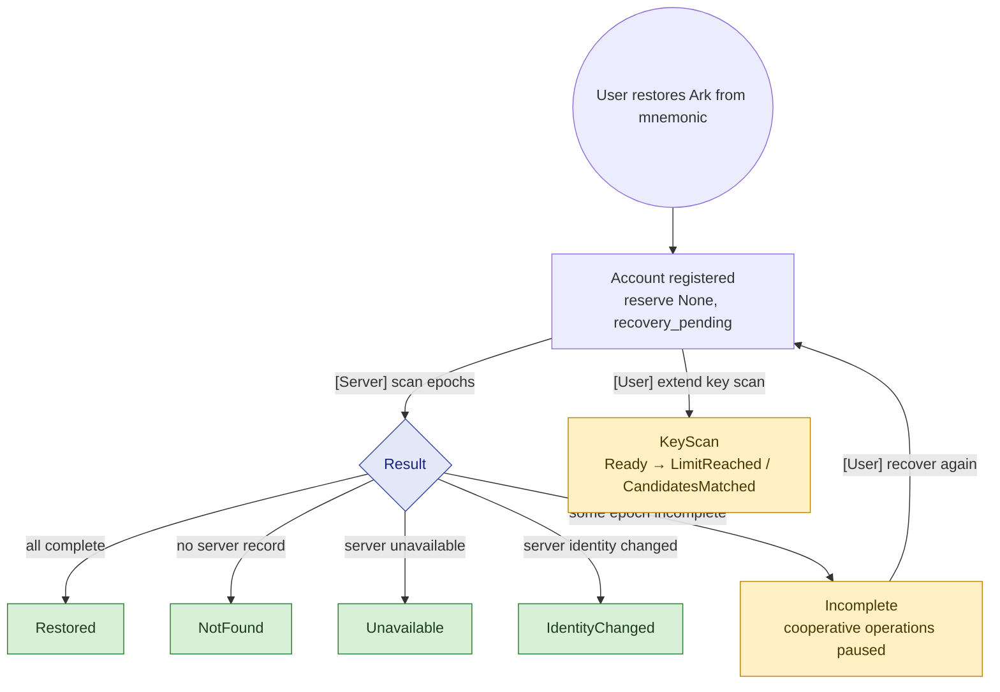

# D3 Wallet recovery

[Back to contents](../README.md) · D · Identity, device & recovery

## State diagram

GitHub renders the Mermaid block below directly; if it does not display correctly, open the SVG.

[SVG](diagrams/D3.svg) · [Mermaid source](diagrams/D3.mmd)

## State table

| ID | State (code name) | Entry condition | Where funds / data are | UI display | What the user can do | Terminal? | Code location |
|---|---|---|---|---|---|---|---|
| D3-01 | `Restored` | All epochs complete | Recovered VTXOs and exits | — | — | Yes | `W/ark/types.rs:69` |
| D3-02 | `NotFound` | Server has no record of the wallet | — | — | Try another source | Yes | `types.rs:70` |
| D3-03 | `Incomplete` | Any epoch incomplete; account stays `recovery_pending`, cooperative operations refused, reservation None | Partially recovered | — | Recover again | No | `W/ark/types.rs:71` |
| D3-04 | `Unavailable` / `IdentityChanged` | Server unavailable / server identity changed | — | — | Retry later / judge manually | Yes (this attempt) | `types.rs:72-73` |
| D3-05 | Key scan `Ready` / `LimitReached` / `CandidatesMatched` | Scanned to limit or matched by index | Scan progress | — | Extend scan | No | `types.rs:89-108` |
| D3-06 | BTC history scan `Ready` / `LimitReached` / `UnsupportedChainSource` | Same as above (shared BTC) | Addresses discovered | — | Extend scan | No | `types.rs:441-457` |

"Same as above" refers to the previous row of the table. In the UI column, `xxx.yyy` values are localization keys.
