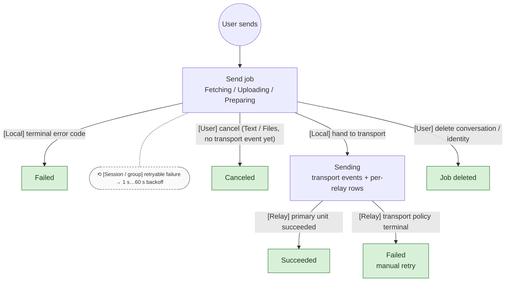

# C1 Message send

[Back to contents](../README.md) · C · Messaging & relationships

## State diagram

GitHub renders the Mermaid block below directly; if it does not display correctly, open the SVG.

[SVG](diagrams/C1.svg) · [Mermaid source](diagrams/C1.mmd)

## State table

| ID | State (code name) | Entry condition | Where funds / data are | UI display | What the user can do | Terminal? | Code location |
|---|---|---|---|---|---|---|---|
| C1-01 | `Fetching` | Link-preview intent unfinished | Send job | Sending | Text / file can be canceled | No | `A/messaging/delivery_queries.rs:420-424` |
| C1-02 | `Uploading` | Attachment intent unfinished | Send job + local attachments | Uploading | Same as above | No | `delivery_queries.rs:425-429` |
| C1-03 | `Preparing` | Job exists, not yet handed to transport | Send job | Sending | Same as above | No | `delivery_queries.rs:430-432` |
| C1-04 | `Failed` (inside job) | Upload paused | Send job | Failed | Retry | No | `delivery_queries.rs:421-422` |
| C1-05 | `Sending` | Transport events created; neither business success nor terminal | `app_message_transport_events` + per-relay delivery rows | Sending | Wait | No | `delivery_queries.rs:443-445` |
| C1-06 | `Succeeded` | Primary unit reached business success | Delivery rows | Sent | — | Yes | `delivery_queries.rs:433-437` |
| C1-07 | `Failed` (delivery) | Transport policy judged terminal | Delivery rows | Failed | Manual retry (per `manual_retryable`) | Yes | `delivery_queries.rs:438-442` |

"Same as above" refers to the previous row of the table. In the UI column, `xxx.yyy` values are localization keys.
