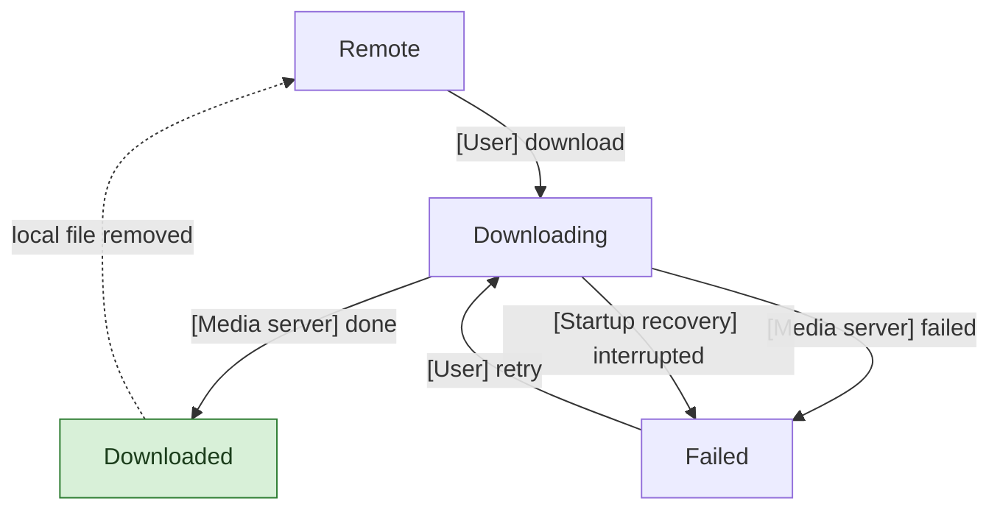
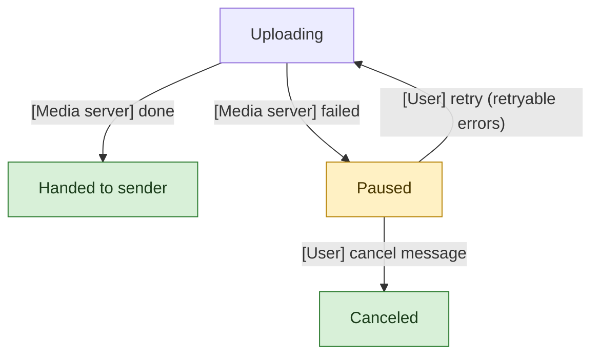

# C2 Attachment upload and download

[Back to contents](../README.md) · C · Messaging & relationships

## State diagram

GitHub renders the Mermaid block below directly; if it does not display correctly, open the SVG.

### C2a Download

[SVG](diagrams/C2a.svg) · [Mermaid source](diagrams/C2a.mmd)

### C2b Upload (part of the send job)

[SVG](diagrams/C2b.svg) · [Mermaid source](diagrams/C2b.mmd)

## State table

### Download

| ID | State (code name) | Entry condition | Where funds / data are | UI display | What the user can do | Terminal? | Code location |
|---|---|---|---|---|---|---|---|
| C2-01 | `Remote` | Not downloaded | Remote URL + key | Downloadable | Download | No | `A/data_store/message_snapshot.rs:536-540` |
| C2-02 | `Downloading` | Download started (`transfer_state=1`) | Temp file | Downloading | Wait | No | `A/app_storage/attachments.rs:356` |
| C2-03 | `Downloaded` | `transfer_state=2` and local file exists | Local file | Openable | — | Yes (back to Remote projection if the file is gone) | `message_snapshot.rs:527-535` |
| C2-04 | `Failed` | Download failed, or interruption found at startup / runtime restart | `last_error_code` | Failed | Retry | No | `attachments.rs:462-469`, `:472-492` |

### Upload (part of the send job)

| ID | State (code name) | Entry condition | Where funds / data are | UI display | What the user can do | Terminal? | Code location |
|---|---|---|---|---|---|---|---|
| C2-05 | Uploading | Attachment intent unfinished | — | `Uploading` | Text / file messages can be canceled | No | `A/messaging/delivery_queries.rs:425-429` |
| C2-06 | Paused (failure inside job) | Upload failure writes `upload_state='paused'` | — | `Failed` | Retry allowed for retryable errors; not for missing source, invalid intent, unsafe target | No | `A/app_storage/message_sender_attachments.rs:349`; `A/message_sender/projection.rs:73-94` |

"Same as above" refers to the previous row of the table. In the UI column, `xxx.yyy` values are localization keys.
