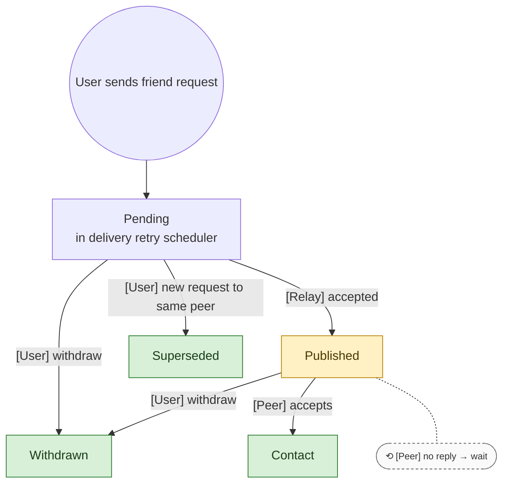

# C3 Friend requests and PQXDH upgrade

[Back to contents](../README.md) · C · Messaging & relationships

## State diagram

GitHub renders the Mermaid block below directly; if it does not display correctly, open the SVG.

[SVG](diagrams/C3.svg) · [Mermaid source](diagrams/C3.mmd)

## State table

| ID | State (code name) | Entry condition | Where funds / data are | UI display | What the user can do | Terminal? | Code location |
|---|---|---|---|---|---|---|---|
| C3-01 | `Pending` (sender side) | Request submitted to the delivery retry scheduler | Pending request + protocol-level pending session | Waiting for peer | Withdraw | No | `A/friend_request.rs:1260-1263`, `:1611-1625` |
| C3-02 | `Published` | At least one relay accepted | Same as above | Waiting for peer | Withdraw | No | `A/types.rs:3512` |
| C3-03 | Accepted by peer | Peer reply received | Session established | Contact | — | Yes | — |
| C3-04 | Withdrawn | User withdraws; or a new request to the same peer supersedes it | Protocol pending session and transport cleared | — | — | Yes | `A/friend_request.rs:1265-1369`, `:1220-1258` |
| C3-05 | PQXDH upgrade retry | User triggers manually | — | Separate prompts for `Sent` / `AlreadyUpgraded` / `PeerNotReady` / `IneligibleRoom` / `InFlight` | Retry later | Returns per call | `A/types.rs:533-540` |

"Same as above" refers to the previous row of the table. In the UI column, `xxx.yyy` values are localization keys.
