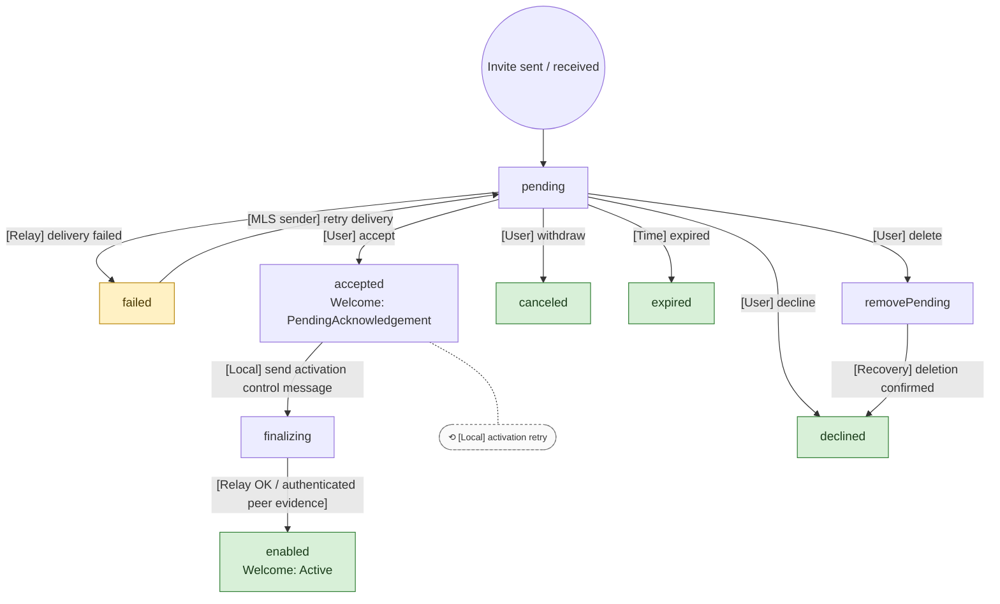

# C4 Group invites and MLS Welcome activation

[Back to contents](../README.md) · C · Messaging & relationships

## State diagram

GitHub renders the Mermaid block below directly; if it does not display correctly, open the SVG.

[SVG](diagrams/C4.svg) · [Mermaid source](diagrams/C4.mmd)

## State table

| ID | State (code name) | Entry condition | Where funds / data are | UI display | What the user can do | Terminal? | Code location |
|---|---|---|---|---|---|---|---|
| C4-01 | `pending` | Invite sent or received; delivery retry returns to pending | — | — | Accept / decline / withdraw | No | `A/group_invite/outgoing.rs:216`, `:395`; `A/group_invite/welcome.rs:212`; `A/group_invite/delivery.rs:413` |
| C4-02 | `failed` | Delivery failed, or decision processing failed | — | — | MLS sender can retry delivery (`group_invite_lifecycle_allows_delivery_retry`) | No | `outgoing.rs:440`, `:482`, `:519`; `A/group_invite/decisions.rs:244`; `A/group_invite.rs:308-318` |
| C4-03 | `accepted` / `finalizing` | Accepted; waiting for member-activation control message to land | — | `PendingAcknowledgement` | Wait | No | `A/group_invite/projection.rs:14`, `:24` |
| C4-04 | `enabled` | Authenticated activation evidence or relay OK received | — | `Active` | — | Yes | `A/group_invite/delivery.rs:513`; `projection.rs:25` |
| C4-05 | `declined` / `canceled` / `expired` | Declined, withdrawn, expired | — | — | — | Yes | `A/group_invite/removal_recovery.rs:55-63`, `:93-103` |
| C4-06 | `removePending` | Pending confirmation during deletion | — | — | — | No | `A/group_invite/decisions.rs:175`; `removal_recovery.rs:235`, `:345` |

"Same as above" refers to the previous row of the table. In the UI column, `xxx.yyy` values are localization keys.
