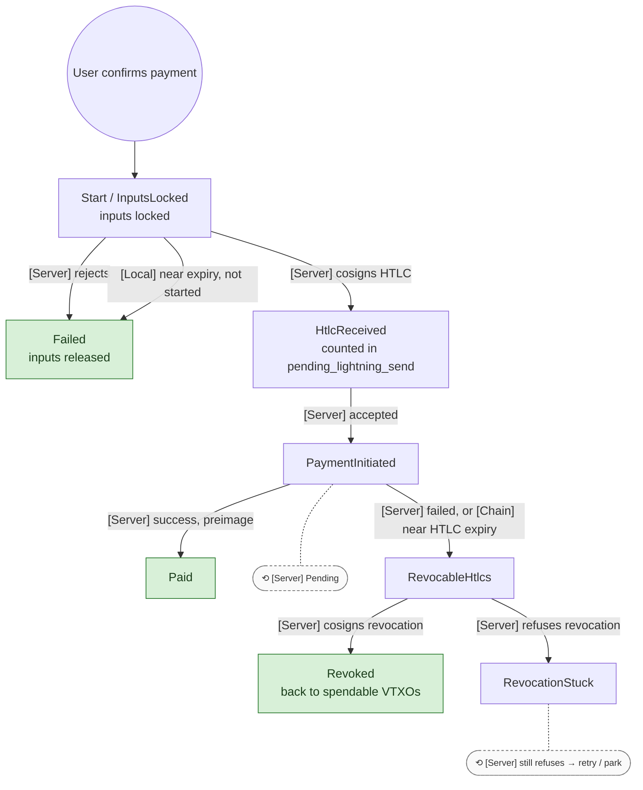
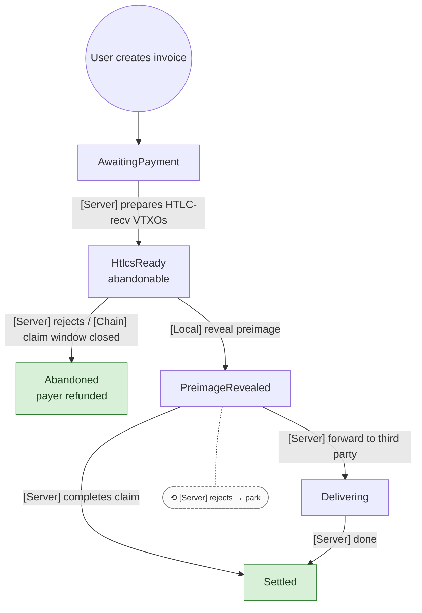

# B1 Lightning send and receive (Ark)

[Back to contents](../README.md) · B · Payments

## State diagram

GitHub renders the Mermaid block below directly; if it does not display correctly, open the SVG.

### B1a Send (pay an invoice)

[SVG](diagrams/B1a.svg) · [Mermaid source](diagrams/B1a.mmd)

### B1b Receive (issue an invoice)

[SVG](diagrams/B1b.svg) · [Mermaid source](diagrams/B1b.mmd)

## State table

### Send

| ID | State (code name) | Entry condition | Where funds / data are | UI display | What the user can do | Terminal? | Code location |
|---|---|---|---|---|---|---|---|
| B1-01 | `Start` / `InputsLocked` | User confirms payment | Input VTXOs locked by the action | `InProgress` | Wait | No | `BK/actions/lightning/pay.rs:326-330`, `:221-229` |
| B1-02 | `HtlcReceived` | Server cosigned HTLC outputs | HTLC VTXOs locked, counted in `pending_lightning_send` | `InProgress` | Wait | No | `BK/actions/lightning/pay.rs:331-332` |
| B1-03 | `PaymentInitiated` | Server told to pay | Same as above | `InProgress` | Wait | No | `BK/actions/lightning/pay.rs:183-207` |
| B1-04 | `RevocableHtlcs` | Server reports failure, or still Pending near HTLC expiry | Same as above, revocation prepared | `InProgress` | Wait | No | `BK/actions/lightning/pay.rs:189-198` |
| B1-05 | `RevocationStuck` | Server refuses to revoke | Same as above | `InProgress{has_failed_revocation: true}` | Wait | No | `BK/actions/lightning/pay.rs:260-275`, `:299-315`; `W/ark/bark_runtime.rs:3032-3038`; `iOS/Wallet/Ark/ArkWalletModels.swift:1117` |
| B1-06 | `Paid` | Preimage obtained | Paid out | `Paid` | — | Yes | `BK/actions/lightning/pay.rs:185-188` |
| B1-07 | Revocation done (Done) | Server cosigns the revocation | Back to spendable VTXOs | — | — | Yes | `BK/actions/lightning/pay.rs:209-213` |

### Receive

| ID | State (code name) | Entry condition | Where funds / data are | UI display | What the user can do | Terminal? | Code location |
|---|---|---|---|---|---|---|---|
| B1-08 | `AwaitingPayment` | Invoice created | None | — | — | No | `BK/actions/lightning/receive.rs:257-258` |
| B1-09 | `HtlcsReady` | Server prepared HTLC-recv VTXOs | Locked; still abandonable | — | — | No; abandoned if claim window closes or claim rejected | `BK/actions/lightning/receive.rs:259-262`, `:204-211`, `:240-246` |
| B1-10 | `PreimageRevealed` | Preimage revealed to server | HTLC-recv VTXOs locked, counted in `claimable_lightning_receive` | — | — | No; parks after a failed claim | `BK/actions/lightning/receive.rs:263-269`, `:212-224`, `:247-249`; `BK/lightning/receive.rs:205-240` |
| B1-11 | `Delivering` | Claim outputs must be forwarded to a third party | Locked | — | — | No | `BK/actions/lightning/receive.rs:270-273` |
| B1-12 | `Settled` | Claim complete | New VTXOs | — | — | Yes | `W/ark/bark_runtime.rs:3007-3014` |

"Same as above" refers to the previous row of the table. In the UI column, `xxx.yyy` values are localization keys.
