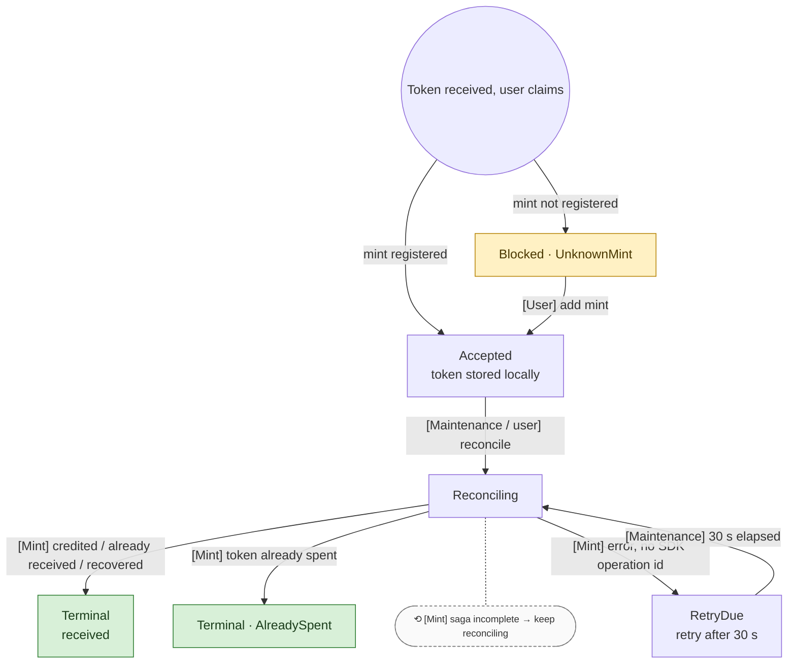

# B2 Cashu receive

[Back to contents](../README.md) · B · Payments

## State diagram

GitHub renders the Mermaid block below directly; if it does not display correctly, open the SVG.

[SVG](diagrams/B2.svg) · [Mermaid source](diagrams/B2.mmd)

## State table

| ID | State (code name) | Entry condition | Where funds / data are | UI display | What the user can do | Terminal? | Code location |
|---|---|---|---|---|---|---|---|
| B2-01 | `Accepted` | Token received, mint registered | Bearer token in local encrypted store (the only replayable copy) | Receive in progress | Wait | No | `W/cashu/receive_store.rs:340-345`; `W/cashu/receive_operations.rs:63` |
| B2-02 | `Blocked` (`UnknownMint`) | Mint not registered | Same as above | Add mint required | Add the mint, then continue | No | `receive_store.rs:342-345`; skipped by maintenance `receive_operations.rs:509-512` |
| B2-03 | `Reconciling` | Reconciling, or SDK already has a saga for it | Token + CDK saga | Processing | Wait | No | `receive_operations.rs:188-194`, `:216-226` |
| B2-04 | `RetryDue` (`RetryRequired`) | Reconcile errored with no SDK operation id; retry after 30 s | Token | Processing | Wait | No | `receive_operations.rs:192`, `:214-227` |
| B2-05 | `Terminal` (no issue) | Got `Credited` / `AlreadyReceived` / `Recovered` | In CDK balance | Received | — | Yes | `receive_operations.rs:196-206` |
| B2-06 | `Terminal` (`AlreadySpent`) | Mint says token already spent | None | `CashuTokenAlreadySpent` error | — | Yes | `receive_operations.rs:207-213` |

"Same as above" refers to the previous row of the table. In the UI column, `xxx.yyy` values are localization keys.
