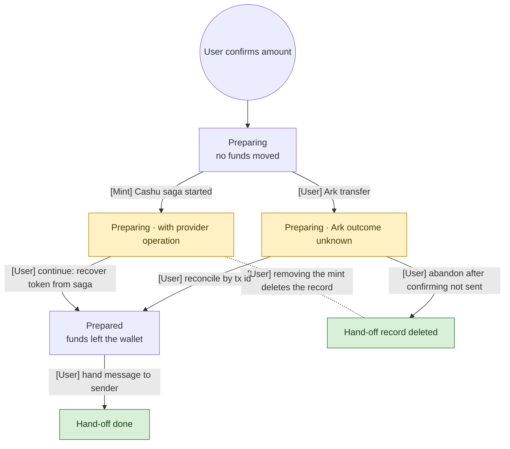
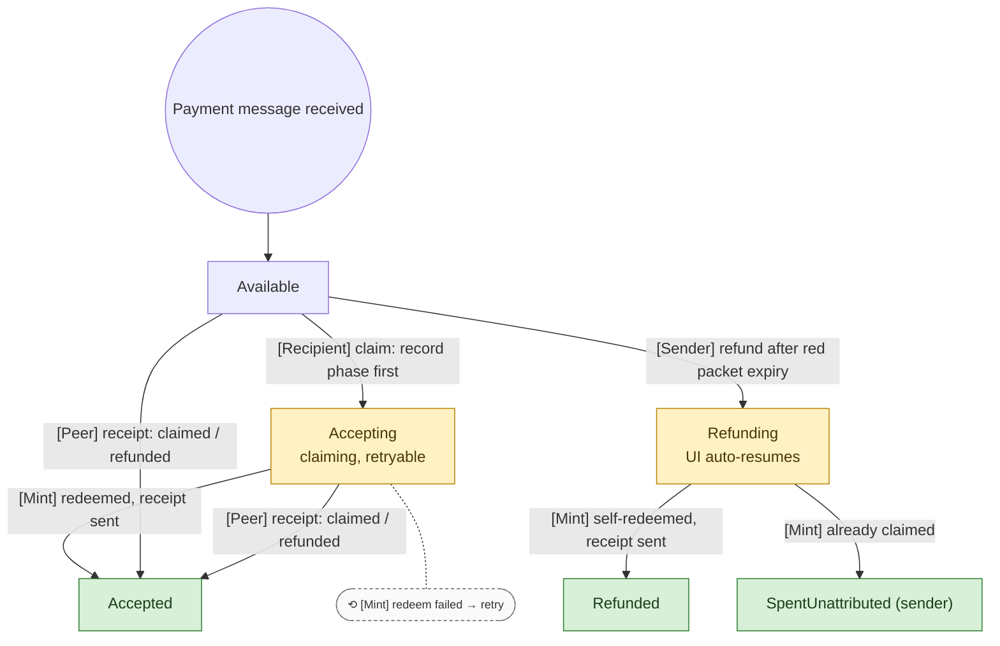

# B3 Chat transfers, red packets and receipts

[Back to contents](../README.md) · B · Payments

## State diagram

GitHub renders the Mermaid block below directly; if it does not display correctly, open the SVG.

### B3a Sender: wallet hand-off (one per room and identity)

[SVG](diagrams/B3a.svg) · [Mermaid source](diagrams/B3a.mmd)

### B3b Message side: Cashu transfer / red packet (Signal DM)

[SVG](diagrams/B3b.svg) · [Mermaid source](diagrams/B3b.mmd)

## State table

### Sender: wallet hand-off (at most one per room)

| ID | State (code name) | Entry condition | Where funds / data are | UI display | What the user can do | Terminal? | Code location |
|---|---|---|---|---|---|---|---|
| B3-01 | `Preparing`, no provider operation | User confirms amount | No funds moved | — | Continue | No | `W/ledger.rs:539-606` |
| B3-02 | `Preparing`, with provider operation (Cashu) | Cashu send saga started | Mint-side saga; token may already exist | `wallet.chat.previous-cashu-interrupted` | "Continue": recover the token from the saga | No | `WU/wallet.rs:2752-2810`, `:1880-1931` |
| B3-03 | `Preparing`, Ark outcome unresolved | Ark transfer outcome unknown | May already have left the account | `wallet.chat.previous-wallet-transfer-interrupted` | Reconcile by tx id; or abandon after confirming nothing was sent | No | `W/ledger.rs:734-759`; `iOS/Wallet/Views/ChatPayFlowSheet.swift:862-900` |
| B3-04 | `Prepared` | Token (Cashu) or tx id (Ark) obtained | Funds have left the wallet; token in local saga | `wallet.chat.wallet-transfer-complete` (message hand-off can resume) | Continue sending the message | No | `W/ledger.rs:691-722`; `ChatPayFlowSheet.swift:725-731` |
| B3-05 | Deleted (done) | Message handed to the sender | Hand-off record deleted | — | — | Yes | `W/ledger.rs:724-732`; `ChatPayFlowSheet.swift:851` |

### Message side: Cashu transfer / red packet (Signal DMs only)

| ID | State (code name) | Entry condition | Where funds / data are | UI display | What the user can do | Terminal? | Code location |
|---|---|---|---|---|---|---|---|
| B3-06 | none → `Pending` / `Available` | Received or sent | — | Claimable | Recipient claims; sender cannot claim (red packet) | No | `A/payment_lifecycle.rs:826-849` |
| B3-07 | `Accepting` → `Pending` / `Accepting` | Recipient taps claim; phase persisted before redeeming | — | Claiming, `can_retry` | Retry | No | `A/messaging/payment_messages.rs:876-935`; projection `payment_lifecycle.rs:843-844`, `:858` |
| B3-08 | `Accepted` → `Succeeded` / `Accepted` | Redeemed and receipt sent; or peer receipt received | — | Claimed | Resend receipt if it failed | Yes | `payment_lifecycle.rs:417-455`, `:828-841` |
| B3-09 | `Refunding` → `Expired` / `Accepting` | Sender starts refund after red packet expiry | — | `chat.payment.shared.refunding` / `continue-refund` | Continue refund (UI auto-resumes) | No | `payment_lifecycle.rs:470-480`; `iOS/Views/Components/CashuBubble.swift:723-726`, `:330`, `:1007-1025` |
| B3-10 | `Refunded` | Refund complete | — | Refunded | Resend receipt if it failed | Yes | `payment_lifecycle.rs:497-522`, `:826-827` |
| B3-11 | `SpentUnattributed` (sender-observed) | Sender finds token spent with no receipt | — | `payment_spent_without_receipt` | — | Yes (projection) | `payment_lifecycle.rs:810-815`; `CashuBubble.swift:1001-1003`, `:1018-1019` |

"Same as above" refers to the previous row of the table. In the UI column, `xxx.yyy` values are localization keys.
