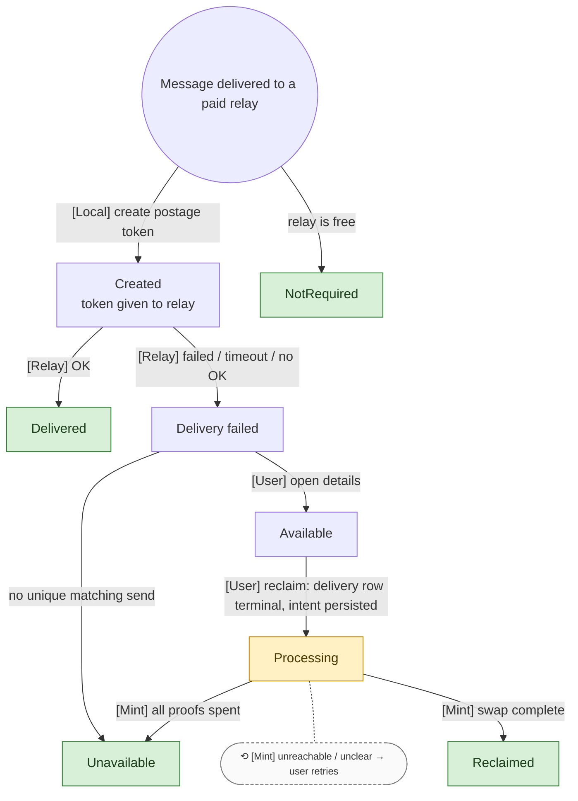

# B4 Relay postage and reclaim

[Back to contents](../README.md) · B · Payments

## State diagram

GitHub renders the Mermaid block below directly; if it does not display correctly, open the SVG.

[SVG](diagrams/B4.svg) · [Mermaid source](diagrams/B4.mmd)

## State table

### Per delivery (message × relay)

| ID | State (code name) | Entry condition | Where funds / data are | UI display | What the user can do | Terminal? | Code location |
|---|---|---|---|---|---|---|---|
| B4-01 | `NotRequired` | Relay charges no postage | — | — | — | Yes (for that delivery) | `PC/transport.rs:79-84` |
| B4-02 | `NotStarted` / `Unavailable` | Not yet paid, or cannot pay | Not paid | — | — | No | same as above |
| B4-03 | `Created` | Postage token created and sent to relay with the event | Token handed to relay; wallet ledger records a `relay_stamp` send | — | — | Yes (for that delivery) | same as above; ledger marker `W/cashu/stamp_reclaim.rs:132-142` |

### Reclaim (failed delivery rows only)

| ID | State (code name) | Entry condition | Where funds / data are | UI display | What the user can do | Terminal? | Code location |
|---|---|---|---|---|---|---|---|
| B4-04 | Not reclaimable (no binding) | Delivery row status not in failed / timeout / no_ack / terminal_failed / retry_exhausted, or an OK was received | — | No entry shown | — | — | `A/messaging/stamp_reclaim.rs:5-23` |
| B4-05 | `Available` | Binding maps to exactly one `TokenCreated` send saga | Token possibly not yet redeemed by relay | Reclaim shown | Reclaim | No | `W/cashu/stamp_reclaim.rs:128-186` |
| B4-06 | `Processing` | Reclaim intent accepted (persisted before touching the mint), or mint state unclear / unreachable | Intent + original proofs | Processing | Reclaim again | No | `W/cashu/stamp_reclaim.rs:187-199`, `:209-252` |
| B4-07 | `Reclaimed` | Swap complete | Back in wallet | Reclaimed | — | Yes | `W/cashu/stamp_reclaim.rs:203-208`, `:415` |
| B4-08 | `Unavailable` | All proofs spent (relay redeemed), or no unique matching ledger entry | At the relay | Not reclaimable | — | Yes | `W/cashu/stamp_reclaim.rs:149-158`, `:220-224` |

"Same as above" refers to the previous row of the table. In the UI column, `xxx.yyy` values are localization keys.
