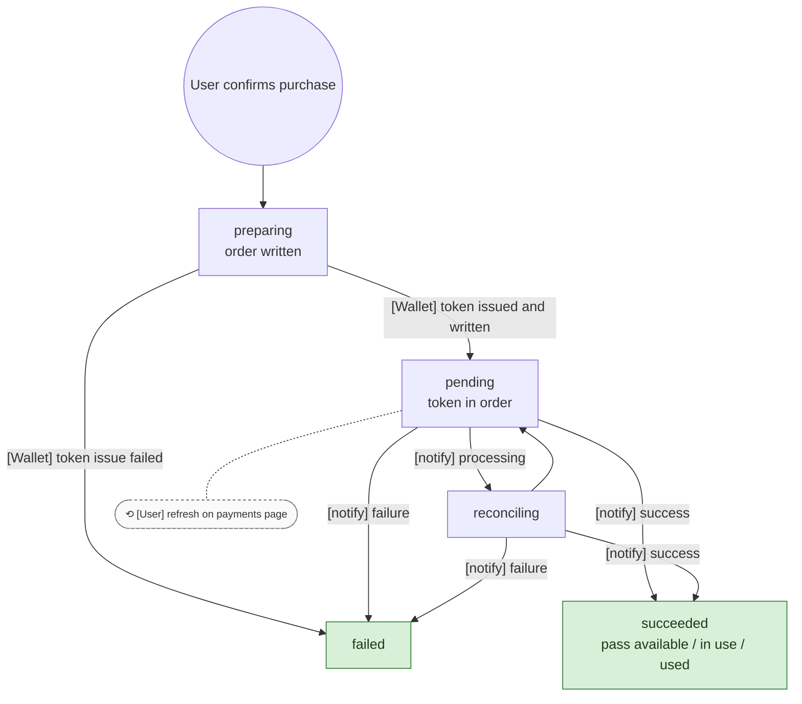

# B5 Paid call tickets

[Back to contents](../README.md) · B · Payments

## State diagram

GitHub renders the Mermaid block below directly; if it does not display correctly, open the SVG.

[SVG](diagrams/B5.svg) · [Mermaid source](diagrams/B5.mmd)

## State table

| ID | State (code name) | Entry condition | Where funds / data are | UI display | What the user can do | Terminal? | Code location |
|---|---|---|---|---|---|---|---|
| B5-01 | `preparing` → `Preparing` | User confirms purchase; order row written | Token not yet issued; or issued but not yet written | Paying | Continue / cancel | No | `R/app_storage/rtc_tickets.rs:110`; `R/rtc/payments.rs:132` |
| B5-02 | `pending` / `reconciling` → `Confirming` | Token written to the order and given to notify | Token in the order | Confirming; confirm page offers only Continue | Keep polling | No | `rtc_tickets.rs:128-141`; `R/rtc/payments.rs:58-59`, `:177-199`, `:329` |
| B5-03 | `succeeded` → `Available` / `UsePending` / `Used` | notify confirmed; then projected by usage | Pass | Available / in use / used | Call | Yes (payment side) | `rtc_tickets.rs:143-153` |
| B5-04 | `failed` → `Failed` | notify returned failure, or wallet failed to issue a token | Token cleared | Failed | — | Yes | `rtc_tickets.rs:118-125`, `:152` |

"Same as above" refers to the previous row of the table. In the UI column, `xxx.yyy` values are localization keys.
