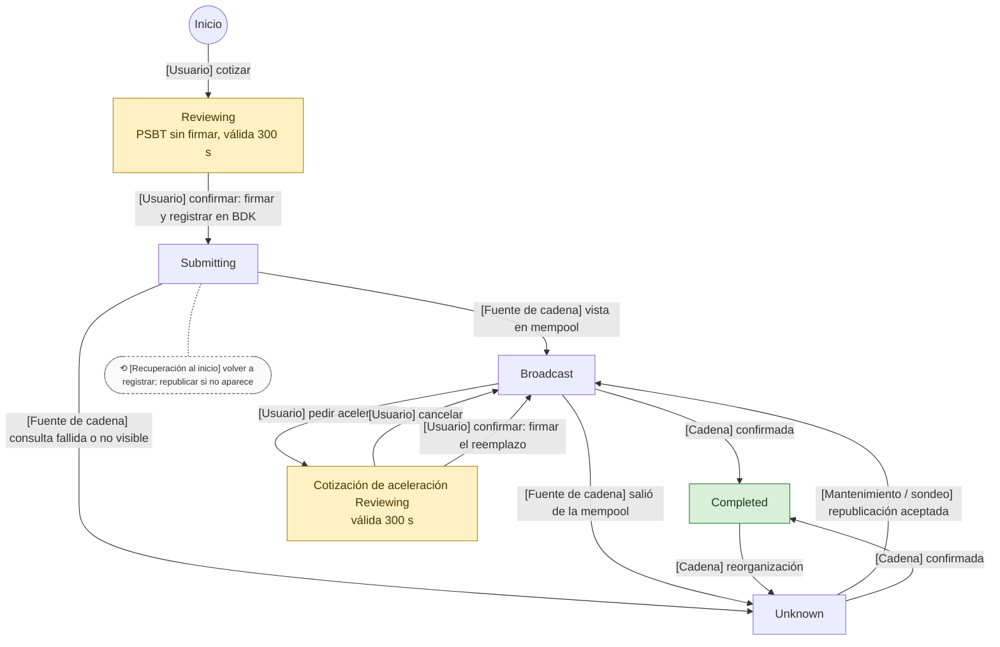
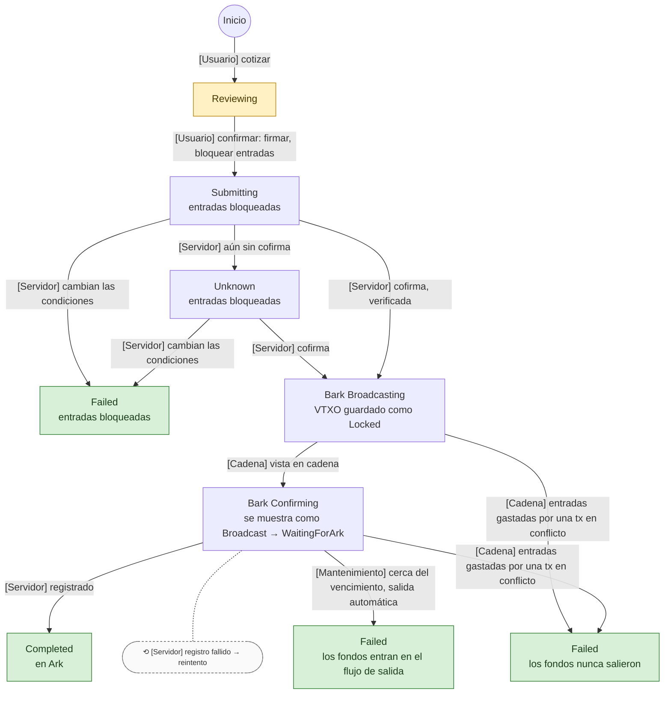

# A1 Depósito en Ark, envío directo de BTC, aceleración RBF

[Volver al índice](../README.md) · A · Fondos on-chain y Ark

## Diagrama de estados

GitHub muestra directamente el bloque Mermaid de abajo; si no se ve bien, abra el SVG.

### A1a Envío directo de BTC (con RBF)

[SVG](diagrams/A1a.svg) · [Fuente Mermaid](diagrams/A1a.mmd)

### A1b Depósito en Ark

[SVG](diagrams/A1b.svg) · [Fuente Mermaid](diagrams/A1b.mmd)

## Tabla de estados

### Registro compartido (`keychat_bitcoin_transfers`)

| ID | Estado (nombre en código) | Condición de entrada | Dónde están los fondos / datos | Interfaz | Qué puede hacer el usuario | ¿Final? | Ubicación en el código |
|---|---|---|---|---|---|---|---|
| A1-01 | `Reviewing` | Se persiste en cuanto se genera la cotización; válida 300 s | PSBT sin firmar; los fondos siguen en la cartera on-chain, sin bloquear | `wallet.bitcoin.review` | Confirmar; o descartar la cotización (las cotizaciones de aceleración se pueden borrar) | No (sin limpieza al caducar; confirmar después de caducar se rechaza) | `W/ark/bitcoin/transfer.rs:308-336`, `:355-358` |
| A1-02 | `Submitting` | Firmada; `signed_tx_hex` escrito | Tx firmada guardada localmente; el envío directo ya se hizo `register_tx` en BDK y cuenta como gastado; entradas de onboard bloqueadas | `wallet.bitcoin.submitting` + `wallet.bitcoin.unknown-help` | Solo esperar | No | direct send `W/ark/bitcoin/transfer.rs:382-393`; onboard `W/ark/bark_runtime/onboard.rs:220-236` |
| A1-03 | `Broadcast` | La fuente de cadena informa mempool | Tx en la mempool | `wallet.bitcoin.onboard.awaiting-confirmation` + `wallet.bitcoin.waiting-chain` | Esperar; el envío directo admite RBF | No | direct `W/ark/bitcoin/replacement.rs:803-807`; onboard `W/ark/bark_runtime/onboard.rs:339` |
| A1-04 | `WaitingForArk` | Solo onboard: tx de financiación confirmada, Ark aún no la ha registrado | Fondos en la salida del board; VTXO del board bloqueado por el movement | Igual que arriba + `wallet.bitcoin.waiting-ark` | Esperar | No | `W/ark/bark_runtime/onboard.rs:336-338` |
| A1-05 | `Unknown` | Falló la consulta a la fuente de cadena, tx no visible, onboard sin cofirma o movement ausente | Envío directo: tx firmada aún en BDK; onboard: entradas bloqueadas | `wallet.bitcoin.checking` + `wallet.bitcoin.unknown-help` | Esperar | No | direct `W/ark/bitcoin/replacement.rs:806`, `:808-809`; onboard `W/ark/bark_runtime/onboard.rs:311-313`, `:340-345`; projected as Unknown without chain source `W/ark/provider/shared_bitcoin.rs:818-840` |
| A1-06 | `Completed` | Envío directo: un intento confirmado; onboard: movement correcto con prueba de salida | Envío directo: entregado; onboard: en Ark | `wallet.bitcoin.completed` | — | Sí (el envío directo puede volver a Unknown tras una reorganización de la cadena) | `W/ark/bitcoin/replacement.rs:796-802`; `W/ark/bark_runtime/onboard.rs:325-327` |
| A1-07 | `Failed` | Solo onboard: cambian las condiciones del servidor (`submit_signed_board` devuelve None), o el movement de Bark queda Failed/Canceled | Si cambian las condiciones: las entradas siguen bloqueadas; si falla el movement: los fondos pueden estar en una salida | `wallet.bitcoin.failed` ("Transfer failed. Review a new quote to try again.") | Nueva cotización | Sí | `W/ark/bark_runtime/onboard.rs:306-310`, `:328-329` |

### Estados de Bark superpuestos al onboard (`Board.progress`)

| ID | Estado (nombre en código) | Condición de entrada | Dónde están los fondos / datos | Interfaz | Qué puede hacer el usuario | ¿Final? | Ubicación en el código |
|---|---|---|---|---|---|---|---|
| A1-08 | `Broadcasting` | Cofirma obtenida, VTXO construido | Tx de financiación pendiente de publicar; VTXO guardado como Locked | — | Visto en cadena → `Confirming`; entradas en conflicto con una tx confirmada → fallo; si no, en espera | No | `BK/actions/board.rs:147-160`, `:230-283` |
| A1-09 | `Confirming` | Tx de financiación en mempool o en bloque | VTXO del board Locked, contabilizado en `pending_board` | — | Registrar cuando haya confirmaciones suficientes; reintentar si falla el registro; iniciar una salida cerca del vencimiento | No | `BK/actions/board.rs:290-393` |
| A1-10 | movement `Failed` (tras la salida) | VTXO salido, o entradas gastadas por una tx en conflicto | Lo primero: en una salida; lo segundo: los fondos nunca salieron | — | Final | Sí | `BK/actions/board.rs:299-314` |

### Aceleración RBF ("linaje" del envío directo)

| ID | Estado (nombre en código) | Condición de entrada | Dónde están los fondos / datos | Interfaz | Qué puede hacer el usuario | ¿Final? | Ubicación en el código |
|---|---|---|---|---|---|---|---|
| A1-11 | Cotización de aceleración `Reviewing` + `replacement` | El usuario pide acelerar; se cumplen las condiciones | PSBT de reemplazo sin firmar, válida 300 s | — | Confirmar; o cancelar (solo borra el registro sin firmar) | No (sigue al linaje) | `W/ark/bitcoin/replacement.rs:378-401`, `:403-450` |
| A1-12 | Padre con `replaced_by`, hijo firmado | El usuario confirma | Padre e hijo se confirman en una sola transacción | — | Esperar | No (sigue al linaje) | `W/ark/bitcoin/replacement.rs:825-860` |
| A1-13 | Estado del linaje | El intento que confirma pasa a Completed, los demás no cambian; la cabeza se juzga por mempool / no visto | — | — | — | No (sigue al linaje) | `W/ark/bitcoin/replacement.rs:786-823` |

«Igual que arriba» se refiere a la fila anterior de la tabla. En la columna de interfaz, los valores `xxx.yyy` son claves de localización.
