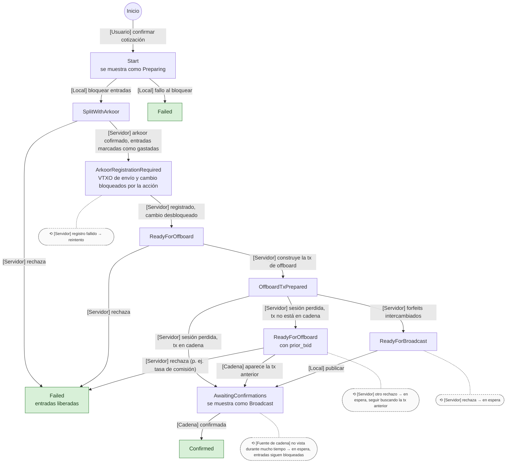

# A2 Envío de BTC desde Ark a una dirección on-chain

[Volver al índice](../README.md) · A · Fondos on-chain y Ark

## Diagrama de estados

GitHub muestra directamente el bloque Mermaid de abajo; si no se ve bien, abra el SVG.

[SVG](diagrams/A2.svg) · [Fuente Mermaid](diagrams/A2.mmd)

## Tabla de estados

| ID | Estado (nombre en código) | Condición de entrada | Dónde están los fondos / datos | Interfaz | Qué puede hacer el usuario | ¿Final? | Ubicación en el código |
|---|---|---|---|---|---|---|---|
| A2-01 | `Preparing` (Bark `Start` / `SplitWithArkoor`) | El usuario confirma; se escribe el checkpoint de la acción | VTXO de entrada bloqueados por la acción | `wallet.bitcoin-send.preparing` ("Payment in progress") | «Comprobar estado» | No | projection `W/ark/bark_runtime/bitcoin_send.rs:105-111`, `:127-139`; locking `BK/actions/offboard.rs:553-572` |
| A2-02 | `Preparing` (Bark `ArkoorRegistrationRequired`) | División arkoor hecha; entradas originales marcadas como gastadas | El VTXO de envío dividido **y el cambio** quedan bloqueados por la acción, a la espera de registro en el servidor | Igual que arriba | Igual que arriba | No | `BK/actions/offboard.rs:605-636`, `:641-661` |
| A2-03 | `Preparing` (Bark `ReadyForOffboard` / `OffboardTxPrepared` / `ReadyForBroadcast`) | Registrado; tx de offboard y forfeits intercambiados con el servidor | VTXO de envío bloqueado; cambio desbloqueado | Igual que arriba | Igual que arriba | No | `BK/actions/offboard.rs:263-286`, `:670-760` |
| A2-04 | `Broadcast` (Bark `AwaitingConfirmations`) | Tx de offboard publicada | Fondos en una tx on-chain; VTXO cedidos (forfeit) | `wallet.bitcoin-send.broadcast` | «Comprobar estado» | No | `bitcoin_send.rs:109`; `BK/actions/offboard.rs:287-326` |
| A2-05 | `Confirmed` | Movement correcto | Entregado en la dirección del destinatario | `wallet.bitcoin-send.confirmed` | — | Sí | `bitcoin_send.rs:106` |
| A2-06 | `Failed` | Movement Failed / Canceled (Bark libera las entradas si falla en `Start`, `SplitWithArkoor` o un `ReadyForOffboard` previo al forfeit) | Entradas gastables de nuevo | `wallet.bitcoin-send.failed` | Nueva cotización | Sí | `bitcoin_send.rs:107`; `BK/actions/offboard.rs:352-414` |
| A2-07 | Resultado desconocido (la llamada de confirmación expiró o falló) | `start_send_onchain_confirmed` escribió el checkpoint pero expiró | Lo que contenga el estado de Bark subyacente | `wallet.bitcoin-send.uncertain` | Consultar la operación original; no se puede iniciar otra | No | `bitcoin_send.rs:73-79`; `iOS/Wallet/Views/Forms/ArkBitcoinSendReview.swift:240-242` |

«Igual que arriba» se refiere a la fila anterior de la tabla. En la columna de interfaz, los valores `xxx.yyy` son claves de localización.
