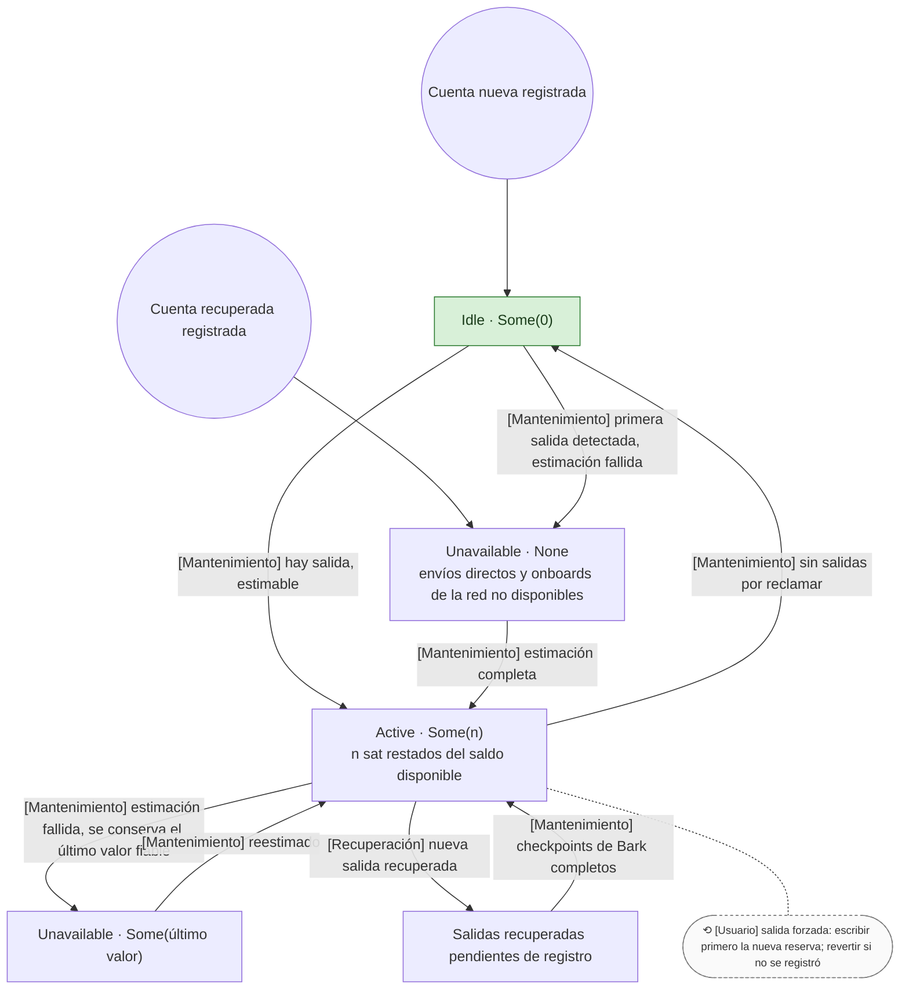

# A3 Reserva de comisiones de salida

[Volver al índice](../README.md) · A · Fondos on-chain y Ark

## Diagrama de estados

GitHub muestra directamente el bloque Mermaid de abajo; si no se ve bien, abra el SVG.

[SVG](diagrams/A3.svg) · [Fuente Mermaid](diagrams/A3.mmd)

## Tabla de estados

| ID | Estado (nombre en código) | Condición de entrada | Dónde están los fondos / datos | Interfaz | Qué puede hacer el usuario | ¿Final? | Ubicación en el código |
|---|---|---|---|---|---|---|---|
| A3-01 | `Idle`, `remaining_sats = Some(0)` | Cuenta nueva registrada; sin salidas por reclamar | Sin reserva | Ninguno | — | No (puede volver a Active) | registration `W/ark/bitcoin.rs:259-271`; zeroing `W/ark/bark_runtime/exit_fee.rs:195-200` |
| A3-02 | `Active`, `Some(n)` | Hay una salida en curso y se pueden estimar las comisiones | n sat del BTC compartido se tratan como reserva y se restan del saldo disponible | La estructura de saldo tiene `reserved_sats` / `available_sats` (`W/ark/types.rs:429-439`) | Los envíos que invaden la reserva requieren confirmación explícita (`BitcoinExitReserveImpact`) | No | `exit_fee.rs:215-221`, `:116-122` |
| A3-03 | `Unavailable`, `Some(último valor)` | Falló la estimación; se mantiene el último valor fiable | Igual que arriba | Igual que arriba | Igual que arriba | No | `exit_fee.rs:207-212`; retention rule `W/ark/bitcoin.rs:322-330` |
| A3-04 | `Unavailable`, `None` | Recuperación iniciada, nueva salida recuperada, primera salida detectada desde Idle, o nueva salida autorizada sin reestimación | Reserva desconocida; los envíos directos y los onboards en la misma red no están disponibles | Los envíos dan error | Ninguno | No | `W/ark/bitcoin.rs:62-77`, `:245-251`, `:259-267`; `exit_fee.rs:123-131`; error site `W/ark/bitcoin/transfer.rs:232-235` |
| A3-05 | Salidas recuperadas pendientes de registro (`pending_recovered_exit_ids` no vacío) | Salidas recuperadas registradas, checkpoints de Bark incompletos | Igual que arriba | Igual que arriba | Ninguno | No | `W/ark/bitcoin.rs:69`; rejected on read `transfer.rs:231-234`; cleared `exit_fee.rs:92-105` |

«Igual que arriba» se refiere a la fila anterior de la tabla. En la columna de interfaz, los valores `xxx.yyy` son claves de localización.
