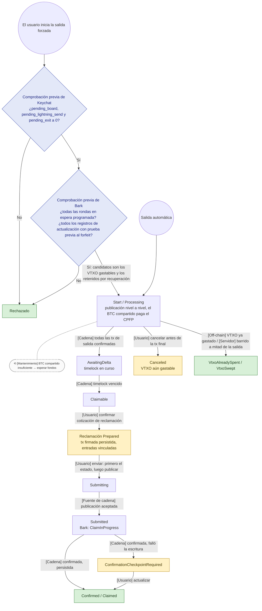

# A4 Salida forzada y reclamación

[Volver al índice](../README.md) · A · Fondos on-chain y Ark

## Diagrama de estados

GitHub muestra directamente el bloque Mermaid de abajo; si no se ve bien, abra el SVG.

[SVG](diagrams/A4.svg) · [Fuente Mermaid](diagrams/A4.mmd)

## Tabla de estados

### Salida (una por VTXO)

| ID | Estado (nombre en código) | Condición de entrada | Dónde están los fondos / datos | Interfaz | Qué puede hacer el usuario | ¿Final? | Ubicación en el código |
|---|---|---|---|---|---|---|---|
| A4-01 | `Start` / `Processing` | El usuario confirma la salida forzada, o el sistema sale automáticamente por un board / HTLC | Las tx de la cadena de salida se publican nivel a nivel; el BTC compartido paga el CPFP | `wallet.ark.exit-in-progress`, `wallet.ark.pending-funding`, `wallet.ark.refresh-to-progress-exit` | Actualizar para avanzar; añadir fondos on-chain | No | `BK/exit/progress/mod.rs:45-56`; funding check `W/ark/bark_runtime/exit_fee.rs:225-250` |
| A4-02 | `AwaitingDelta` | Todas las tx de salida confirmadas | Salida de salida, timelock aún no vencido | `wallet.ark.claim-timelock-running` | Esperar | No | `BK/exit/progress/mod.rs:57` |
| A4-03 | `Claimable` | Timelock vencido | Salida de salida, gastable solo por el usuario | `wallet.ark.claim-to-bitcoin-address` | Reclamar | No | `BK/exit/progress/states.rs:356-361` |
| A4-04 | `ClaimInProgress` | Aparece en mempool una tx que gasta la salida | Tx de reclamación en la mempool | `wallet.ark.claim-in-progress` | Esperar | No; vuelve a `Claimable` si sale de la mempool | `BK/exit/progress/states.rs:367-389` |
| A4-05 | `Claimed` | Tx de gasto confirmada | En la dirección del usuario | — | — | Sí | `BK/exit/progress/states.rs:344-349`, `:375-378` |
| A4-06 | `VtxoAlreadySpent` / `VtxoSwept` | VTXO ya gastado off-chain; o el servidor barrió a mitad de la salida | Ninguno | — | — | Sí | `BK/exit/models/mod.rs:40-47` |
| A4-07 | `Canceled` | Cancelada antes de publicar la tx final | VTXO aún gastable | — | Empezar de nuevo | Reanudable | `BK/exit/models/mod.rs:48-51` |

### Registro de reclamación de Keychat (`ark_claims`; entradas vinculadas 1:1 a una tx firmada)

| ID | Estado (nombre en código) | Condición de entrada | Dónde están los fondos / datos | Interfaz | Qué puede hacer el usuario | ¿Final? | Ubicación en el código |
|---|---|---|---|---|---|---|---|
| A4-08 | `Prepared` | El usuario confirma la cotización; tx firmada persistida; entradas registradas en `ark_claim_inputs` | — | `wallet.ark.claim-prepared` | «Enviar la tx original» | No | `W/ark/bark_runtime/exit_claim.rs:46-61`; `W/ark/claim_store.rs:189-218` |
| A4-09 | `Submitting` | Publicación iniciada (el estado se escribe antes de publicar) | — | Reclamando | Esperar | No | `exit_claim.rs:97-104`; `claim_store.rs:262-271` |
| A4-10 | `Submitted` | La publicación tuvo éxito, o la fuente de cadena informa mempool | — | `wallet.ark.claim-in-progress-message` | «Actualizar» | No | `claim_store.rs:272-279`; `exit_claim.rs:140-142` |
| A4-11 | `ConfirmationCheckpointRequired` (proyección) | Confirmada en cadena pero falló la escritura en la BD | — | `wallet.ark.claim-confirmation-checkpoint-required` | Actualizar | No | `exit_claim.rs:130-139`, `:153-159` |
| A4-12 | `Confirmed` | Confirmada en cadena y persistida | — | Reclamado | — | Sí | `claim_store.rs:287-293` |

«Igual que arriba» se refiere a la fila anterior de la tabla. En la columna de interfaz, los valores `xxx.yyy` son claves de localización.
