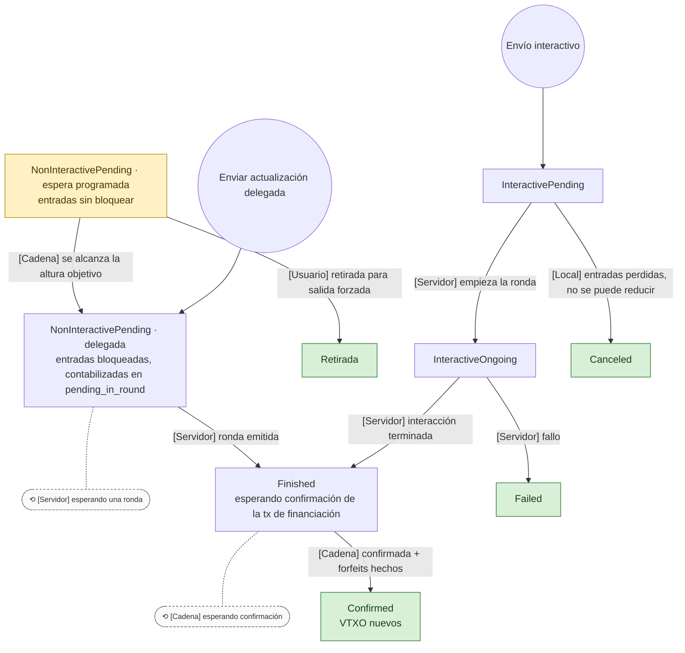
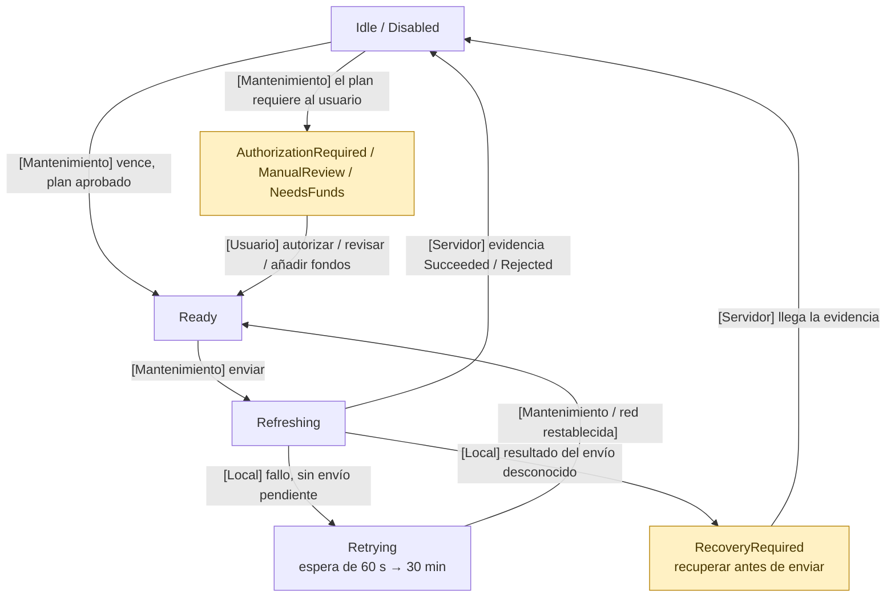

# A5 Actualización (refresh) y mantenimiento automático

[Volver al índice](../README.md) · A · Fondos on-chain y Ark

## Diagrama de estados

GitHub muestra directamente el bloque Mermaid de abajo; si no se ve bien, abra el SVG.

### A5a Una actualización (ronda de Bark)

[SVG](diagrams/A5a.svg) · [Fuente Mermaid](diagrams/A5a.mmd)

### A5b Fase de mantenimiento de Keychat (por cuenta)

[SVG](diagrams/A5b.svg) · [Fuente Mermaid](diagrams/A5b.mmd)

## Tabla de estados

### Una actualización (ronda de Bark)

| ID | Estado (nombre en código) | Condición de entrada | Dónde están los fondos / datos | Interfaz | Qué puede hacer el usuario | ¿Final? | Ubicación en el código |
|---|---|---|---|---|---|---|---|
| A5-01 | `NonInteractivePending{scheduled_height: Some}` | Actualización programada aceptada por el servidor, esperando la altura objetivo; espera programada: sí (`is_scheduled_waiting`) | Entradas no bloqueadas; aún admite salida forzada | — | — | No | `BK/round/mod.rs:262-267` |
| A5-02 | `NonInteractivePending{scheduled_height: None}` / `Redelegating` | Actualización delegada enviada, esperando a que el servidor ejecute una ronda; espera programada: no | Entradas bloqueadas por el movement, contabilizadas en `pending_in_round` | — | — | No | `BK/round/mod.rs:1043-1059`, `:816-830`; balance `BK/balance.rs:190-197` |
| A5-03 | `InteractivePending` / `InteractiveOngoing` | Ronda interactiva en cola / en curso; espera programada: no | Igual que arriba | — | — | No | `BK/round/mod.rs:777`, `:783-803` |
| A5-04 | `Finished` (no terminado) | Interacción terminada, esperando la confirmación de la tx de financiación de la ronda; espera programada: no | Igual que arriba; forfeits aún incompletos | — | — | No | `BK/round/mod.rs:923-959` |
| A5-05 | `Finished` (terminado) → `Confirmed` | Tx de financiación confirmada y forfeits completos; espera programada: — | VTXO nuevos | — | — | Sí | `BK/round/mod.rs:771-775`, `:937-948` |
| A5-06 | `Failed` / `Canceled` | Ronda fallida, cancelada por el usuario, o entradas perdidas sin poder reducirse; espera programada: — | Entradas liberadas | — | — | Sí | `BK/round/mod.rs:793-813` |

### Fase de mantenimiento de Keychat (por cuenta)

| ID | Estado (nombre en código) | Condición de entrada | Dónde están los fondos / datos | Interfaz | Qué puede hacer el usuario | ¿Final? | Ubicación en el código |
|---|---|---|---|---|---|---|---|
| A5-07 | `Idle` / `Disabled` | No hace falta actualizar / actualización automática desactivada | — | `disabled-title` | Activar, o actualizar manualmente | No (en reposo) | `W/ark/maintenance.rs:72-75` |
| A5-08 | `Ready` / `Refreshing` | Plan aprobado / enviado | — | — | Esperar | No | `W/ark/provider/maintenance.rs:530-538` |
| A5-09 | `Retrying` | Espera tras fallo 60 s → 30 min | — | — | Esperar | No | `W/ark/maintenance.rs:132-146` |
| A5-10 | `RecoveryRequired` | Resultado del envío desconocido; primero recuperar | — | — | Esperar (se revisa cada `URGENT_CHECK_SECONDS`) | No | `W/ark/provider/maintenance.rs:241-258` |
| A5-11 | `AuthorizationRequired` / `ManualReview` / `NeedsFunds` | Requiere autorización de comisión, revisión manual o más fondos | — | `authorization-*`, `funds-title`, etc. | Autorizar, revisar o añadir fondos | No (espera al usuario) | `W/ark/maintenance.rs:35-62` |

«Igual que arriba» se refiere a la fila anterior de la tabla. En la columna de interfaz, los valores `xxx.yyy` son claves de localización.
