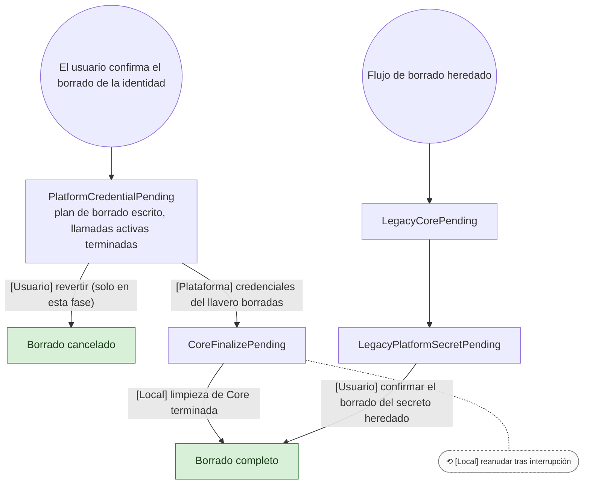

# D1 Eliminación de identidad

[Volver al índice](../README.md) · D · Identidad, dispositivo y recuperación

## Diagrama de estados

GitHub muestra directamente el bloque Mermaid de abajo; si no se ve bien, abra el SVG.

[SVG](diagrams/D1.svg) · [Fuente Mermaid](diagrams/D1.mmd)

## Tabla de estados

| ID | Estado (nombre en código) | Condición de entrada | Dónde están los fondos / datos | Interfaz | Qué puede hacer el usuario | ¿Final? | Ubicación en el código |
|---|---|---|---|---|---|---|---|
| D1-01 | `PlatformCredentialPending` | El usuario confirma el borrado; Core escribe el plan de borrado; se terminan las llamadas activas de la identidad | La identidad sigue presente; el trabajo nuevo se bloquea | — | Revertir (solo en esta fase) | No | `A/data_store/identity_deletion.rs:6-50`; rollback `A/app_storage/identities.rs:1386-1409` |
| D1-02 | `CoreFinalizePending` | La plataforma confirma que se borraron las credenciales del llavero | Credenciales borradas; datos de Core pendientes de limpieza | — | Continuar (repetible) | No | `identity_deletion.rs:54-82`, `:101-138` |
| D1-03 | `LegacyCorePending` / `LegacyPlatformSecretPending` | Puntos intermedios del flujo de borrado heredado | Igual que arriba | — | Continuar; confirmar el borrado del secreto heredado | No | `identity_deletion.rs:121-126`, `:237`, `:271` |
| D1-04 | Borrado completo | Limpieza de Core terminada; fila de borrado eliminada | La identidad ya no existe | — | — | Sí | — |

«Igual que arriba» se refiere a la fila anterior de la tabla. En la columna de interfaz, los valores `xxx.yyy` son claves de localización.
