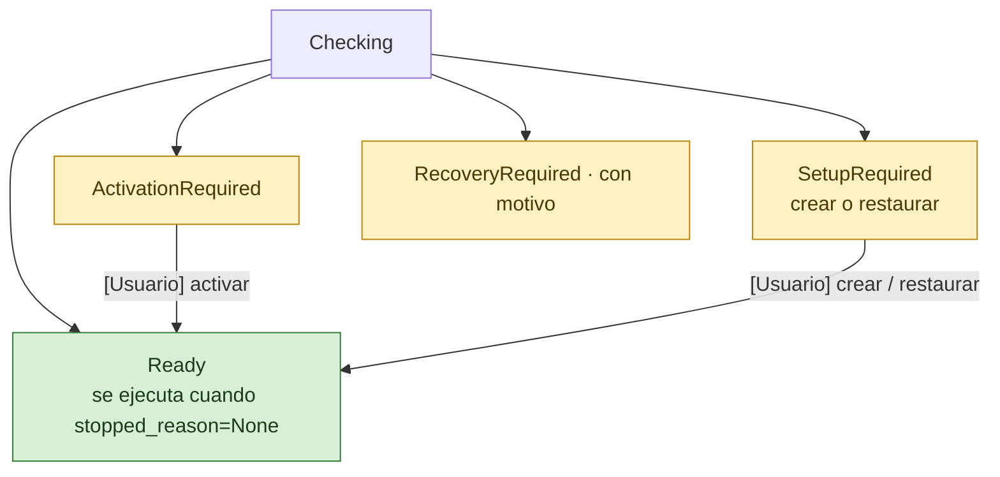
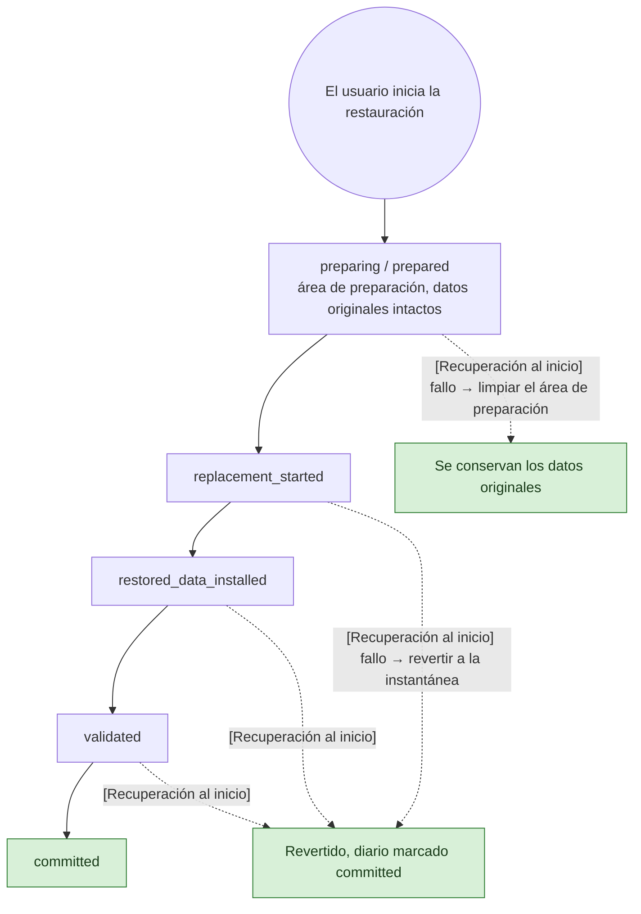

# D2 Activación del dispositivo, arranque y restauración de copia

[Volver al índice](../README.md) · D · Identidad, dispositivo y recuperación

## Diagrama de estados

GitHub muestra directamente el bloque Mermaid de abajo; si no se ve bien, abra el SVG.

### D2a Arranque

[SVG](diagrams/D2a.svg) · [Fuente Mermaid](diagrams/D2a.mmd)

### D2b Restauración de copia (diario de transacciones de iOS)

[SVG](diagrams/D2b.svg) · [Fuente Mermaid](diagrams/D2b.mmd)

## Tabla de estados

### Arranque

| ID | Estado (nombre en código) | Condición de entrada | Dónde están los fondos / datos | Interfaz | Qué puede hacer el usuario | ¿Final? | Ubicación en el código |
|---|---|---|---|---|---|---|---|
| D2-01 | `Checking` | Inicio | — | — | Esperar | No | `A/device_activation.rs:61-62` |
| D2-02 | `SetupRequired` | Sin datos | — | — | Crear o restaurar | No (espera al usuario) | `:63` |
| D2-03 | `ActivationRequired{pending}` | Hay datos, activación sin verificar | — | — | Activar | No (espera al usuario) | `:64-66` |
| D2-04 | `RecoveryRequired{reason}` | Restauración bloqueada, falta la clave de la BD, almacenamiento no disponible / incompatible, llavero no disponible, credenciales en conflicto, política no soportada | — | — | Actuar según el motivo | No (espera al usuario) | `:49-58`, `:67-69` |
| D2-05 | `Ready{stopped_reason}` | Todo listo; o en pausa manual / como origen de migración / como destino de migración | — | — | — | Sí (en reposo) | `:70-80` |

### Restauración de copia (progreso de Core) y diario de transacciones de iOS

| ID | Estado (nombre en código) | Condición de entrada | Dónde están los fondos / datos | Interfaz | Qué puede hacer el usuario | ¿Final? | Ubicación en el código |
|---|---|---|---|---|---|---|---|
| D2-06 | `RestoreInspecting` / `RestoreValidating` / `RestoreStaging` (iOS: `preparing` / `prepared`) | — | Área de preparación; datos originales intactos | — | Área de preparación limpiada al arrancar | No | `A/backup_restore.rs:606-621`; `iOS/Services/BackupRestoreTransaction.swift:197-199` |
| D2-07 | `RestoreReplacingLocalData` / `RestoreWritingKeychain` (iOS: `replacement_started` / `restored_data_installed`) | — | Instantánea de los datos originales + datos nuevos | — | Se revierte a la instantánea al arrancar; luego el diario se marca committed para no repetir la reversión | No | `BackupRestoreTransaction.swift:200-205`, `:209-258` |
| D2-08 | `RestoreReopeningClient` / `RestoreWalletChecking` (iOS: `validated`) | — | Datos nuevos | — | Igual que arriba (reversión) | No | same as above |
| D2-09 | `RestoreComplete` (iOS: `committed`) | — | Datos nuevos; instantánea limpiada | — | — | Sí | `BackupRestoreTransaction.swift:178-181` |
| D2-10 | `Failed` (iOS: —) | — | Depende del punto de fallo | — | Solo puede volver a Idle | Sí | `A/backup_restore.rs:698-741` |

«Igual que arriba» se refiere a la fila anterior de la tabla. En la columna de interfaz, los valores `xxx.yyy` son claves de localización.
