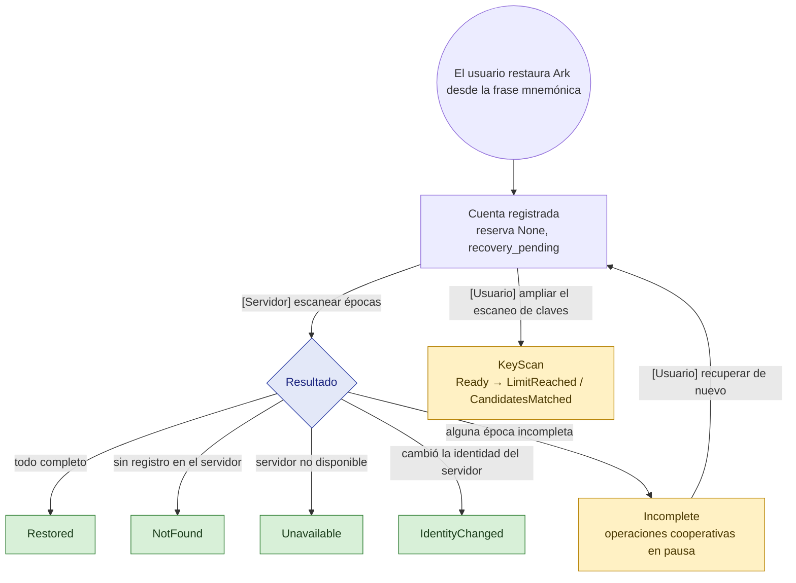

# D3 Recuperación de la cartera

[Volver al índice](../README.md) · D · Identidad, dispositivo y recuperación

## Diagrama de estados

GitHub muestra directamente el bloque Mermaid de abajo; si no se ve bien, abra el SVG.

[SVG](diagrams/D3.svg) · [Fuente Mermaid](diagrams/D3.mmd)

## Tabla de estados

| ID | Estado (nombre en código) | Condición de entrada | Dónde están los fondos / datos | Interfaz | Qué puede hacer el usuario | ¿Final? | Ubicación en el código |
|---|---|---|---|---|---|---|---|
| D3-01 | `Restored` | Todas las épocas completas | VTXO y salidas recuperados | — | — | Sí | `W/ark/types.rs:69` |
| D3-02 | `NotFound` | El servidor no tiene registro de la cartera | — | — | Probar otra fuente | Sí | `types.rs:70` |
| D3-03 | `Incomplete` | Alguna época incompleta; la cuenta sigue `recovery_pending`, operaciones cooperativas rechazadas, reserva None | Recuperada en parte | — | Recuperar de nuevo | No | `W/ark/types.rs:71` |
| D3-04 | `Unavailable` / `IdentityChanged` | Servidor no disponible / la identidad del servidor cambió | — | — | Reintentar más tarde / juzgar manualmente | Sí (este intento) | `types.rs:72-73` |
| D3-05 | Escaneo de claves `Ready` / `LimitReached` / `CandidatesMatched` | Escaneado hasta el límite o coincidencia por índice | Progreso del escaneo | — | Ampliar el escaneo | No | `types.rs:89-108` |
| D3-06 | Escaneo del historial BTC `Ready` / `LimitReached` / `UnsupportedChainSource` | Igual que arriba (BTC compartido) | Direcciones descubiertas | — | Ampliar el escaneo | No | `types.rs:441-457` |

«Igual que arriba» se refiere a la fila anterior de la tabla. En la columna de interfaz, los valores `xxx.yyy` son claves de localización.
