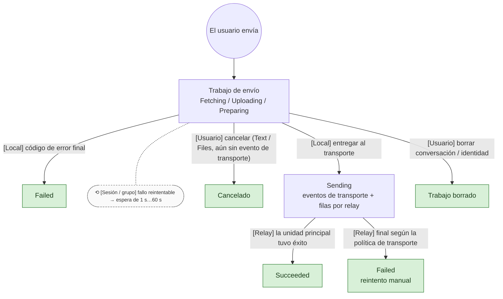

# C1 Envío de mensajes

[Volver al índice](../README.md) · C · Mensajería y relaciones

## Diagrama de estados

GitHub muestra directamente el bloque Mermaid de abajo; si no se ve bien, abra el SVG.

[SVG](diagrams/C1.svg) · [Fuente Mermaid](diagrams/C1.mmd)

## Tabla de estados

| ID | Estado (nombre en código) | Condición de entrada | Dónde están los fondos / datos | Interfaz | Qué puede hacer el usuario | ¿Final? | Ubicación en el código |
|---|---|---|---|---|---|---|---|
| C1-01 | `Fetching` | Intención de vista previa de enlace sin terminar | Trabajo de envío | Enviando | Texto / archivo se pueden cancelar | No | `A/messaging/delivery_queries.rs:420-424` |
| C1-02 | `Uploading` | Intención de adjunto sin terminar | Trabajo de envío + adjuntos locales | Subiendo | Igual que arriba | No | `delivery_queries.rs:425-429` |
| C1-03 | `Preparing` | Existe el trabajo, aún no entregado al transporte | Trabajo de envío | Enviando | Igual que arriba | No | `delivery_queries.rs:430-432` |
| C1-04 | `Failed` (dentro del trabajo) | Subida en pausa | Trabajo de envío | Fallido | Reintentar | No | `delivery_queries.rs:421-422` |
| C1-05 | `Sending` | Eventos de transporte creados; ni éxito de negocio ni final | `app_message_transport_events` + filas de entrega por relay | Enviando | Esperar | No | `delivery_queries.rs:443-445` |
| C1-06 | `Succeeded` | La unidad principal alcanzó el éxito de negocio | Filas de entrega | Enviado | — | Sí | `delivery_queries.rs:433-437` |
| C1-07 | `Failed` (entrega) | La política de transporte lo declara final | Filas de entrega | Fallido | Reintento manual (según `manual_retryable`) | Sí | `delivery_queries.rs:438-442` |

«Igual que arriba» se refiere a la fila anterior de la tabla. En la columna de interfaz, los valores `xxx.yyy` son claves de localización.
