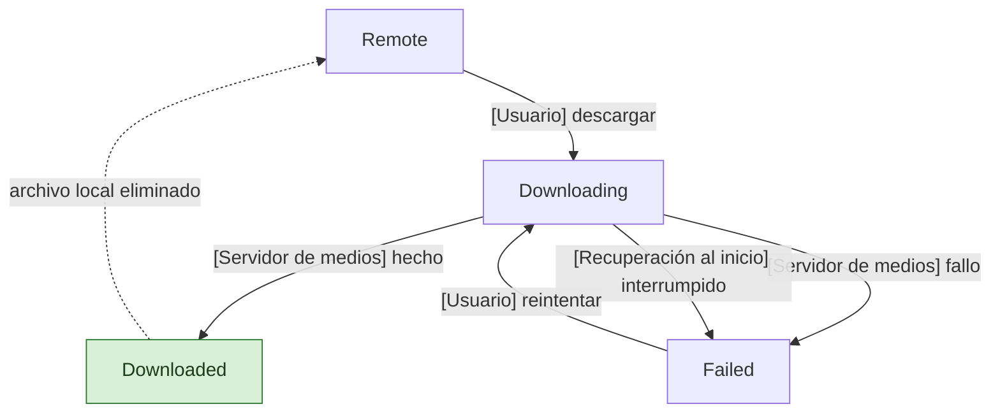
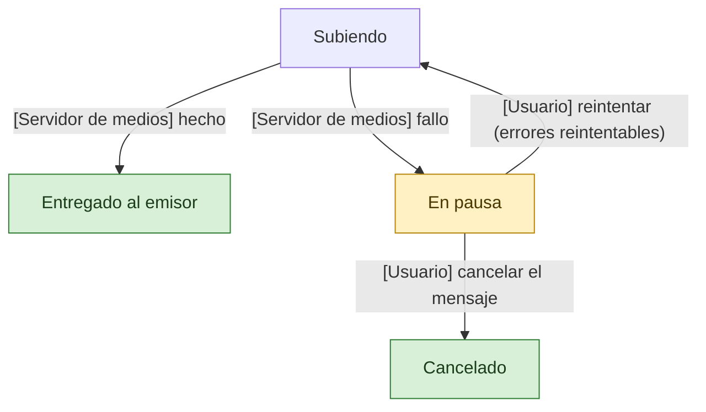

# C2 Subida y descarga de adjuntos

[Volver al índice](../README.md) · C · Mensajería y relaciones

## Diagrama de estados

GitHub muestra directamente el bloque Mermaid de abajo; si no se ve bien, abra el SVG.

### C2a Descarga

[SVG](diagrams/C2a.svg) · [Fuente Mermaid](diagrams/C2a.mmd)

### C2b Subida (parte del trabajo de envío)

[SVG](diagrams/C2b.svg) · [Fuente Mermaid](diagrams/C2b.mmd)

## Tabla de estados

### Descarga

| ID | Estado (nombre en código) | Condición de entrada | Dónde están los fondos / datos | Interfaz | Qué puede hacer el usuario | ¿Final? | Ubicación en el código |
|---|---|---|---|---|---|---|---|
| C2-01 | `Remote` | No descargado | URL remota + clave | Descargable | Descarga | No | `A/data_store/message_snapshot.rs:536-540` |
| C2-02 | `Downloading` | Descarga iniciada (`transfer_state=1`) | Archivo temporal | Descargando | Esperar | No | `A/app_storage/attachments.rs:356` |
| C2-03 | `Downloaded` | `transfer_state=2` y el archivo local existe | Archivo local | Se puede abrir | — | Sí (vuelve a la proyección Remote si falta el archivo) | `message_snapshot.rs:527-535` |
| C2-04 | `Failed` | La descarga falló, o se detectó una interrupción al arrancar / reiniciar el runtime | `last_error_code` | Fallido | Reintentar | No | `attachments.rs:462-469`, `:472-492` |

### Subida (parte del trabajo de envío)

| ID | Estado (nombre en código) | Condición de entrada | Dónde están los fondos / datos | Interfaz | Qué puede hacer el usuario | ¿Final? | Ubicación en el código |
|---|---|---|---|---|---|---|---|
| C2-05 | Subiendo | Intención de adjunto sin terminar | — | `Uploading` | Los mensajes de texto / archivo se pueden cancelar | No | `A/messaging/delivery_queries.rs:425-429` |
| C2-06 | En pausa (fallo dentro del trabajo) | El fallo de subida escribe `upload_state='paused'` | — | `Failed` | Reintento permitido para errores reintentables; no para origen ausente, intención inválida o destino inseguro | No | `A/app_storage/message_sender_attachments.rs:349`; `A/message_sender/projection.rs:73-94` |

«Igual que arriba» se refiere a la fila anterior de la tabla. En la columna de interfaz, los valores `xxx.yyy` son claves de localización.
