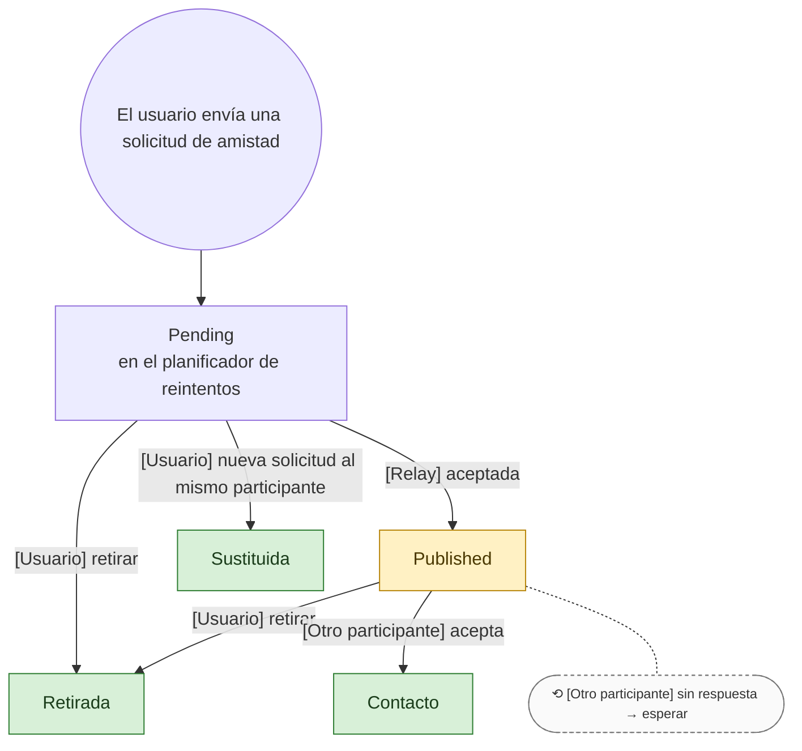

# C3 Solicitudes de amistad y actualización PQXDH

[Volver al índice](../README.md) · C · Mensajería y relaciones

## Diagrama de estados

GitHub muestra directamente el bloque Mermaid de abajo; si no se ve bien, abra el SVG.

[SVG](diagrams/C3.svg) · [Fuente Mermaid](diagrams/C3.mmd)

## Tabla de estados

| ID | Estado (nombre en código) | Condición de entrada | Dónde están los fondos / datos | Interfaz | Qué puede hacer el usuario | ¿Final? | Ubicación en el código |
|---|---|---|---|---|---|---|---|
| C3-01 | `Pending` (lado del remitente) | Solicitud enviada al planificador de reintentos de entrega | Solicitud pendiente + sesión pendiente a nivel de protocolo | Esperando al otro participante | Retirar | No | `A/friend_request.rs:1260-1263`, `:1611-1625` |
| C3-02 | `Published` | Al menos un relay la aceptó | Igual que arriba | Esperando al otro participante | Retirar | No | `A/types.rs:3512` |
| C3-03 | Aceptada por el otro participante | Respuesta del otro participante recibida | Sesión establecida | Contacto | — | Sí | — |
| C3-04 | Retirada | El usuario la retira; o una nueva solicitud al mismo participante la sustituye | Sesión pendiente de protocolo y transporte borrados | — | — | Sí | `A/friend_request.rs:1265-1369`, `:1220-1258` |
| C3-05 | Reintento de actualización PQXDH | El usuario lo lanza manualmente | — | Avisos distintos para `Sent` / `AlreadyUpgraded` / `PeerNotReady` / `IneligibleRoom` / `InFlight` | Reintentar más tarde | Devuelve en cada llamada | `A/types.rs:533-540` |

«Igual que arriba» se refiere a la fila anterior de la tabla. En la columna de interfaz, los valores `xxx.yyy` son claves de localización.
