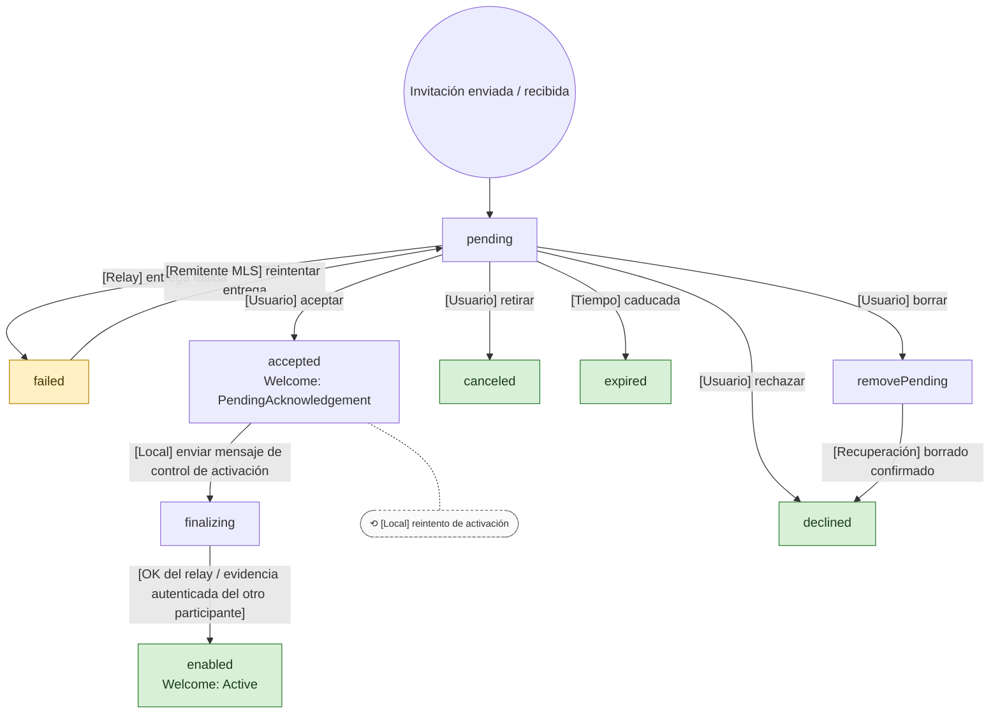

# C4 Invitaciones de grupo y activación del Welcome de MLS

[Volver al índice](../README.md) · C · Mensajería y relaciones

## Diagrama de estados

GitHub muestra directamente el bloque Mermaid de abajo; si no se ve bien, abra el SVG.

[SVG](diagrams/C4.svg) · [Fuente Mermaid](diagrams/C4.mmd)

## Tabla de estados

| ID | Estado (nombre en código) | Condición de entrada | Dónde están los fondos / datos | Interfaz | Qué puede hacer el usuario | ¿Final? | Ubicación en el código |
|---|---|---|---|---|---|---|---|
| C4-01 | `pending` | Invitación enviada o recibida; el reintento de entrega vuelve a pending | — | — | Aceptar / rechazar / retirar | No | `A/group_invite/outgoing.rs:216`, `:395`; `A/group_invite/welcome.rs:212`; `A/group_invite/delivery.rs:413` |
| C4-02 | `failed` | Falló la entrega, o falló el procesamiento de la decisión | — | — | El remitente MLS puede reintentar la entrega (`group_invite_lifecycle_allows_delivery_retry`) | No | `outgoing.rs:440`, `:482`, `:519`; `A/group_invite/decisions.rs:244`; `A/group_invite.rs:308-318` |
| C4-03 | `accepted` / `finalizing` | Aceptada; esperando a que llegue el mensaje de control de activación del miembro | — | `PendingAcknowledgement` | Esperar | No | `A/group_invite/projection.rs:14`, `:24` |
| C4-04 | `enabled` | Se recibió evidencia de activación autenticada o el OK del relay | — | `Active` | — | Sí | `A/group_invite/delivery.rs:513`; `projection.rs:25` |
| C4-05 | `declined` / `canceled` / `expired` | Rechazada, retirada, caducada | — | — | — | Sí | `A/group_invite/removal_recovery.rs:55-63`, `:93-103` |
| C4-06 | `removePending` | Pendiente de confirmación durante el borrado | — | — | — | No | `A/group_invite/decisions.rs:175`; `removal_recovery.rs:235`, `:345` |

«Igual que arriba» se refiere a la fila anterior de la tabla. En la columna de interfaz, los valores `xxx.yyy` son claves de localización.
