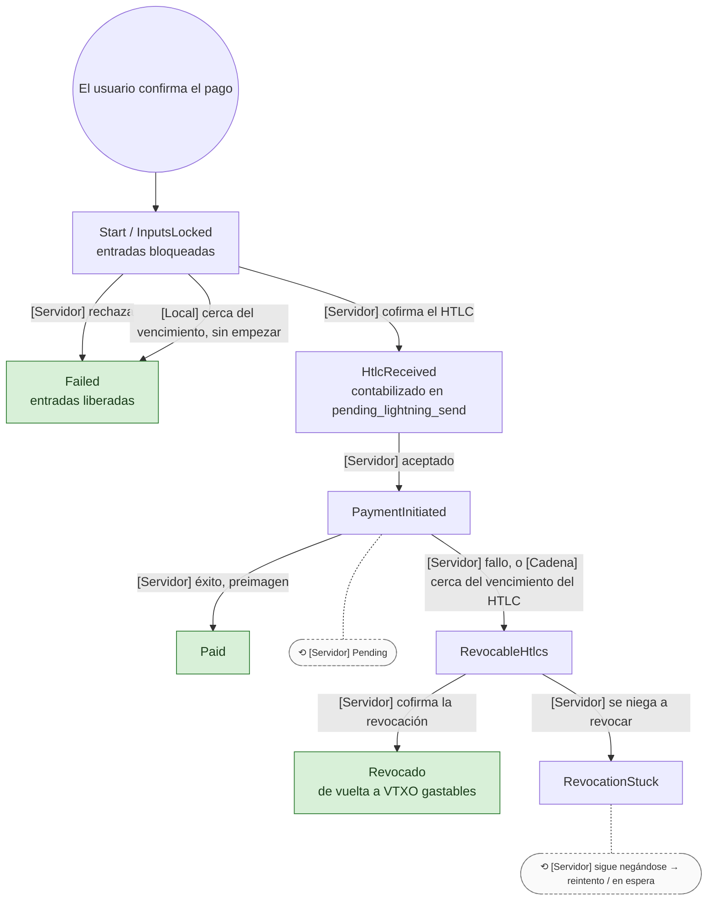
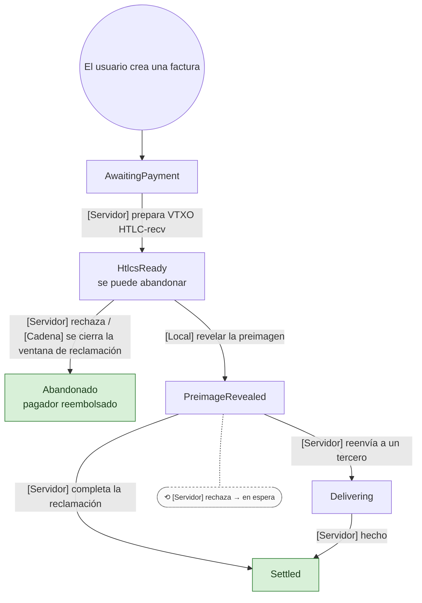

# B1 Envío y recepción Lightning (Ark)

[Volver al índice](../README.md) · B · Pagos y cobros

## Diagrama de estados

GitHub muestra directamente el bloque Mermaid de abajo; si no se ve bien, abra el SVG.

### B1a Envío (pagar una factura)

[SVG](diagrams/B1a.svg) · [Fuente Mermaid](diagrams/B1a.mmd)

### B1b Recepción (emitir una factura)

[SVG](diagrams/B1b.svg) · [Fuente Mermaid](diagrams/B1b.mmd)

## Tabla de estados

### Envío

| ID | Estado (nombre en código) | Condición de entrada | Dónde están los fondos / datos | Interfaz | Qué puede hacer el usuario | ¿Final? | Ubicación en el código |
|---|---|---|---|---|---|---|---|
| B1-01 | `Start` / `InputsLocked` | El usuario confirma el pago | VTXO de entrada bloqueados por la acción | `InProgress` | Esperar | No | `BK/actions/lightning/pay.rs:326-330`, `:221-229` |
| B1-02 | `HtlcReceived` | El servidor cofirmó las salidas HTLC | VTXO HTLC bloqueados, contabilizados en `pending_lightning_send` | `InProgress` | Esperar | No | `BK/actions/lightning/pay.rs:331-332` |
| B1-03 | `PaymentInitiated` | Se ha pedido al servidor que pague | Igual que arriba | `InProgress` | Esperar | No | `BK/actions/lightning/pay.rs:183-207` |
| B1-04 | `RevocableHtlcs` | El servidor informa fallo, o sigue Pending cerca del vencimiento del HTLC | Igual que arriba, revocación preparada | `InProgress` | Esperar | No | `BK/actions/lightning/pay.rs:189-198` |
| B1-05 | `RevocationStuck` | El servidor se niega a revocar | Igual que arriba | `InProgress{has_failed_revocation: true}` | Esperar | No | `BK/actions/lightning/pay.rs:260-275`, `:299-315`; `W/ark/bark_runtime.rs:3032-3038`; `iOS/Wallet/Ark/ArkWalletModels.swift:1117` |
| B1-06 | `Paid` | Preimagen obtenida | Pagado | `Paid` | — | Sí | `BK/actions/lightning/pay.rs:185-188` |
| B1-07 | Revocación hecha (Done) | El servidor cofirma la revocación | De vuelta a VTXO gastables | — | — | Sí | `BK/actions/lightning/pay.rs:209-213` |

### Recepción

| ID | Estado (nombre en código) | Condición de entrada | Dónde están los fondos / datos | Interfaz | Qué puede hacer el usuario | ¿Final? | Ubicación en el código |
|---|---|---|---|---|---|---|---|
| B1-08 | `AwaitingPayment` | Factura creada | Ninguno | — | — | No | `BK/actions/lightning/receive.rs:257-258` |
| B1-09 | `HtlcsReady` | El servidor preparó los VTXO HTLC-recv | Bloqueado; aún se puede abandonar | — | — | No; se abandona si se cierra la ventana de reclamación o se rechaza | `BK/actions/lightning/receive.rs:259-262`, `:204-211`, `:240-246` |
| B1-10 | `PreimageRevealed` | Preimagen revelada al servidor | VTXO HTLC-recv bloqueados, contabilizados en `claimable_lightning_receive` | — | — | No; queda en espera tras una reclamación fallida | `BK/actions/lightning/receive.rs:263-269`, `:212-224`, `:247-249`; `BK/lightning/receive.rs:205-240` |
| B1-11 | `Delivering` | Las salidas reclamadas deben reenviarse a un tercero | Bloqueado | — | — | No | `BK/actions/lightning/receive.rs:270-273` |
| B1-12 | `Settled` | Reclamación completa | VTXO nuevos | — | — | Sí | `W/ark/bark_runtime.rs:3007-3014` |

«Igual que arriba» se refiere a la fila anterior de la tabla. En la columna de interfaz, los valores `xxx.yyy` son claves de localización.
