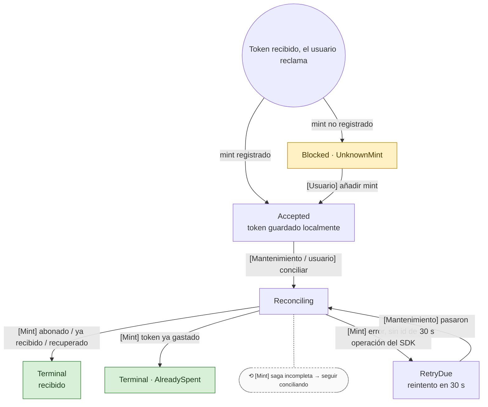

# B2 Recepción Cashu

[Volver al índice](../README.md) · B · Pagos y cobros

## Diagrama de estados

GitHub muestra directamente el bloque Mermaid de abajo; si no se ve bien, abra el SVG.

[SVG](diagrams/B2.svg) · [Fuente Mermaid](diagrams/B2.mmd)

## Tabla de estados

| ID | Estado (nombre en código) | Condición de entrada | Dónde están los fondos / datos | Interfaz | Qué puede hacer el usuario | ¿Final? | Ubicación en el código |
|---|---|---|---|---|---|---|---|
| B2-01 | `Accepted` | Token recibido, mint registrado | Token al portador en el almacén local cifrado (la única copia reutilizable) | Recepción en curso | Esperar | No | `W/cashu/receive_store.rs:340-345`; `W/cashu/receive_operations.rs:63` |
| B2-02 | `Blocked` (`UnknownMint`) | Mint no registrado | Igual que arriba | Hace falta añadir el mint | Añadir el mint y continuar | No | `receive_store.rs:342-345`; skipped by maintenance `receive_operations.rs:509-512` |
| B2-03 | `Reconciling` | Conciliando, o el SDK ya tiene una saga para ello | Token + saga de CDK | Procesando | Esperar | No | `receive_operations.rs:188-194`, `:216-226` |
| B2-04 | `RetryDue` (`RetryRequired`) | La conciliación falló sin id de operación del SDK; reintento en 30 s | Token | Procesando | Esperar | No | `receive_operations.rs:192`, `:214-227` |
| B2-05 | `Terminal` (sin incidencia) | Se obtuvo `Credited` / `AlreadyReceived` / `Recovered` | En el saldo de CDK | Recibido | — | Sí | `receive_operations.rs:196-206` |
| B2-06 | `Terminal` (`AlreadySpent`) | El mint dice que el token ya se gastó | Ninguno | Error `CashuTokenAlreadySpent` | — | Sí | `receive_operations.rs:207-213` |

«Igual que arriba» se refiere a la fila anterior de la tabla. En la columna de interfaz, los valores `xxx.yyy` son claves de localización.
