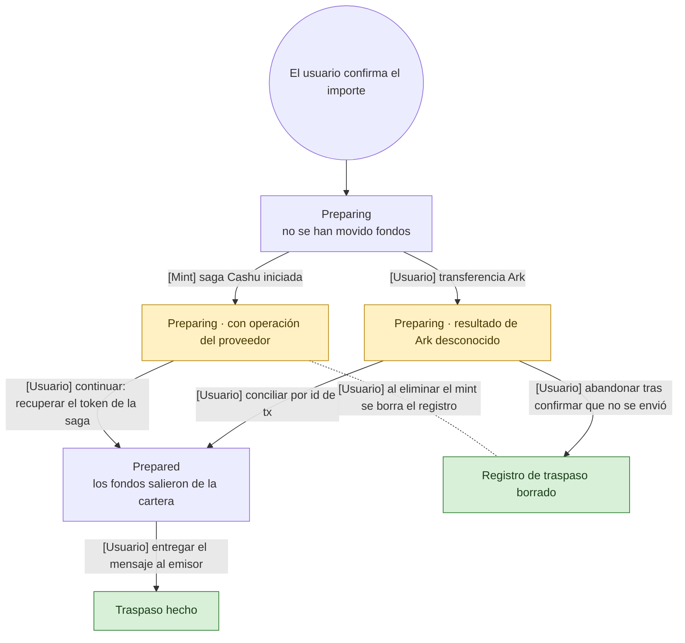
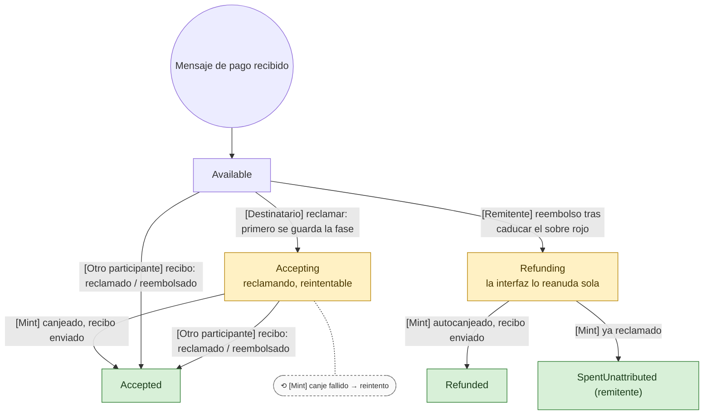

# B3 Transferencias en chat, sobres rojos y recibos

[Volver al índice](../README.md) · B · Pagos y cobros

## Diagrama de estados

GitHub muestra directamente el bloque Mermaid de abajo; si no se ve bien, abra el SVG.

### B3a Remitente: traspaso de cartera (uno por sala e identidad)

[SVG](diagrams/B3a.svg) · [Fuente Mermaid](diagrams/B3a.mmd)

### B3b Lado del mensaje: transferencia Cashu / sobre rojo (DM de Signal)

[SVG](diagrams/B3b.svg) · [Fuente Mermaid](diagrams/B3b.mmd)

## Tabla de estados

### Remitente: traspaso de cartera (como mucho uno por sala)

| ID | Estado (nombre en código) | Condición de entrada | Dónde están los fondos / datos | Interfaz | Qué puede hacer el usuario | ¿Final? | Ubicación en el código |
|---|---|---|---|---|---|---|---|
| B3-01 | `Preparing`, sin operación del proveedor | El usuario confirma el importe | No se han movido fondos | — | Continuar | No | `W/ledger.rs:539-606` |
| B3-02 | `Preparing`, con operación del proveedor (Cashu) | Saga de envío Cashu iniciada | Saga en el mint; el token puede existir ya | `wallet.chat.previous-cashu-interrupted` | «Continuar»: recuperar el token de la saga | No | `WU/wallet.rs:2752-2810`, `:1880-1931` |
| B3-03 | `Preparing`, resultado de Ark sin resolver | Resultado de la transferencia Ark desconocido | Puede haber salido ya de la cuenta | `wallet.chat.previous-wallet-transfer-interrupted` | Conciliar por id de tx; o abandonar tras confirmar que no se envió nada | No | `W/ledger.rs:734-759`; `iOS/Wallet/Views/ChatPayFlowSheet.swift:862-900` |
| B3-04 | `Prepared` | Token (Cashu) o id de tx (Ark) obtenido | Los fondos salieron de la cartera; token en la saga local | `wallet.chat.wallet-transfer-complete` (se puede reanudar el traspaso del mensaje) | Seguir enviando el mensaje | No | `W/ledger.rs:691-722`; `ChatPayFlowSheet.swift:725-731` |
| B3-05 | Borrado (hecho) | Mensaje entregado al emisor | Registro de traspaso borrado | — | — | Sí | `W/ledger.rs:724-732`; `ChatPayFlowSheet.swift:851` |

### Lado del mensaje: transferencia Cashu / sobre rojo (solo DM de Signal)

| ID | Estado (nombre en código) | Condición de entrada | Dónde están los fondos / datos | Interfaz | Qué puede hacer el usuario | ¿Final? | Ubicación en el código |
|---|---|---|---|---|---|---|---|
| B3-06 | ninguno → `Pending` / `Available` | Recibido o enviado | — | Reclamable | El destinatario reclama; el remitente no puede reclamar (sobre rojo) | No | `A/payment_lifecycle.rs:826-849` |
| B3-07 | `Accepting` → `Pending` / `Accepting` | El destinatario pulsa reclamar; la fase se guarda antes de canjear | — | Reclamando, `can_retry` | Reintentar | No | `A/messaging/payment_messages.rs:876-935`; projection `payment_lifecycle.rs:843-844`, `:858` |
| B3-08 | `Accepted` → `Succeeded` / `Accepted` | Canjeado y recibo enviado; o recibo del otro participante recibido | — | Reclamado | Reenviar el recibo si falló | Sí | `payment_lifecycle.rs:417-455`, `:828-841` |
| B3-09 | `Refunding` → `Expired` / `Accepting` | El remitente inicia el reembolso tras caducar el sobre rojo | — | `chat.payment.shared.refunding` / `continue-refund` | Continuar el reembolso (la interfaz lo reanuda sola) | No | `payment_lifecycle.rs:470-480`; `iOS/Views/Components/CashuBubble.swift:723-726`, `:330`, `:1007-1025` |
| B3-10 | `Refunded` | Reembolso completo | — | Reembolsado | Reenviar el recibo si falló | Sí | `payment_lifecycle.rs:497-522`, `:826-827` |
| B3-11 | `SpentUnattributed` (observado por el remitente) | El remitente ve el token gastado sin recibo | — | `payment_spent_without_receipt` | — | Sí (proyección) | `payment_lifecycle.rs:810-815`; `CashuBubble.swift:1001-1003`, `:1018-1019` |

«Igual que arriba» se refiere a la fila anterior de la tabla. En la columna de interfaz, los valores `xxx.yyy` son claves de localización.
