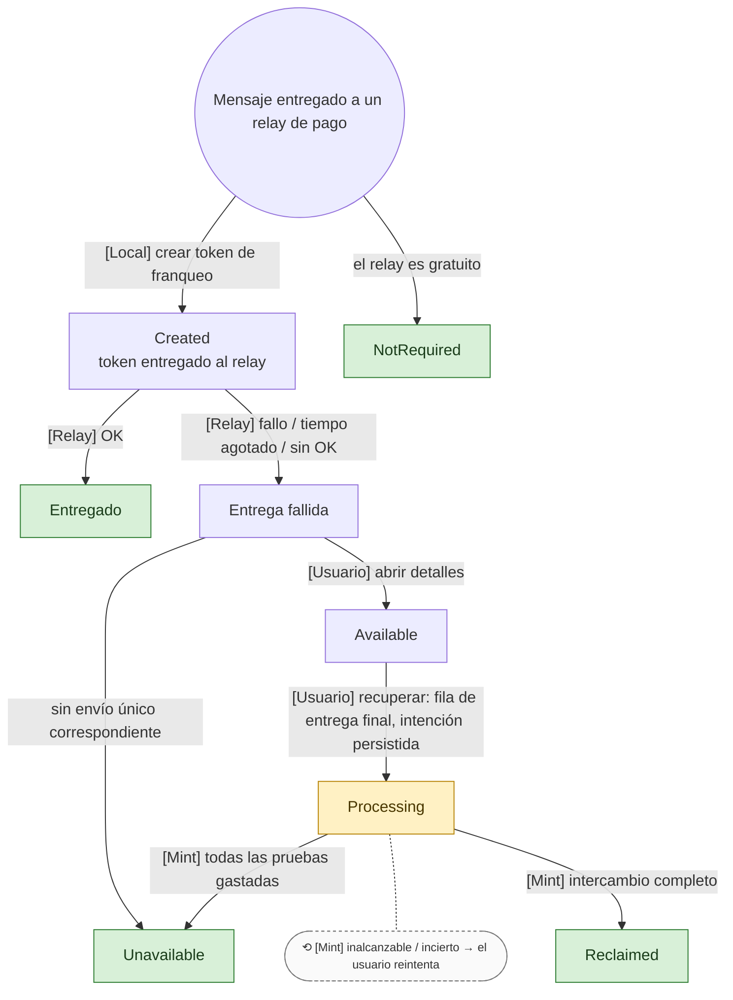

# B4 Franqueo de relay y recuperación

[Volver al índice](../README.md) · B · Pagos y cobros

## Diagrama de estados

GitHub muestra directamente el bloque Mermaid de abajo; si no se ve bien, abra el SVG.

[SVG](diagrams/B4.svg) · [Fuente Mermaid](diagrams/B4.mmd)

## Tabla de estados

### Por entrega (mensaje × relay)

| ID | Estado (nombre en código) | Condición de entrada | Dónde están los fondos / datos | Interfaz | Qué puede hacer el usuario | ¿Final? | Ubicación en el código |
|---|---|---|---|---|---|---|---|
| B4-01 | `NotRequired` | El relay no cobra franqueo | — | — | — | Sí (para esa entrega) | `PC/transport.rs:79-84` |
| B4-02 | `NotStarted` / `Unavailable` | Aún sin pagar, o no se puede pagar | No pagado | — | — | No | same as above |
| B4-03 | `Created` | Token de franqueo creado y enviado al relay con el evento | Token entregado al relay; el libro de la cartera registra un envío `relay_stamp` | — | — | Sí (para esa entrega) | same as above; ledger marker `W/cashu/stamp_reclaim.rs:132-142` |

### Recuperación (solo filas de entrega fallidas)

| ID | Estado (nombre en código) | Condición de entrada | Dónde están los fondos / datos | Interfaz | Qué puede hacer el usuario | ¿Final? | Ubicación en el código |
|---|---|---|---|---|---|---|---|
| B4-04 | No recuperable (sin vínculo) | El estado de la fila de entrega no es failed / timeout / no_ack / terminal_failed / retry_exhausted, o se recibió un OK | — | No se muestra la opción | — | — | `A/messaging/stamp_reclaim.rs:5-23` |
| B4-05 | `Available` | El vínculo corresponde exactamente a una saga de envío `TokenCreated` | Puede que el relay aún no haya canjeado el token | Se muestra «Recuperar» | Recuperar | No | `W/cashu/stamp_reclaim.rs:128-186` |
| B4-06 | `Processing` | Intención de recuperación aceptada (persistida antes de tocar el mint), o estado del mint incierto / inalcanzable | Intención + pruebas originales | Procesando | Recuperar de nuevo | No | `W/cashu/stamp_reclaim.rs:187-199`, `:209-252` |
| B4-07 | `Reclaimed` | Intercambio completo | De vuelta en la cartera | Recuperado | — | Sí | `W/cashu/stamp_reclaim.rs:203-208`, `:415` |
| B4-08 | `Unavailable` | Todas las pruebas gastadas (el relay las canjeó), o sin entrada única en el libro | En el relay | No recuperable | — | Sí | `W/cashu/stamp_reclaim.rs:149-158`, `:220-224` |

«Igual que arriba» se refiere a la fila anterior de la tabla. En la columna de interfaz, los valores `xxx.yyy` son claves de localización.
