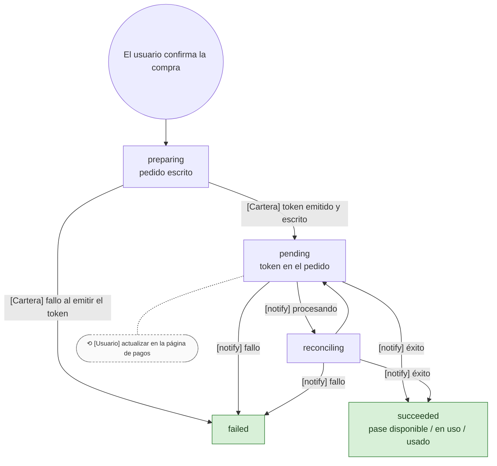

# B5 Billetes de llamada de pago

[Volver al índice](../README.md) · B · Pagos y cobros

## Diagrama de estados

GitHub muestra directamente el bloque Mermaid de abajo; si no se ve bien, abra el SVG.

[SVG](diagrams/B5.svg) · [Fuente Mermaid](diagrams/B5.mmd)

## Tabla de estados

| ID | Estado (nombre en código) | Condición de entrada | Dónde están los fondos / datos | Interfaz | Qué puede hacer el usuario | ¿Final? | Ubicación en el código |
|---|---|---|---|---|---|---|---|
| B5-01 | `preparing` → `Preparing` | El usuario confirma la compra; fila del pedido escrita | Token aún no emitido; o emitido pero aún no escrito | Pagando | Continuar / cancelar | No | `R/app_storage/rtc_tickets.rs:110`; `R/rtc/payments.rs:132` |
| B5-02 | `pending` / `reconciling` → `Confirming` | Token escrito en el pedido y entregado a notify | Token en el pedido | Confirmando; la página de confirmación solo ofrece Continue | Seguir consultando | No | `rtc_tickets.rs:128-141`; `R/rtc/payments.rs:58-59`, `:177-199`, `:329` |
| B5-03 | `succeeded` → `Available` / `UsePending` / `Used` | notify confirmó; después se proyecta según el uso | Pase | Disponible / en uso / usado | Llamar | Sí (lado del pago) | `rtc_tickets.rs:143-153` |
| B5-04 | `failed` → `Failed` | notify devolvió fallo, o la cartera no pudo emitir el token | Token borrado | Fallido | — | Sí | `rtc_tickets.rs:118-125`, `:152` |

«Igual que arriba» se refiere a la fila anterior de la tabla. En la columna de interfaz, los valores `xxx.yyy` son claves de localización.
