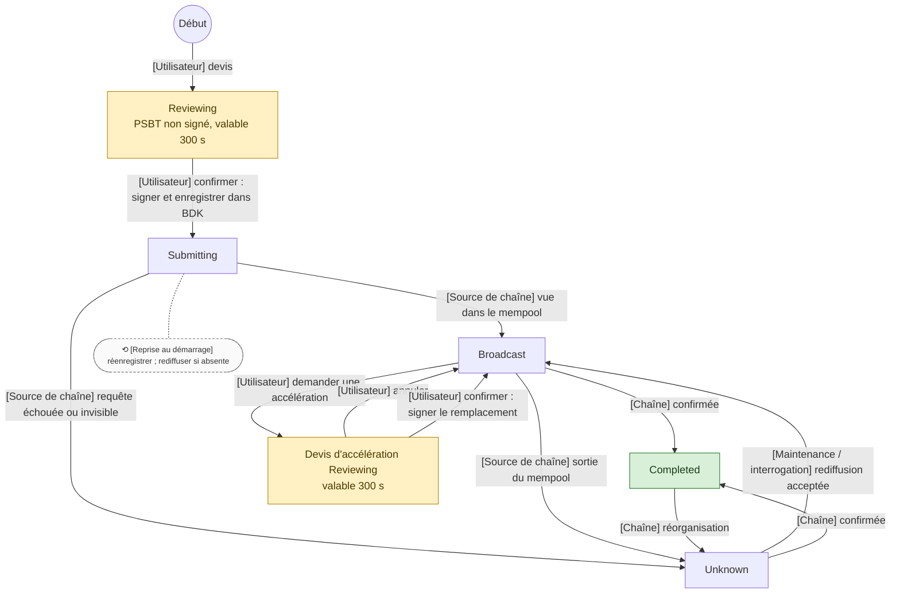
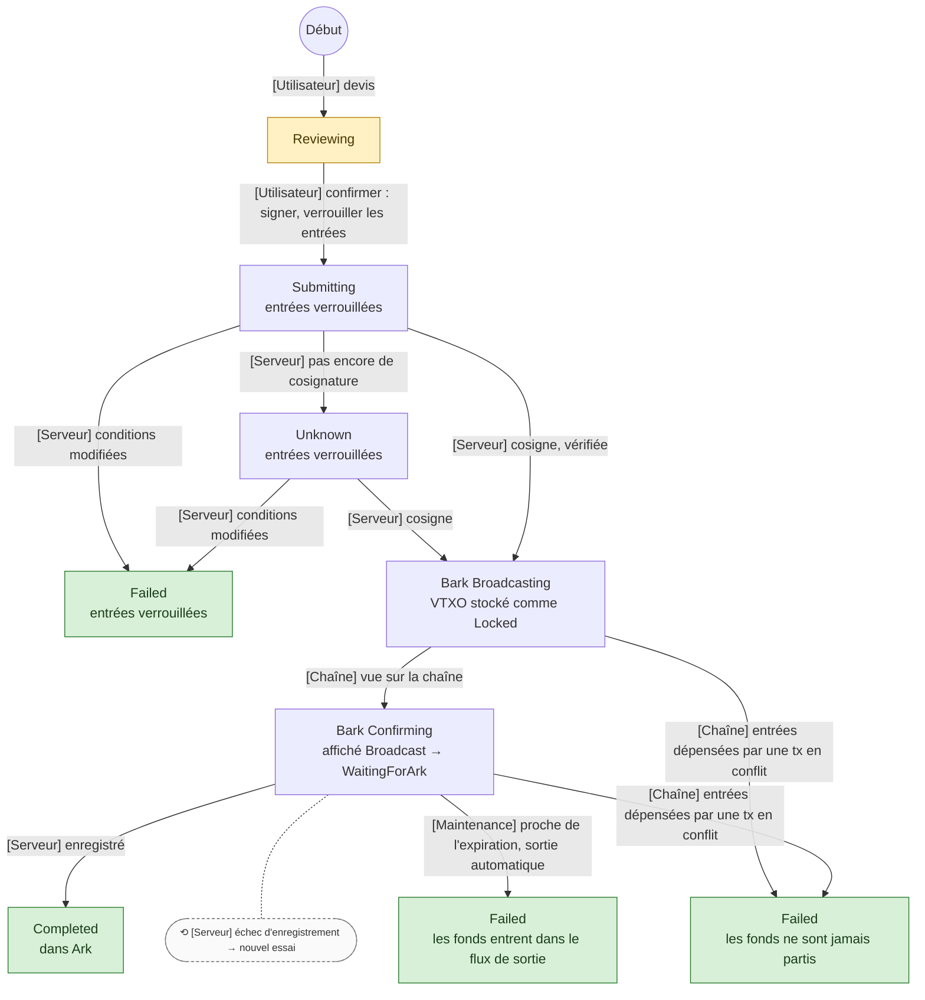

# A1 Dépôt vers Ark, envoi direct de BTC, accélération RBF

[Retour au sommaire](../README.md) · A · Fonds on-chain et Ark

## Diagramme d'états

GitHub affiche directement le bloc Mermaid ci-dessous ; en cas de problème d'affichage, ouvrez le SVG.

### A1a Envoi direct de BTC (avec RBF)

[SVG](diagrams/A1a.svg) · [Source Mermaid](diagrams/A1a.mmd)

### A1b Dépôt vers Ark

[SVG](diagrams/A1b.svg) · [Source Mermaid](diagrams/A1b.mmd)

## Tableau d'états

### Enregistrement partagé (`keychat_bitcoin_transfers`)

| ID | État (nom dans le code) | Condition d'entrée | Où sont les fonds / données | Affichage | Ce que l'utilisateur peut faire | Terminal ? | Emplacement dans le code |
|---|---|---|---|---|---|---|---|
| A1-01 | `Reviewing` | Persisté dès la génération du devis ; valable 300 s | PSBT non signé ; les fonds restent dans le portefeuille on-chain, non verrouillés | `wallet.bitcoin.review` | Confirmer ; ou abandonner le devis (les devis d'accélération peuvent être supprimés) | Non (pas de nettoyage à l'expiration ; une confirmation après expiration est refusée) | `W/ark/bitcoin/transfer.rs:308-336`, `:355-358` |
| A1-02 | `Submitting` | Signé ; `signed_tx_hex` écrit | Tx signée stockée localement ; l'envoi direct est déjà `register_tx` dans BDK et compté comme dépensé ; entrées de l'onboard verrouillées | `wallet.bitcoin.submitting` + `wallet.bitcoin.unknown-help` | Attendre uniquement | Non | direct send `W/ark/bitcoin/transfer.rs:382-393`; onboard `W/ark/bark_runtime/onboard.rs:220-236` |
| A1-03 | `Broadcast` | La source de chaîne signale le mempool | Tx dans le mempool | `wallet.bitcoin.onboard.awaiting-confirmation` + `wallet.bitcoin.waiting-chain` | Attendre ; l'envoi direct peut faire un RBF | Non | direct `W/ark/bitcoin/replacement.rs:803-807`; onboard `W/ark/bark_runtime/onboard.rs:339` |
| A1-04 | `WaitingForArk` | Onboard uniquement : tx de financement confirmée, Ark ne l'a pas encore enregistrée | Fonds dans la sortie du board ; VTXO du board verrouillé par le movement | Idem + `wallet.bitcoin.waiting-ark` | Attendre | Non | `W/ark/bark_runtime/onboard.rs:336-338` |
| A1-05 | `Unknown` | Échec de la requête à la source de chaîne, tx invisible, onboard sans cosignature, ou movement absent | Envoi direct : tx signée toujours dans BDK ; onboard : entrées verrouillées | `wallet.bitcoin.checking` + `wallet.bitcoin.unknown-help` | Attendre | Non | direct `W/ark/bitcoin/replacement.rs:806`, `:808-809`; onboard `W/ark/bark_runtime/onboard.rs:311-313`, `:340-345`; projected as Unknown without chain source `W/ark/provider/shared_bitcoin.rs:818-840` |
| A1-06 | `Completed` | Envoi direct : une tentative confirmée ; onboard : movement réussi avec preuve de sortie | Envoi direct : livré ; onboard : dans Ark | `wallet.bitcoin.completed` | — | Oui (l'envoi direct peut revenir à Unknown après une réorganisation de la chaîne) | `W/ark/bitcoin/replacement.rs:796-802`; `W/ark/bark_runtime/onboard.rs:325-327` |
| A1-07 | `Failed` | Onboard uniquement : conditions du serveur modifiées (`submit_signed_board` renvoie None), ou movement Bark Failed/Canceled | Si les conditions changent : les entrées restent verrouillées ; si le movement échoue : les fonds peuvent être dans une sortie | `wallet.bitcoin.failed` ("Transfer failed. Review a new quote to try again.") | Nouveau devis | Oui | `W/ark/bark_runtime/onboard.rs:306-310`, `:328-329` |

### États Bark superposés à l'onboard (`Board.progress`)

| ID | État (nom dans le code) | Condition d'entrée | Où sont les fonds / données | Affichage | Ce que l'utilisateur peut faire | Terminal ? | Emplacement dans le code |
|---|---|---|---|---|---|---|---|
| A1-08 | `Broadcasting` | Cosignature obtenue, VTXO construit | Tx de financement à diffuser ; VTXO stocké comme Locked | — | Vue sur la chaîne → `Confirming` ; entrées en conflit avec une tx confirmée → échec ; sinon en attente | Non | `BK/actions/board.rs:147-160`, `:230-283` |
| A1-09 | `Confirming` | Tx de financement dans le mempool ou un bloc | VTXO du board Locked, compté dans `pending_board` | — | Enregistrer dès que les confirmations suffisent ; réessayer en cas d'échec d'enregistrement ; lancer une sortie à l'approche de l'expiration | Non | `BK/actions/board.rs:290-393` |
| A1-10 | movement `Failed` (après la sortie) | VTXO sorti, ou entrées dépensées par une tx en conflit | Premier cas : dans une sortie ; second cas : les fonds ne sont jamais partis | — | Terminal | Oui | `BK/actions/board.rs:299-314` |

### Accélération RBF (« lignée » de l'envoi direct)

| ID | État (nom dans le code) | Condition d'entrée | Où sont les fonds / données | Affichage | Ce que l'utilisateur peut faire | Terminal ? | Emplacement dans le code |
|---|---|---|---|---|---|---|---|
| A1-11 | Devis d'accélération `Reviewing` + `replacement` | L'utilisateur demande une accélération ; conditions remplies | PSBT de remplacement non signé, valable 300 s | — | Confirmer ; ou annuler (supprime seulement l'enregistrement non signé) | Non (suit la lignée) | `W/ark/bitcoin/replacement.rs:378-401`, `:403-450` |
| A1-12 | Parent avec `replaced_by`, enfant signé | L'utilisateur confirme | Parent et enfant validés dans une seule transaction | — | Attendre | Non (suit la lignée) | `W/ark/bitcoin/replacement.rs:825-860` |
| A1-13 | État de la lignée | La tentative confirmée passe à Completed, les autres restent inchangées ; la tête est jugée selon mempool / non vue | — | — | — | Non (suit la lignée) | `W/ark/bitcoin/replacement.rs:786-823` |

« Idem » renvoie à la ligne précédente du tableau. Dans la colonne d'affichage, les valeurs `xxx.yyy` sont des clés de localisation.
