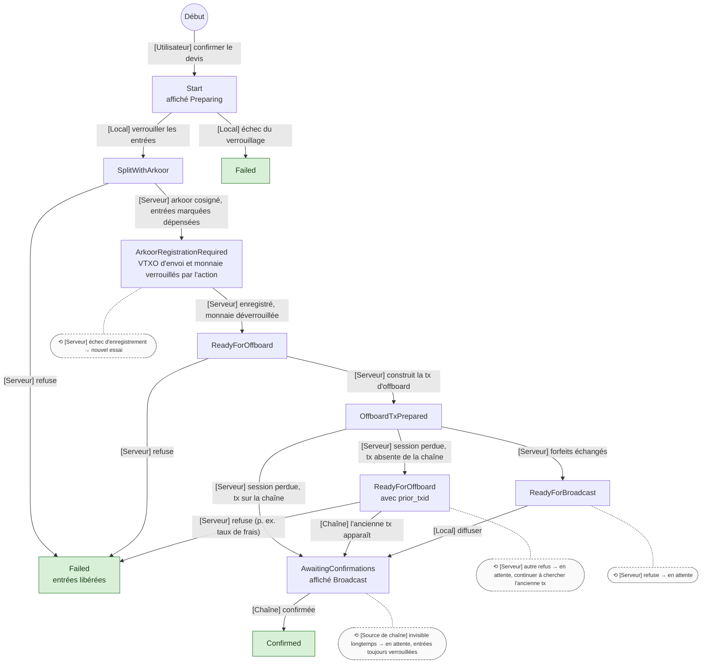

# A2 Envoi de BTC depuis Ark vers une adresse on-chain

[Retour au sommaire](../README.md) · A · Fonds on-chain et Ark

## Diagramme d'états

GitHub affiche directement le bloc Mermaid ci-dessous ; en cas de problème d'affichage, ouvrez le SVG.

[SVG](diagrams/A2.svg) · [Source Mermaid](diagrams/A2.mmd)

## Tableau d'états

| ID | État (nom dans le code) | Condition d'entrée | Où sont les fonds / données | Affichage | Ce que l'utilisateur peut faire | Terminal ? | Emplacement dans le code |
|---|---|---|---|---|---|---|---|
| A2-01 | `Preparing` (Bark `Start` / `SplitWithArkoor`) | L'utilisateur confirme ; le point de contrôle de l'action est écrit | VTXO d'entrée verrouillés par l'action | `wallet.bitcoin-send.preparing` ("Payment in progress") | « Vérifier l'état » | Non | projection `W/ark/bark_runtime/bitcoin_send.rs:105-111`, `:127-139`; locking `BK/actions/offboard.rs:553-572` |
| A2-02 | `Preparing` (Bark `ArkoorRegistrationRequired`) | Découpage arkoor effectué ; entrées d'origine marquées dépensées | Le VTXO d'envoi découpé **et la monnaie** sont tous deux verrouillés par l'action, en attente d'enregistrement auprès du serveur | Idem | Idem | Non | `BK/actions/offboard.rs:605-636`, `:641-661` |
| A2-03 | `Preparing` (Bark `ReadyForOffboard` / `OffboardTxPrepared` / `ReadyForBroadcast`) | Enregistré ; tx d'offboard et forfeits échangés avec le serveur | VTXO d'envoi verrouillé ; monnaie déverrouillée | Idem | Idem | Non | `BK/actions/offboard.rs:263-286`, `:670-760` |
| A2-04 | `Broadcast` (Bark `AwaitingConfirmations`) | Tx d'offboard diffusée | Fonds dans une tx on-chain ; VTXO cédés (forfeit) | `wallet.bitcoin-send.broadcast` | « Vérifier l'état » | Non | `bitcoin_send.rs:109`; `BK/actions/offboard.rs:287-326` |
| A2-05 | `Confirmed` | Movement réussi | Livré à l'adresse du destinataire | `wallet.bitcoin-send.confirmed` | — | Oui | `bitcoin_send.rs:106` |
| A2-06 | `Failed` | Movement Failed / Canceled (Bark libère les entrées en cas d'échec dans `Start`, `SplitWithArkoor` ou un `ReadyForOffboard` antérieur au forfeit) | Entrées à nouveau dépensables | `wallet.bitcoin-send.failed` | Nouveau devis | Oui | `bitcoin_send.rs:107`; `BK/actions/offboard.rs:352-414` |
| A2-07 | Résultat inconnu (l'appel de confirmation a expiré ou échoué) | `start_send_onchain_confirmed` a écrit le point de contrôle mais a expiré | Selon l'état Bark sous-jacent | `wallet.bitcoin-send.uncertain` | Vérifier l'opération d'origine ; impossible d'en lancer une autre | Non | `bitcoin_send.rs:73-79`; `iOS/Wallet/Views/Forms/ArkBitcoinSendReview.swift:240-242` |

« Idem » renvoie à la ligne précédente du tableau. Dans la colonne d'affichage, les valeurs `xxx.yyy` sont des clés de localisation.
