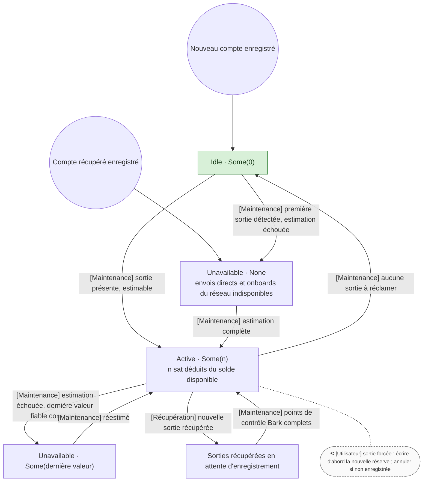

# A3 Réserve de frais de sortie

[Retour au sommaire](../README.md) · A · Fonds on-chain et Ark

## Diagramme d'états

GitHub affiche directement le bloc Mermaid ci-dessous ; en cas de problème d'affichage, ouvrez le SVG.

[SVG](diagrams/A3.svg) · [Source Mermaid](diagrams/A3.mmd)

## Tableau d'états

| ID | État (nom dans le code) | Condition d'entrée | Où sont les fonds / données | Affichage | Ce que l'utilisateur peut faire | Terminal ? | Emplacement dans le code |
|---|---|---|---|---|---|---|---|
| A3-01 | `Idle`, `remaining_sats = Some(0)` | Nouveau compte enregistré ; aucune sortie à réclamer | Aucune réserve | Aucun | — | Non (peut redevenir Active) | registration `W/ark/bitcoin.rs:259-271`; zeroing `W/ark/bark_runtime/exit_fee.rs:195-200` |
| A3-02 | `Active`, `Some(n)` | Une sortie est en cours et les frais peuvent être estimés | n sat du BTC partagé sont réservés et déduits du solde disponible | La structure de solde comporte `reserved_sats` / `available_sats` (`W/ark/types.rs:429-439`) | Les envois qui empiètent sur la réserve demandent une confirmation explicite (`BitcoinExitReserveImpact`) | Non | `exit_fee.rs:215-221`, `:116-122` |
| A3-03 | `Unavailable`, `Some(dernière valeur)` | Estimation échouée ; dernière valeur fiable conservée | Idem | Idem | Idem | Non | `exit_fee.rs:207-212`; retention rule `W/ark/bitcoin.rs:322-330` |
| A3-04 | `Unavailable`, `None` | Récupération lancée, nouvelle sortie récupérée, première sortie détectée depuis Idle, ou nouvelle sortie autorisée sans réestimation | Réserve inconnue ; les envois directs et les onboards sur le même réseau sont indisponibles | Les envois échouent | Aucun | Non | `W/ark/bitcoin.rs:62-77`, `:245-251`, `:259-267`; `exit_fee.rs:123-131`; error site `W/ark/bitcoin/transfer.rs:232-235` |
| A3-05 | Sorties récupérées en attente d'enregistrement (`pending_recovered_exit_ids` non vide) | Sorties récupérées enregistrées, points de contrôle Bark incomplets | Idem | Idem | Aucun | Non | `W/ark/bitcoin.rs:69`; rejected on read `transfer.rs:231-234`; cleared `exit_fee.rs:92-105` |

« Idem » renvoie à la ligne précédente du tableau. Dans la colonne d'affichage, les valeurs `xxx.yyy` sont des clés de localisation.
