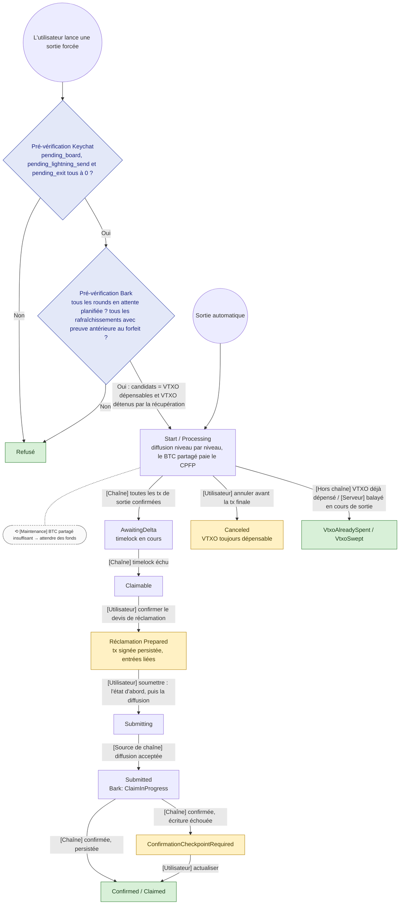

# A4 Sortie forcée et réclamation

[Retour au sommaire](../README.md) · A · Fonds on-chain et Ark

## Diagramme d'états

GitHub affiche directement le bloc Mermaid ci-dessous ; en cas de problème d'affichage, ouvrez le SVG.

[SVG](diagrams/A4.svg) · [Source Mermaid](diagrams/A4.mmd)

## Tableau d'états

### Sortie (une par VTXO)

| ID | État (nom dans le code) | Condition d'entrée | Où sont les fonds / données | Affichage | Ce que l'utilisateur peut faire | Terminal ? | Emplacement dans le code |
|---|---|---|---|---|---|---|---|
| A4-01 | `Start` / `Processing` | L'utilisateur confirme la sortie forcée, ou le système sort automatiquement pour un board / HTLC | Les tx de la chaîne de sortie sont diffusées niveau par niveau ; le BTC partagé paie le CPFP | `wallet.ark.exit-in-progress`, `wallet.ark.pending-funding`, `wallet.ark.refresh-to-progress-exit` | Rafraîchir pour avancer ; ajouter des fonds on-chain | Non | `BK/exit/progress/mod.rs:45-56`; funding check `W/ark/bark_runtime/exit_fee.rs:225-250` |
| A4-02 | `AwaitingDelta` | Toutes les tx de sortie confirmées | Sortie de sortie, timelock pas encore échu | `wallet.ark.claim-timelock-running` | Attendre | Non | `BK/exit/progress/mod.rs:57` |
| A4-03 | `Claimable` | Timelock échu | Sortie de sortie, dépensable uniquement par l'utilisateur | `wallet.ark.claim-to-bitcoin-address` | Réclamer | Non | `BK/exit/progress/states.rs:356-361` |
| A4-04 | `ClaimInProgress` | Une tx du mempool dépensant la sortie apparaît | Tx de réclamation dans le mempool | `wallet.ark.claim-in-progress` | Attendre | Non ; revient à `Claimable` si elle sort du mempool | `BK/exit/progress/states.rs:367-389` |
| A4-05 | `Claimed` | Tx de dépense confirmée | À l'adresse de l'utilisateur | — | — | Oui | `BK/exit/progress/states.rs:344-349`, `:375-378` |
| A4-06 | `VtxoAlreadySpent` / `VtxoSwept` | VTXO déjà dépensé hors chaîne ; ou balayé par le serveur en cours de sortie | Aucun | — | — | Oui | `BK/exit/models/mod.rs:40-47` |
| A4-07 | `Canceled` | Annulée avant la diffusion de la tx finale | VTXO toujours dépensable | — | Recommencer | Reprenable | `BK/exit/models/mod.rs:48-51` |

### Enregistrement de réclamation Keychat (`ark_claims` ; entrées liées 1:1 à une tx signée)

| ID | État (nom dans le code) | Condition d'entrée | Où sont les fonds / données | Affichage | Ce que l'utilisateur peut faire | Terminal ? | Emplacement dans le code |
|---|---|---|---|---|---|---|---|
| A4-08 | `Prepared` | L'utilisateur confirme le devis ; tx signée persistée ; entrées enregistrées dans `ark_claim_inputs` | — | `wallet.ark.claim-prepared` | « Soumettre la tx d'origine » | Non | `W/ark/bark_runtime/exit_claim.rs:46-61`; `W/ark/claim_store.rs:189-218` |
| A4-09 | `Submitting` | Diffusion lancée (l'état est écrit avant la diffusion) | — | Réclamation en cours | Attendre | Non | `exit_claim.rs:97-104`; `claim_store.rs:262-271` |
| A4-10 | `Submitted` | Diffusion réussie, ou la source de chaîne signale le mempool | — | `wallet.ark.claim-in-progress-message` | « Actualiser » | Non | `claim_store.rs:272-279`; `exit_claim.rs:140-142` |
| A4-11 | `ConfirmationCheckpointRequired` (projection) | Confirmée sur la chaîne mais l'écriture en base a échoué | — | `wallet.ark.claim-confirmation-checkpoint-required` | Actualiser | Non | `exit_claim.rs:130-139`, `:153-159` |
| A4-12 | `Confirmed` | Confirmée sur la chaîne et persistée | — | Réclamé | — | Oui | `claim_store.rs:287-293` |

« Idem » renvoie à la ligne précédente du tableau. Dans la colonne d'affichage, les valeurs `xxx.yyy` sont des clés de localisation.
