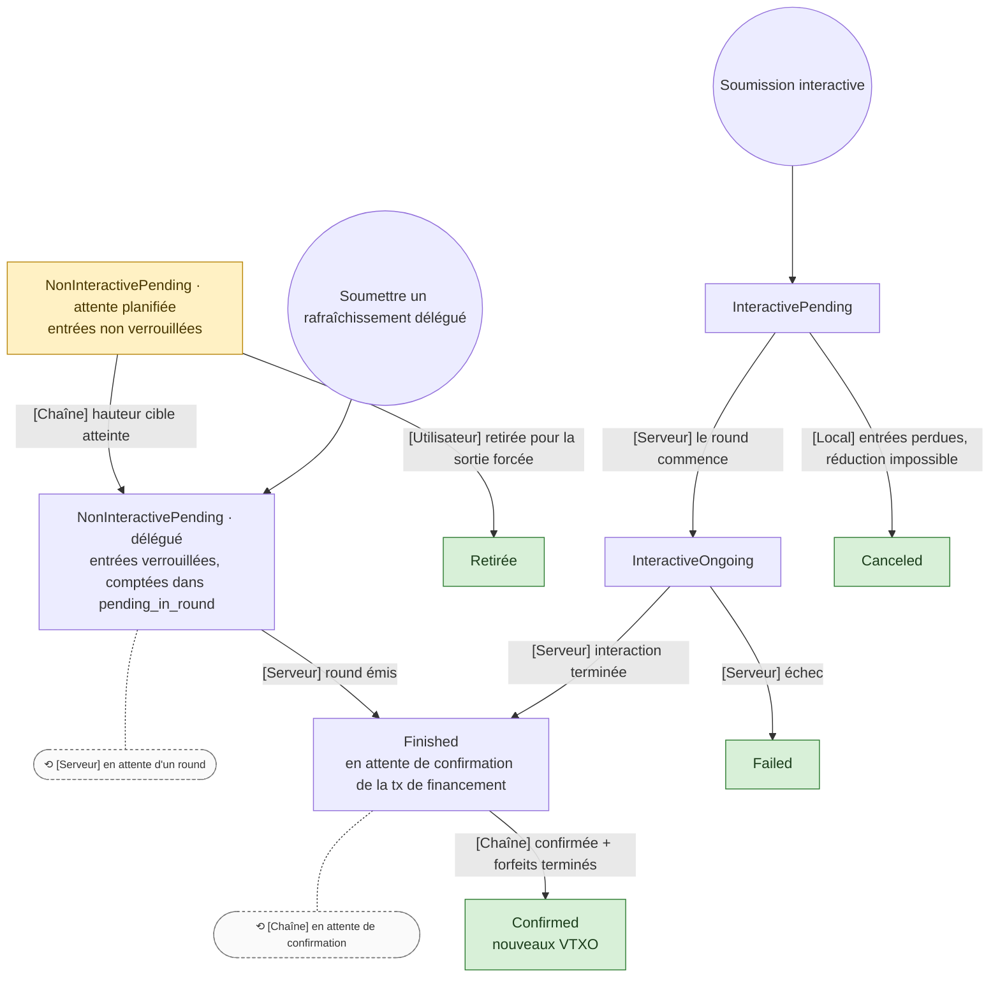
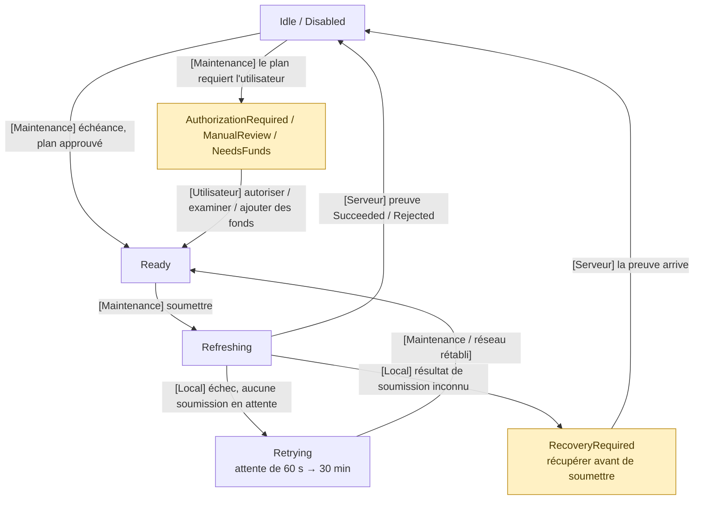

# A5 Rafraîchissement et maintenance automatique

[Retour au sommaire](../README.md) · A · Fonds on-chain et Ark

## Diagramme d'états

GitHub affiche directement le bloc Mermaid ci-dessous ; en cas de problème d'affichage, ouvrez le SVG.

### A5a Un rafraîchissement (round Bark)

[SVG](diagrams/A5a.svg) · [Source Mermaid](diagrams/A5a.mmd)

### A5b Phase de maintenance Keychat (par compte)

[SVG](diagrams/A5b.svg) · [Source Mermaid](diagrams/A5b.mmd)

## Tableau d'états

### Un rafraîchissement (round Bark)

| ID | État (nom dans le code) | Condition d'entrée | Où sont les fonds / données | Affichage | Ce que l'utilisateur peut faire | Terminal ? | Emplacement dans le code |
|---|---|---|---|---|---|---|---|
| A5-01 | `NonInteractivePending{scheduled_height: Some}` | Rafraîchissement planifié accepté par le serveur, en attente de la hauteur cible ; attente planifiée : oui (`is_scheduled_waiting`) | Entrées non verrouillées ; sortie forcée toujours possible | — | — | Non | `BK/round/mod.rs:262-267` |
| A5-02 | `NonInteractivePending{scheduled_height: None}` / `Redelegating` | Rafraîchissement délégué soumis, en attente d'un round du serveur ; attente planifiée : non | Entrées verrouillées par le movement, comptées dans `pending_in_round` | — | — | Non | `BK/round/mod.rs:1043-1059`, `:816-830`; balance `BK/balance.rs:190-197` |
| A5-03 | `InteractivePending` / `InteractiveOngoing` | Round interactif en file / en cours ; attente planifiée : non | Idem | — | — | Non | `BK/round/mod.rs:777`, `:783-803` |
| A5-04 | `Finished` (non terminé) | Interaction terminée, en attente de confirmation de la tx de financement du round ; attente planifiée : non | Idem ; forfeits pas encore terminés | — | — | Non | `BK/round/mod.rs:923-959` |
| A5-05 | `Finished` (terminé) → `Confirmed` | Tx de financement confirmée et forfeits terminés ; attente planifiée : — | Nouveaux VTXO | — | — | Oui | `BK/round/mod.rs:771-775`, `:937-948` |
| A5-06 | `Failed` / `Canceled` | Round échoué, annulé par l'utilisateur, ou entrées perdues sans réduction possible ; attente planifiée : — | Entrées libérées | — | — | Oui | `BK/round/mod.rs:793-813` |

### Phase de maintenance Keychat (par compte)

| ID | État (nom dans le code) | Condition d'entrée | Où sont les fonds / données | Affichage | Ce que l'utilisateur peut faire | Terminal ? | Emplacement dans le code |
|---|---|---|---|---|---|---|---|
| A5-07 | `Idle` / `Disabled` | Aucun rafraîchissement nécessaire / rafraîchissement automatique désactivé | — | `disabled-title` | Activer, ou rafraîchir manuellement | Non (au repos) | `W/ark/maintenance.rs:72-75` |
| A5-08 | `Ready` / `Refreshing` | Plan approuvé / soumis | — | — | Attendre | Non | `W/ark/provider/maintenance.rs:530-538` |
| A5-09 | `Retrying` | Attente après échec 60 s → 30 min | — | — | Attendre | Non | `W/ark/maintenance.rs:132-146` |
| A5-10 | `RecoveryRequired` | Résultat de la soumission inconnu ; récupérer d'abord | — | — | Attendre (revérifié toutes les `URGENT_CHECK_SECONDS`) | Non | `W/ark/provider/maintenance.rs:241-258` |
| A5-11 | `AuthorizationRequired` / `ManualReview` / `NeedsFunds` | Nécessite une autorisation de frais, une revue manuelle ou plus de fonds | — | `authorization-*`, `funds-title`, etc. | Autoriser, examiner ou ajouter des fonds | Non (en attente de l'utilisateur) | `W/ark/maintenance.rs:35-62` |

« Idem » renvoie à la ligne précédente du tableau. Dans la colonne d'affichage, les valeurs `xxx.yyy` sont des clés de localisation.
