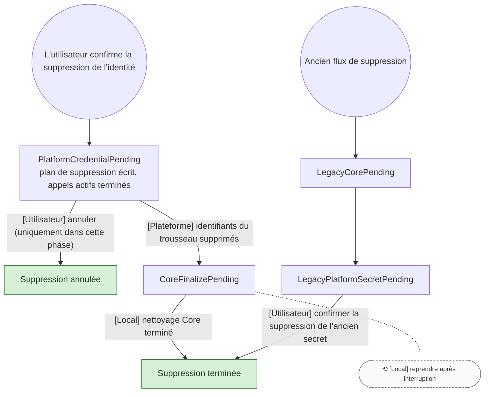

# D1 Suppression d'identité

[Retour au sommaire](../README.md) · D · Identité, appareil et récupération

## Diagramme d'états

GitHub affiche directement le bloc Mermaid ci-dessous ; en cas de problème d'affichage, ouvrez le SVG.

[SVG](diagrams/D1.svg) · [Source Mermaid](diagrams/D1.mmd)

## Tableau d'états

| ID | État (nom dans le code) | Condition d'entrée | Où sont les fonds / données | Affichage | Ce que l'utilisateur peut faire | Terminal ? | Emplacement dans le code |
|---|---|---|---|---|---|---|---|
| D1-01 | `PlatformCredentialPending` | L'utilisateur confirme la suppression ; Core écrit le plan de suppression ; les appels actifs de l'identité sont terminés | Identité toujours présente ; tout nouveau travail est bloqué | — | Annuler (uniquement dans cette phase) | Non | `A/data_store/identity_deletion.rs:6-50`; rollback `A/app_storage/identities.rs:1386-1409` |
| D1-02 | `CoreFinalizePending` | La plateforme confirme la suppression des identifiants du trousseau | Identifiants supprimés ; données Core en attente de nettoyage | — | Continuer (répétable) | Non | `identity_deletion.rs:54-82`, `:101-138` |
| D1-03 | `LegacyCorePending` / `LegacyPlatformSecretPending` | Points intermédiaires de l'ancien flux de suppression | Idem | — | Continuer ; confirmer la suppression de l'ancien secret | Non | `identity_deletion.rs:121-126`, `:237`, `:271` |
| D1-04 | Suppression terminée | Nettoyage Core terminé ; ligne de suppression retirée | Identité disparue | — | — | Oui | — |

« Idem » renvoie à la ligne précédente du tableau. Dans la colonne d'affichage, les valeurs `xxx.yyy` sont des clés de localisation.
