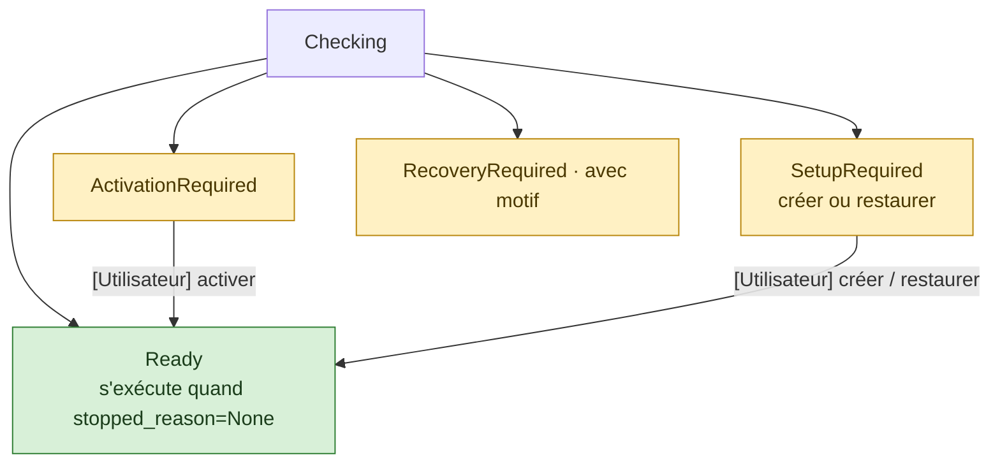
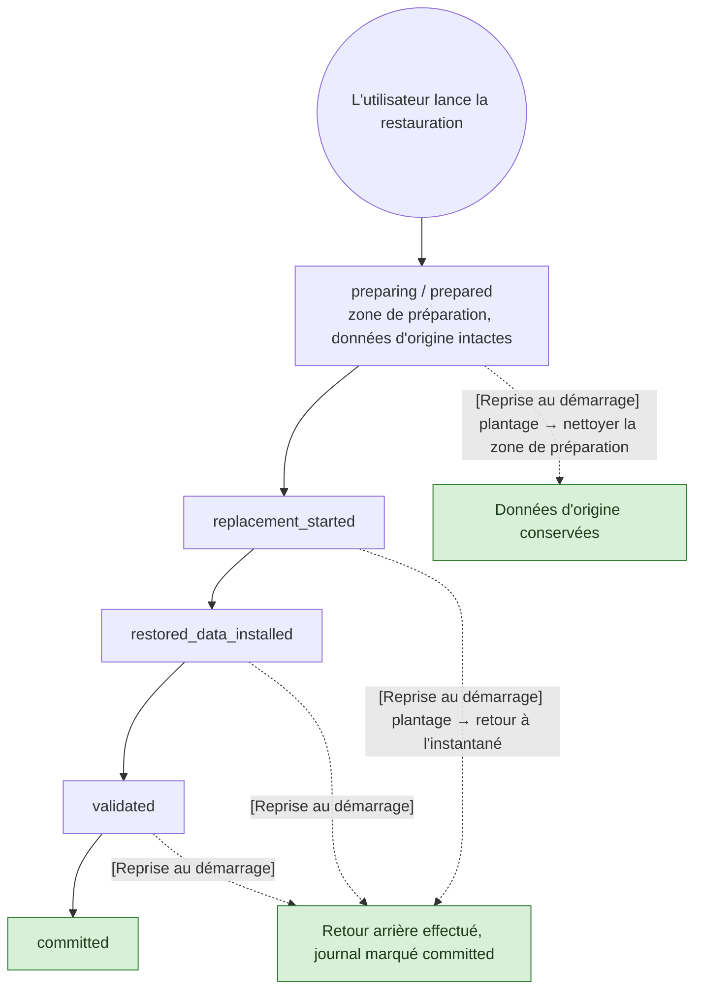

# D2 Activation de l'appareil, démarrage et restauration de sauvegarde

[Retour au sommaire](../README.md) · D · Identité, appareil et récupération

## Diagramme d'états

GitHub affiche directement le bloc Mermaid ci-dessous ; en cas de problème d'affichage, ouvrez le SVG.

### D2a Démarrage

[SVG](diagrams/D2a.svg) · [Source Mermaid](diagrams/D2a.mmd)

### D2b Restauration de sauvegarde (journal de transactions iOS)

[SVG](diagrams/D2b.svg) · [Source Mermaid](diagrams/D2b.mmd)

## Tableau d'états

### Démarrage

| ID | État (nom dans le code) | Condition d'entrée | Où sont les fonds / données | Affichage | Ce que l'utilisateur peut faire | Terminal ? | Emplacement dans le code |
|---|---|---|---|---|---|---|---|
| D2-01 | `Checking` | Lancement | — | — | Attendre | Non | `A/device_activation.rs:61-62` |
| D2-02 | `SetupRequired` | Aucune donnée | — | — | Créer ou restaurer | Non (en attente de l'utilisateur) | `:63` |
| D2-03 | `ActivationRequired{pending}` | Données présentes, activation non vérifiée | — | — | Activer | Non (en attente de l'utilisateur) | `:64-66` |
| D2-04 | `RecoveryRequired{reason}` | Restauration bloquée, clé de base absente, stockage indisponible / incompatible, trousseau indisponible, identifiants en conflit, politique non prise en charge | — | — | Agir selon le motif | Non (en attente de l'utilisateur) | `:49-58`, `:67-69` |
| D2-05 | `Ready{stopped_reason}` | Tout est prêt ; ou en pause manuelle / comme source de migration / comme cible de migration | — | — | — | Oui (au repos) | `:70-80` |

### Restauration de sauvegarde (progression Core) et journal de transactions iOS

| ID | État (nom dans le code) | Condition d'entrée | Où sont les fonds / données | Affichage | Ce que l'utilisateur peut faire | Terminal ? | Emplacement dans le code |
|---|---|---|---|---|---|---|---|
| D2-06 | `RestoreInspecting` / `RestoreValidating` / `RestoreStaging` (iOS: `preparing` / `prepared`) | — | Zone de préparation ; données d'origine intactes | — | Zone de préparation nettoyée au démarrage | Non | `A/backup_restore.rs:606-621`; `iOS/Services/BackupRestoreTransaction.swift:197-199` |
| D2-07 | `RestoreReplacingLocalData` / `RestoreWritingKeychain` (iOS: `replacement_started` / `restored_data_installed`) | — | Instantané des données d'origine + nouvelles données | — | Retour à l'instantané au démarrage ; le journal est ensuite marqué committed pour éviter un second retour | Non | `BackupRestoreTransaction.swift:200-205`, `:209-258` |
| D2-08 | `RestoreReopeningClient` / `RestoreWalletChecking` (iOS: `validated`) | — | Nouvelles données | — | Idem (retour arrière) | Non | same as above |
| D2-09 | `RestoreComplete` (iOS: `committed`) | — | Nouvelles données ; instantané nettoyé | — | — | Oui | `BackupRestoreTransaction.swift:178-181` |
| D2-10 | `Failed` (iOS: —) | — | Selon le point d'échec | — | Ne peut que revenir à Idle | Oui | `A/backup_restore.rs:698-741` |

« Idem » renvoie à la ligne précédente du tableau. Dans la colonne d'affichage, les valeurs `xxx.yyy` sont des clés de localisation.
