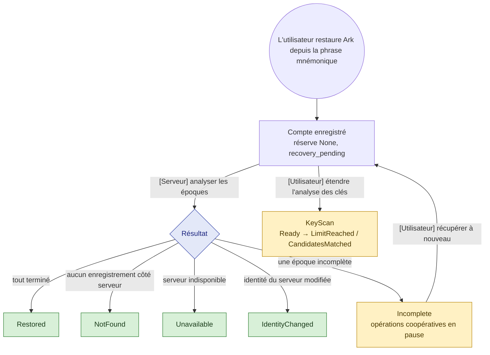

# D3 Récupération du portefeuille

[Retour au sommaire](../README.md) · D · Identité, appareil et récupération

## Diagramme d'états

GitHub affiche directement le bloc Mermaid ci-dessous ; en cas de problème d'affichage, ouvrez le SVG.

[SVG](diagrams/D3.svg) · [Source Mermaid](diagrams/D3.mmd)

## Tableau d'états

| ID | État (nom dans le code) | Condition d'entrée | Où sont les fonds / données | Affichage | Ce que l'utilisateur peut faire | Terminal ? | Emplacement dans le code |
|---|---|---|---|---|---|---|---|
| D3-01 | `Restored` | Toutes les époques terminées | VTXO et sorties récupérés | — | — | Oui | `W/ark/types.rs:69` |
| D3-02 | `NotFound` | Le serveur n'a aucun enregistrement du portefeuille | — | — | Essayer une autre source | Oui | `types.rs:70` |
| D3-03 | `Incomplete` | Une époque incomplète ; le compte reste `recovery_pending`, opérations coopératives refusées, réserve None | Partiellement récupéré | — | Récupérer à nouveau | Non | `W/ark/types.rs:71` |
| D3-04 | `Unavailable` / `IdentityChanged` | Serveur indisponible / l'identité du serveur a changé | — | — | Réessayer plus tard / juger manuellement | Oui (cette tentative) | `types.rs:72-73` |
| D3-05 | Analyse des clés `Ready` / `LimitReached` / `CandidatesMatched` | Analysé jusqu'à la limite ou correspondance par index | Progression de l'analyse | — | Étendre l'analyse | Non | `types.rs:89-108` |
| D3-06 | Analyse de l'historique BTC `Ready` / `LimitReached` / `UnsupportedChainSource` | Idem (BTC partagé) | Adresses découvertes | — | Étendre l'analyse | Non | `types.rs:441-457` |

« Idem » renvoie à la ligne précédente du tableau. Dans la colonne d'affichage, les valeurs `xxx.yyy` sont des clés de localisation.
