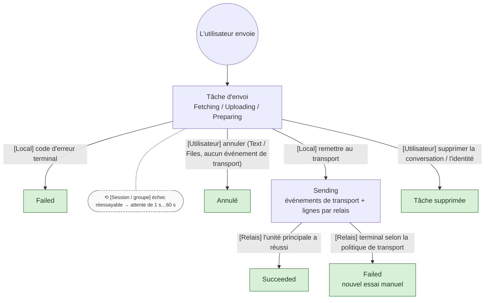

# C1 Envoi de messages

[Retour au sommaire](../README.md) · C · Messagerie et relations

## Diagramme d'états

GitHub affiche directement le bloc Mermaid ci-dessous ; en cas de problème d'affichage, ouvrez le SVG.

[SVG](diagrams/C1.svg) · [Source Mermaid](diagrams/C1.mmd)

## Tableau d'états

| ID | État (nom dans le code) | Condition d'entrée | Où sont les fonds / données | Affichage | Ce que l'utilisateur peut faire | Terminal ? | Emplacement dans le code |
|---|---|---|---|---|---|---|---|
| C1-01 | `Fetching` | Intention d'aperçu de lien inachevée | Tâche d'envoi | Envoi en cours | Texte / fichier annulables | Non | `A/messaging/delivery_queries.rs:420-424` |
| C1-02 | `Uploading` | Intention de pièce jointe inachevée | Tâche d'envoi + pièces jointes locales | Téléversement en cours | Idem | Non | `delivery_queries.rs:425-429` |
| C1-03 | `Preparing` | La tâche existe, pas encore remise au transport | Tâche d'envoi | Envoi en cours | Idem | Non | `delivery_queries.rs:430-432` |
| C1-04 | `Failed` (dans la tâche) | Téléversement en pause | Tâche d'envoi | Échec | Réessayer | Non | `delivery_queries.rs:421-422` |
| C1-05 | `Sending` | Événements de transport créés ; ni succès métier ni état terminal | `app_message_transport_events` + lignes de livraison par relais | Envoi en cours | Attendre | Non | `delivery_queries.rs:443-445` |
| C1-06 | `Succeeded` | L'unité principale a atteint le succès métier | Lignes de livraison | Envoyé | — | Oui | `delivery_queries.rs:433-437` |
| C1-07 | `Failed` (livraison) | La politique de transport le juge terminal | Lignes de livraison | Échec | Nouvel essai manuel (selon `manual_retryable`) | Oui | `delivery_queries.rs:438-442` |

« Idem » renvoie à la ligne précédente du tableau. Dans la colonne d'affichage, les valeurs `xxx.yyy` sont des clés de localisation.
