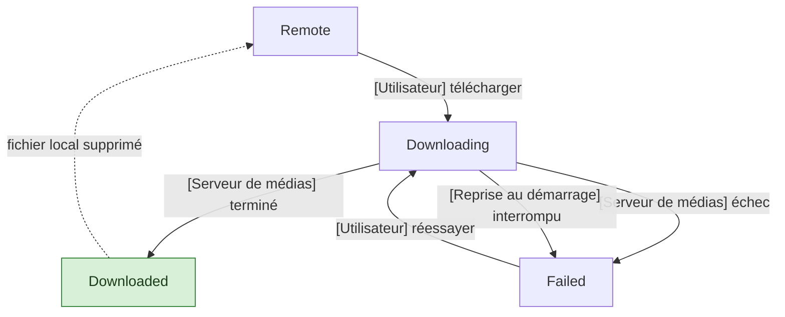
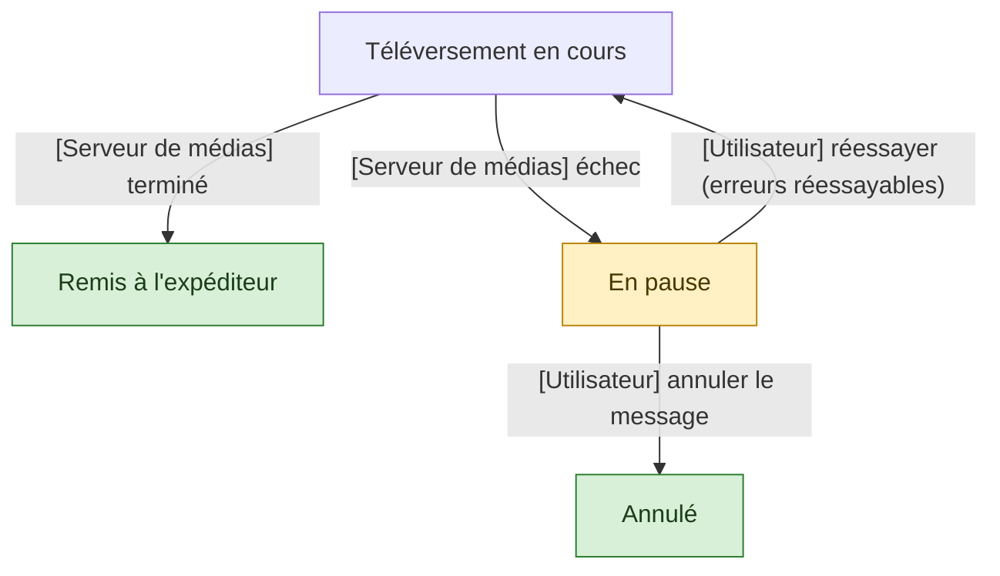

# C2 Envoi et téléchargement de pièces jointes

[Retour au sommaire](../README.md) · C · Messagerie et relations

## Diagramme d'états

GitHub affiche directement le bloc Mermaid ci-dessous ; en cas de problème d'affichage, ouvrez le SVG.

### C2a Téléchargement

[SVG](diagrams/C2a.svg) · [Source Mermaid](diagrams/C2a.mmd)

### C2b Téléversement (partie de la tâche d'envoi)

[SVG](diagrams/C2b.svg) · [Source Mermaid](diagrams/C2b.mmd)

## Tableau d'états

### Téléchargement

| ID | État (nom dans le code) | Condition d'entrée | Où sont les fonds / données | Affichage | Ce que l'utilisateur peut faire | Terminal ? | Emplacement dans le code |
|---|---|---|---|---|---|---|---|
| C2-01 | `Remote` | Non téléchargé | URL distante + clé | Téléchargeable | Téléchargement | Non | `A/data_store/message_snapshot.rs:536-540` |
| C2-02 | `Downloading` | Téléchargement lancé (`transfer_state=1`) | Fichier temporaire | Téléchargement en cours | Attendre | Non | `A/app_storage/attachments.rs:356` |
| C2-03 | `Downloaded` | `transfer_state=2` et le fichier local existe | Fichier local | Ouvrable | — | Oui (revient à la projection Remote si le fichier disparaît) | `message_snapshot.rs:527-535` |
| C2-04 | `Failed` | Téléchargement échoué, ou interruption détectée au démarrage / au redémarrage du runtime | `last_error_code` | Échec | Réessayer | Non | `attachments.rs:462-469`, `:472-492` |

### Téléversement (partie de la tâche d'envoi)

| ID | État (nom dans le code) | Condition d'entrée | Où sont les fonds / données | Affichage | Ce que l'utilisateur peut faire | Terminal ? | Emplacement dans le code |
|---|---|---|---|---|---|---|---|
| C2-05 | Téléversement en cours | Intention de pièce jointe inachevée | — | `Uploading` | Les messages texte / fichier sont annulables | Non | `A/messaging/delivery_queries.rs:425-429` |
| C2-06 | En pause (échec dans la tâche) | L'échec du téléversement écrit `upload_state='paused'` | — | `Failed` | Nouvel essai permis pour les erreurs réessayables ; pas pour une source manquante, une intention invalide ou une cible non sûre | Non | `A/app_storage/message_sender_attachments.rs:349`; `A/message_sender/projection.rs:73-94` |

« Idem » renvoie à la ligne précédente du tableau. Dans la colonne d'affichage, les valeurs `xxx.yyy` sont des clés de localisation.
