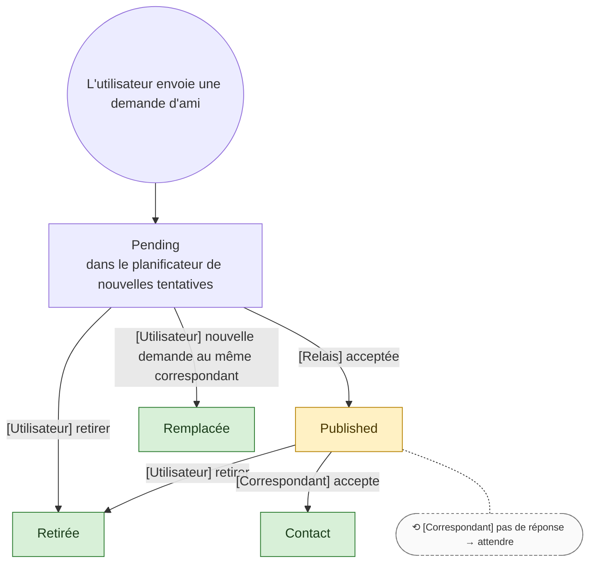

# C3 Demandes d'ami et mise à niveau PQXDH

[Retour au sommaire](../README.md) · C · Messagerie et relations

## Diagramme d'états

GitHub affiche directement le bloc Mermaid ci-dessous ; en cas de problème d'affichage, ouvrez le SVG.

[SVG](diagrams/C3.svg) · [Source Mermaid](diagrams/C3.mmd)

## Tableau d'états

| ID | État (nom dans le code) | Condition d'entrée | Où sont les fonds / données | Affichage | Ce que l'utilisateur peut faire | Terminal ? | Emplacement dans le code |
|---|---|---|---|---|---|---|---|
| C3-01 | `Pending` (côté expéditeur) | Demande soumise au planificateur de nouvelles tentatives de livraison | Demande en attente + session en attente au niveau du protocole | En attente du correspondant | Retirer | Non | `A/friend_request.rs:1260-1263`, `:1611-1625` |
| C3-02 | `Published` | Au moins un relais a accepté | Idem | En attente du correspondant | Retirer | Non | `A/types.rs:3512` |
| C3-03 | Acceptée par le correspondant | Réponse du correspondant reçue | Session établie | Contact | — | Oui | — |
| C3-04 | Retirée | L'utilisateur retire ; ou une nouvelle demande au même correspondant la remplace | Session en attente du protocole et transport effacés | — | — | Oui | `A/friend_request.rs:1265-1369`, `:1220-1258` |
| C3-05 | Nouvelle tentative de mise à niveau PQXDH | L'utilisateur déclenche manuellement | — | Messages distincts pour `Sent` / `AlreadyUpgraded` / `PeerNotReady` / `IneligibleRoom` / `InFlight` | Réessayer plus tard | Renvoie à chaque appel | `A/types.rs:533-540` |

« Idem » renvoie à la ligne précédente du tableau. Dans la colonne d'affichage, les valeurs `xxx.yyy` sont des clés de localisation.
