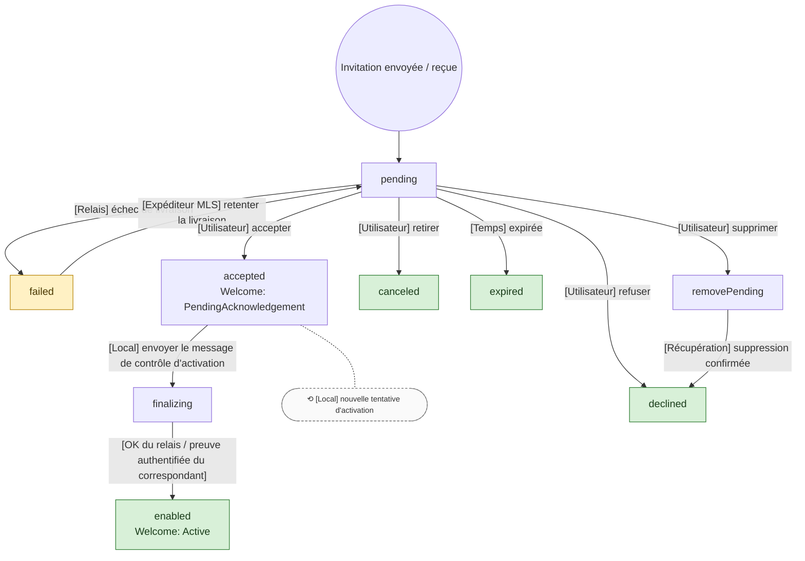

# C4 Invitations de groupe et activation du Welcome MLS

[Retour au sommaire](../README.md) · C · Messagerie et relations

## Diagramme d'états

GitHub affiche directement le bloc Mermaid ci-dessous ; en cas de problème d'affichage, ouvrez le SVG.

[SVG](diagrams/C4.svg) · [Source Mermaid](diagrams/C4.mmd)

## Tableau d'états

| ID | État (nom dans le code) | Condition d'entrée | Où sont les fonds / données | Affichage | Ce que l'utilisateur peut faire | Terminal ? | Emplacement dans le code |
|---|---|---|---|---|---|---|---|
| C4-01 | `pending` | Invitation envoyée ou reçue ; une nouvelle tentative de livraison revient à pending | — | — | Accepter / refuser / retirer | Non | `A/group_invite/outgoing.rs:216`, `:395`; `A/group_invite/welcome.rs:212`; `A/group_invite/delivery.rs:413` |
| C4-02 | `failed` | Échec de livraison, ou échec du traitement de la décision | — | — | L'expéditeur MLS peut retenter la livraison (`group_invite_lifecycle_allows_delivery_retry`) | Non | `outgoing.rs:440`, `:482`, `:519`; `A/group_invite/decisions.rs:244`; `A/group_invite.rs:308-318` |
| C4-03 | `accepted` / `finalizing` | Acceptée ; en attente de l'arrivée du message de contrôle d'activation du membre | — | `PendingAcknowledgement` | Attendre | Non | `A/group_invite/projection.rs:14`, `:24` |
| C4-04 | `enabled` | Preuve d'activation authentifiée ou OK du relais reçu | — | `Active` | — | Oui | `A/group_invite/delivery.rs:513`; `projection.rs:25` |
| C4-05 | `declined` / `canceled` / `expired` | Refusée, retirée, expirée | — | — | — | Oui | `A/group_invite/removal_recovery.rs:55-63`, `:93-103` |
| C4-06 | `removePending` | En attente de confirmation pendant la suppression | — | — | — | Non | `A/group_invite/decisions.rs:175`; `removal_recovery.rs:235`, `:345` |

« Idem » renvoie à la ligne précédente du tableau. Dans la colonne d'affichage, les valeurs `xxx.yyy` sont des clés de localisation.
