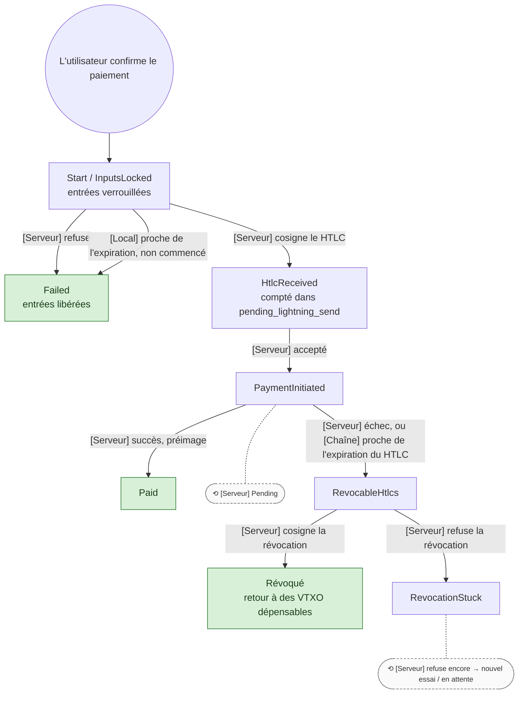
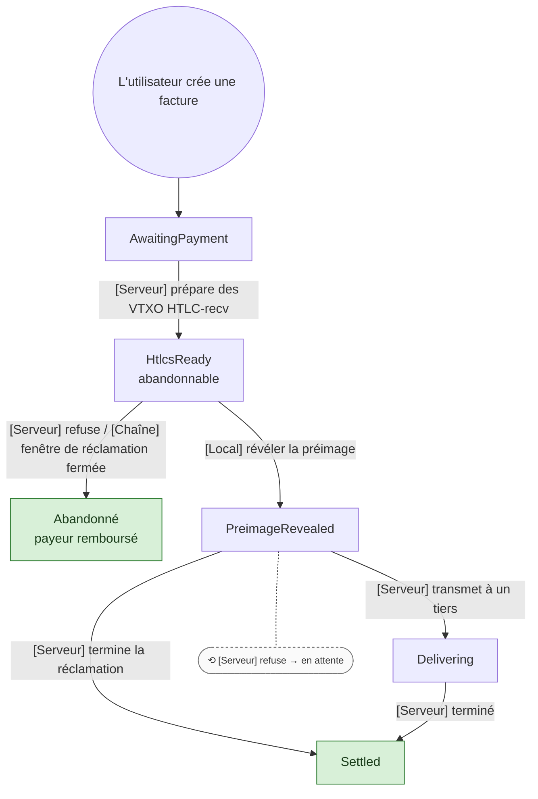

# B1 Envoi et réception Lightning (Ark)

[Retour au sommaire](../README.md) · B · Paiements et encaissements

## Diagramme d'états

GitHub affiche directement le bloc Mermaid ci-dessous ; en cas de problème d'affichage, ouvrez le SVG.

### B1a Envoi (payer une facture)

[SVG](diagrams/B1a.svg) · [Source Mermaid](diagrams/B1a.mmd)

### B1b Réception (émettre une facture)

[SVG](diagrams/B1b.svg) · [Source Mermaid](diagrams/B1b.mmd)

## Tableau d'états

### Envoi

| ID | État (nom dans le code) | Condition d'entrée | Où sont les fonds / données | Affichage | Ce que l'utilisateur peut faire | Terminal ? | Emplacement dans le code |
|---|---|---|---|---|---|---|---|
| B1-01 | `Start` / `InputsLocked` | L'utilisateur confirme le paiement | VTXO d'entrée verrouillés par l'action | `InProgress` | Attendre | Non | `BK/actions/lightning/pay.rs:326-330`, `:221-229` |
| B1-02 | `HtlcReceived` | Le serveur a cosigné les sorties HTLC | VTXO HTLC verrouillés, comptés dans `pending_lightning_send` | `InProgress` | Attendre | Non | `BK/actions/lightning/pay.rs:331-332` |
| B1-03 | `PaymentInitiated` | Le serveur a reçu l'ordre de payer | Idem | `InProgress` | Attendre | Non | `BK/actions/lightning/pay.rs:183-207` |
| B1-04 | `RevocableHtlcs` | Le serveur signale un échec, ou reste Pending près de l'expiration du HTLC | Idem, révocation préparée | `InProgress` | Attendre | Non | `BK/actions/lightning/pay.rs:189-198` |
| B1-05 | `RevocationStuck` | Le serveur refuse de révoquer | Idem | `InProgress{has_failed_revocation: true}` | Attendre | Non | `BK/actions/lightning/pay.rs:260-275`, `:299-315`; `W/ark/bark_runtime.rs:3032-3038`; `iOS/Wallet/Ark/ArkWalletModels.swift:1117` |
| B1-06 | `Paid` | Préimage obtenue | Payé | `Paid` | — | Oui | `BK/actions/lightning/pay.rs:185-188` |
| B1-07 | Révocation effectuée (Done) | Le serveur cosigne la révocation | Retour à des VTXO dépensables | — | — | Oui | `BK/actions/lightning/pay.rs:209-213` |

### Réception

| ID | État (nom dans le code) | Condition d'entrée | Où sont les fonds / données | Affichage | Ce que l'utilisateur peut faire | Terminal ? | Emplacement dans le code |
|---|---|---|---|---|---|---|---|
| B1-08 | `AwaitingPayment` | Facture créée | Aucun | — | — | Non | `BK/actions/lightning/receive.rs:257-258` |
| B1-09 | `HtlcsReady` | Le serveur a préparé les VTXO HTLC-recv | Verrouillé ; encore abandonnable | — | — | Non ; abandonné si la fenêtre de réclamation se ferme ou si la réclamation est refusée | `BK/actions/lightning/receive.rs:259-262`, `:204-211`, `:240-246` |
| B1-10 | `PreimageRevealed` | Préimage révélée au serveur | VTXO HTLC-recv verrouillés, comptés dans `claimable_lightning_receive` | — | — | Non ; en attente après une réclamation échouée | `BK/actions/lightning/receive.rs:263-269`, `:212-224`, `:247-249`; `BK/lightning/receive.rs:205-240` |
| B1-11 | `Delivering` | Les sorties réclamées doivent être transmises à un tiers | Verrouillé | — | — | Non | `BK/actions/lightning/receive.rs:270-273` |
| B1-12 | `Settled` | Réclamation terminée | Nouveaux VTXO | — | — | Oui | `W/ark/bark_runtime.rs:3007-3014` |

« Idem » renvoie à la ligne précédente du tableau. Dans la colonne d'affichage, les valeurs `xxx.yyy` sont des clés de localisation.
