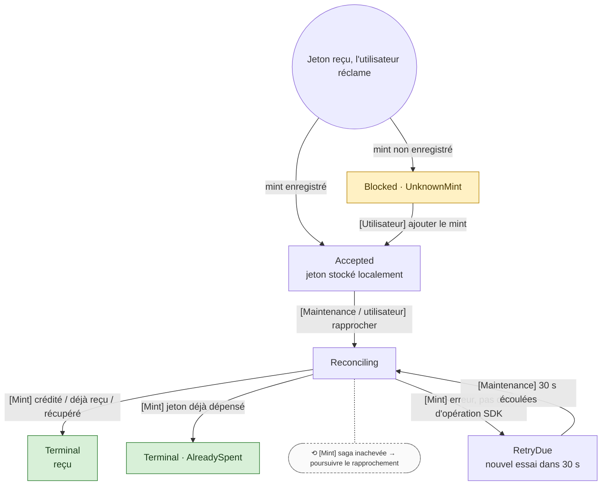

# B2 Réception Cashu

[Retour au sommaire](../README.md) · B · Paiements et encaissements

## Diagramme d'états

GitHub affiche directement le bloc Mermaid ci-dessous ; en cas de problème d'affichage, ouvrez le SVG.

[SVG](diagrams/B2.svg) · [Source Mermaid](diagrams/B2.mmd)

## Tableau d'états

| ID | État (nom dans le code) | Condition d'entrée | Où sont les fonds / données | Affichage | Ce que l'utilisateur peut faire | Terminal ? | Emplacement dans le code |
|---|---|---|---|---|---|---|---|
| B2-01 | `Accepted` | Jeton reçu, mint enregistré | Jeton au porteur dans le stockage local chiffré (la seule copie rejouable) | Réception en cours | Attendre | Non | `W/cashu/receive_store.rs:340-345`; `W/cashu/receive_operations.rs:63` |
| B2-02 | `Blocked` (`UnknownMint`) | Mint non enregistré | Idem | Ajout du mint requis | Ajouter le mint, puis continuer | Non | `receive_store.rs:342-345`; skipped by maintenance `receive_operations.rs:509-512` |
| B2-03 | `Reconciling` | Rapprochement en cours, ou le SDK a déjà une saga pour cela | Jeton + saga CDK | Traitement | Attendre | Non | `receive_operations.rs:188-194`, `:216-226` |
| B2-04 | `RetryDue` (`RetryRequired`) | Le rapprochement a échoué sans id d'opération SDK ; nouvel essai dans 30 s | Jeton | Traitement | Attendre | Non | `receive_operations.rs:192`, `:214-227` |
| B2-05 | `Terminal` (sans incident) | `Credited` / `AlreadyReceived` / `Recovered` obtenu | Dans le solde CDK | Reçu | — | Oui | `receive_operations.rs:196-206` |
| B2-06 | `Terminal` (`AlreadySpent`) | Le mint indique que le jeton est déjà dépensé | Aucun | Erreur `CashuTokenAlreadySpent` | — | Oui | `receive_operations.rs:207-213` |

« Idem » renvoie à la ligne précédente du tableau. Dans la colonne d'affichage, les valeurs `xxx.yyy` sont des clés de localisation.
