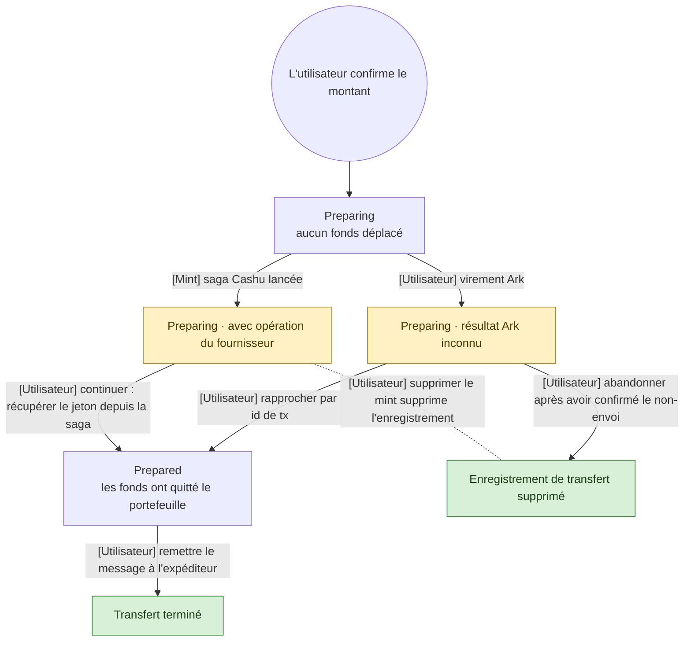
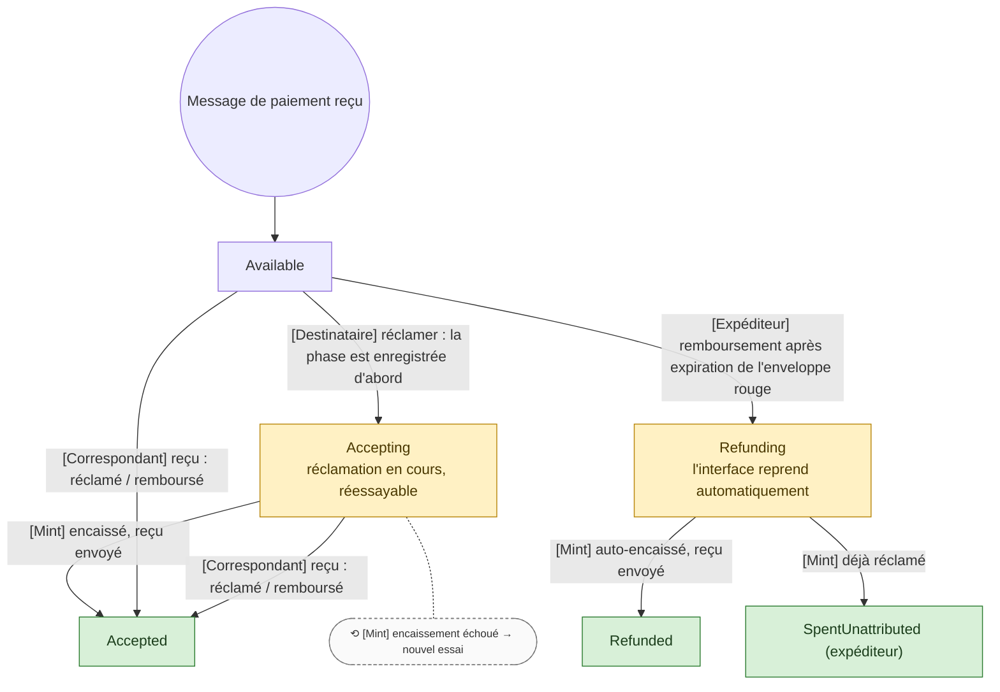

# B3 Virements dans le chat, enveloppes rouges et reçus

[Retour au sommaire](../README.md) · B · Paiements et encaissements

## Diagramme d'états

GitHub affiche directement le bloc Mermaid ci-dessous ; en cas de problème d'affichage, ouvrez le SVG.

### B3a Expéditeur : transfert du portefeuille (un par salon et identité)

[SVG](diagrams/B3a.svg) · [Source Mermaid](diagrams/B3a.mmd)

### B3b Côté message : virement Cashu / enveloppe rouge (message privé Signal)

[SVG](diagrams/B3b.svg) · [Source Mermaid](diagrams/B3b.mmd)

## Tableau d'états

### Expéditeur : transfert du portefeuille (au plus un par salon)

| ID | État (nom dans le code) | Condition d'entrée | Où sont les fonds / données | Affichage | Ce que l'utilisateur peut faire | Terminal ? | Emplacement dans le code |
|---|---|---|---|---|---|---|---|
| B3-01 | `Preparing`, sans opération du fournisseur | L'utilisateur confirme le montant | Aucun fonds déplacé | — | Continuer | Non | `W/ledger.rs:539-606` |
| B3-02 | `Preparing`, avec opération du fournisseur (Cashu) | Saga d'envoi Cashu lancée | Saga côté mint ; le jeton existe peut-être déjà | `wallet.chat.previous-cashu-interrupted` | « Continuer » : récupérer le jeton depuis la saga | Non | `WU/wallet.rs:2752-2810`, `:1880-1931` |
| B3-03 | `Preparing`, résultat Ark non résolu | Résultat du virement Ark inconnu | Peut avoir déjà quitté le compte | `wallet.chat.previous-wallet-transfer-interrupted` | Rapprocher par id de tx ; ou abandonner après avoir confirmé que rien n'a été envoyé | Non | `W/ledger.rs:734-759`; `iOS/Wallet/Views/ChatPayFlowSheet.swift:862-900` |
| B3-04 | `Prepared` | Jeton (Cashu) ou id de tx (Ark) obtenu | Les fonds ont quitté le portefeuille ; jeton dans la saga locale | `wallet.chat.wallet-transfer-complete` (le transfert du message peut reprendre) | Poursuivre l'envoi du message | Non | `W/ledger.rs:691-722`; `ChatPayFlowSheet.swift:725-731` |
| B3-05 | Supprimé (terminé) | Message remis à l'expéditeur | Enregistrement de transfert supprimé | — | — | Oui | `W/ledger.rs:724-732`; `ChatPayFlowSheet.swift:851` |

### Côté message : virement Cashu / enveloppe rouge (messages privés Signal uniquement)

| ID | État (nom dans le code) | Condition d'entrée | Où sont les fonds / données | Affichage | Ce que l'utilisateur peut faire | Terminal ? | Emplacement dans le code |
|---|---|---|---|---|---|---|---|
| B3-06 | aucun → `Pending` / `Available` | Reçu ou envoyé | — | Réclamable | Le destinataire réclame ; l'expéditeur ne peut pas réclamer (enveloppe rouge) | Non | `A/payment_lifecycle.rs:826-849` |
| B3-07 | `Accepting` → `Pending` / `Accepting` | Le destinataire touche « réclamer » ; la phase est enregistrée avant l'encaissement | — | Réclamation en cours, `can_retry` | Réessayer | Non | `A/messaging/payment_messages.rs:876-935`; projection `payment_lifecycle.rs:843-844`, `:858` |
| B3-08 | `Accepted` → `Succeeded` / `Accepted` | Encaissé et reçu envoyé ; ou reçu du correspondant reçu | — | Réclamé | Renvoyer le reçu en cas d'échec | Oui | `payment_lifecycle.rs:417-455`, `:828-841` |
| B3-09 | `Refunding` → `Expired` / `Accepting` | L'expéditeur lance le remboursement après expiration de l'enveloppe rouge | — | `chat.payment.shared.refunding` / `continue-refund` | Poursuivre le remboursement (l'interface reprend automatiquement) | Non | `payment_lifecycle.rs:470-480`; `iOS/Views/Components/CashuBubble.swift:723-726`, `:330`, `:1007-1025` |
| B3-10 | `Refunded` | Remboursement terminé | — | Remboursé | Renvoyer le reçu en cas d'échec | Oui | `payment_lifecycle.rs:497-522`, `:826-827` |
| B3-11 | `SpentUnattributed` (observé par l'expéditeur) | L'expéditeur constate le jeton dépensé sans reçu | — | `payment_spent_without_receipt` | — | Oui (projection) | `payment_lifecycle.rs:810-815`; `CashuBubble.swift:1001-1003`, `:1018-1019` |

« Idem » renvoie à la ligne précédente du tableau. Dans la colonne d'affichage, les valeurs `xxx.yyy` sont des clés de localisation.
