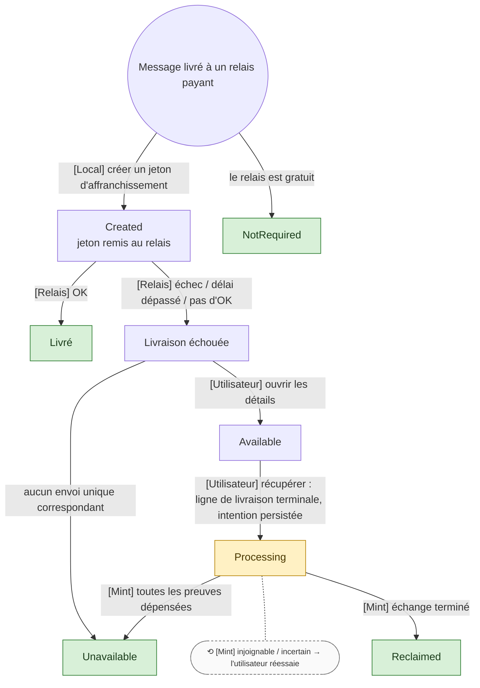

# B4 Affranchissement de relais et récupération

[Retour au sommaire](../README.md) · B · Paiements et encaissements

## Diagramme d'états

GitHub affiche directement le bloc Mermaid ci-dessous ; en cas de problème d'affichage, ouvrez le SVG.

[SVG](diagrams/B4.svg) · [Source Mermaid](diagrams/B4.mmd)

## Tableau d'états

### Par livraison (message × relais)

| ID | État (nom dans le code) | Condition d'entrée | Où sont les fonds / données | Affichage | Ce que l'utilisateur peut faire | Terminal ? | Emplacement dans le code |
|---|---|---|---|---|---|---|---|
| B4-01 | `NotRequired` | Le relais ne facture pas d'affranchissement | — | — | — | Oui (pour cette livraison) | `PC/transport.rs:79-84` |
| B4-02 | `NotStarted` / `Unavailable` | Pas encore payé, ou paiement impossible | Non payé | — | — | Non | same as above |
| B4-03 | `Created` | Jeton d'affranchissement créé et envoyé au relais avec l'événement | Jeton remis au relais ; le registre du portefeuille enregistre un envoi `relay_stamp` | — | — | Oui (pour cette livraison) | same as above; ledger marker `W/cashu/stamp_reclaim.rs:132-142` |

### Récupération (lignes de livraison échouées uniquement)

| ID | État (nom dans le code) | Condition d'entrée | Où sont les fonds / données | Affichage | Ce que l'utilisateur peut faire | Terminal ? | Emplacement dans le code |
|---|---|---|---|---|---|---|---|
| B4-04 | Non récupérable (aucun lien) | L'état de la ligne de livraison n'est pas failed / timeout / no_ack / terminal_failed / retry_exhausted, ou un OK a été reçu | — | Aucune entrée affichée | — | — | `A/messaging/stamp_reclaim.rs:5-23` |
| B4-05 | `Available` | Le lien correspond exactement à une saga d'envoi `TokenCreated` | Le jeton n'a peut-être pas encore été encaissé par le relais | « Récupérer » affiché | Récupérer | Non | `W/cashu/stamp_reclaim.rs:128-186` |
| B4-06 | `Processing` | Intention de récupération acceptée (persistée avant de toucher au mint), ou état du mint incertain / injoignable | Intention + preuves d'origine | Traitement | Récupérer à nouveau | Non | `W/cashu/stamp_reclaim.rs:187-199`, `:209-252` |
| B4-07 | `Reclaimed` | Échange terminé | De retour dans le portefeuille | Récupéré | — | Oui | `W/cashu/stamp_reclaim.rs:203-208`, `:415` |
| B4-08 | `Unavailable` | Toutes les preuves dépensées (encaissées par le relais), ou aucune entrée unique correspondante dans le registre | Chez le relais | Non récupérable | — | Oui | `W/cashu/stamp_reclaim.rs:149-158`, `:220-224` |

« Idem » renvoie à la ligne précédente du tableau. Dans la colonne d'affichage, les valeurs `xxx.yyy` sont des clés de localisation.
